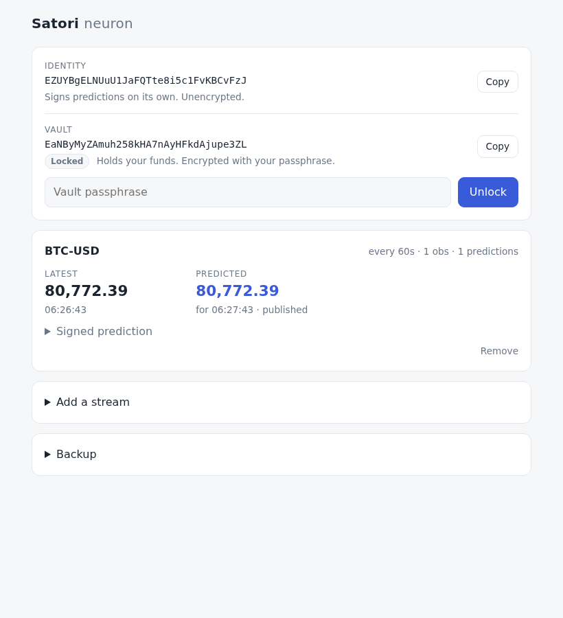

# satori

The Satori neuron as a client-side browser app: Satori's two keys (identity
and vault, Docker-compatible), a DuckDB-WASM database in the browser, and the
core flow:

```
source ──fetch──▶ observations ──▶ engine (OLS line) ──▶ prediction ──sign──▶ publish (local)
```

Each stream (default: Coinbase BTC-USD spot) ticks once per interval (60s by
default) and right away on page load. No server of our own; the only network
call is to each stream's source URL.



## Run

```sh
npm install
npm run dev        # http://localhost:5180 (CSP header on every response)
```

Setup makes two keys, as the Docker neuron does: the **identity** (stored
unencrypted, so the neuron runs and signs from page load) and the **vault**
(holds funds, encrypted with your passphrase). Create new ones, restore from
words, or import a Docker neuron's `wallet.yaml` + `vault.yaml`. **Unlock**
opens the vault (needed for backup and the Docker file downloads); **Lock**
wipes it from memory. Only one tab runs the neuron; others say so.

AI agents: read [/llms.txt](public/llms.txt); the page exposes `window.satori`.

## Test

```sh
npm test           # vitest: keys (Docker parity vectors and files), engine, db (DuckDB-WASM in node), neuron, ui helpers
npm run e2e        # playwright, system Chrome: full flow + OPFS persistence smoke
```

## Code

| Folder | Does |
|---|---|
| `src/keys/` | identity + vault, 24 words / WIF ↔ secret, Docker `wallet.yaml`/`vault.yaml`, Evrmore address, sign/verify |
| `src/db/` | DuckDB-WASM on OPFS; schema with a version for migrations; small async API |
| `src/engine/` | `predict(points, at)`: least-squares line over time |
| `src/neuron/` | `tick`, scheduler, publisher shape, single-tab Web Lock |
| `src/ui/` + `src/main.js` | ArrowJS screens, app wiring, `window.satori` |
| `public/llms.txt` | how an AI agent drives the app |

## Docs

- Intent: [docs/intent/INTENT.md](docs/intent/INTENT.md)
- Design (source of truth): [docs/design/OVERVIEW.md](docs/design/OVERVIEW.md), keys: [docs/design/keys.md](docs/design/keys.md)
- Later steps, already researched: [docs/future/README.md](docs/future/README.md)
