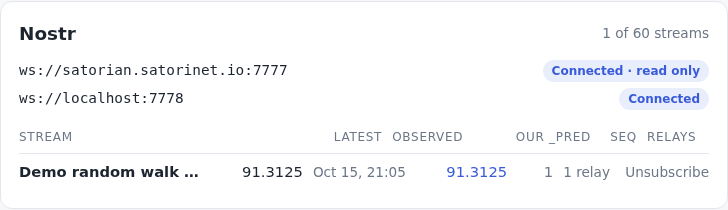
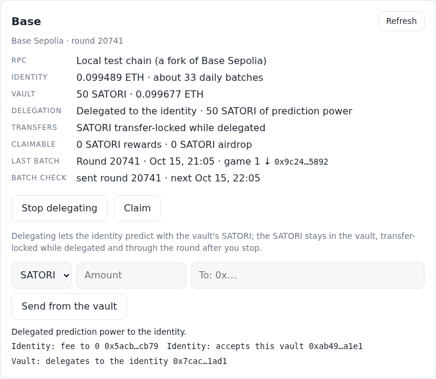

# satori

The Satori neuron as a client-side browser app: Satori's two keys (identity
and vault, Docker-compatible), a DuckDB-WASM database in the browser,
central's data flow as the Docker neuron (Satori Lite) runs it, Lite's
Nostr flow (subscribe to streams, publish `<stream>_pred`), and Lite's Base
flow (the vault delegates its prediction power to the identity, which sends a
batch of up/down predictions every UTC round on its own):

```
register ─▶ poll central (5–30 min after start, then every 11 h) ─▶ store ─▶ forecast new rows ─▶ submit the batch
relays ─▶ subscribed stream's observation (34601) ─▶ store ─▶ forecast two cadences ahead (t2) ─▶ publish <stream>_pred (34601)
Base: Unlock ─▶ delegate ─▶ each round the identity: registry streams ─▶ forecast ─▶ UP/DOWN ─▶ one batch tx; claims, sends
```

On every page load the neuron registers its identity and vault public keys
with central. It then polls central's observations, stores them, forecasts
each stream that got a new observation, and sends the predictions to central
after a login signed by the identity. The engine (`bar1`, after the owner's
`namaste_club`) is a Bayesian AR(1) on 12 h returns: shrunk toward "tomorrow
= today", iterated to t1 (12 h) and t2 (24 h), and faded toward the last value
as far as its own backtest says it trails it. It sends the last value
(`naive`) until a stream has an observation in 8 back-to-back 12 h buckets
(6 lag pairs), about 4 days of polls every 11 h. A stream central updates
once a day, or a neuron that polls once a day, stays `naive`. Predictions
central does not take are kept and sent with the next poll. **Poll now** runs
a cycle at once. No server of our own: the browser talks to central directly.

On Nostr the neuron has its own key (`nostr.yaml`, as Docker), reads central's
relays plus the ones under Settings, and lists the streams the relays
announce (**Network streams**). Subscribing to one publishes the subscription
and announces `<stream>_pred`; every new observation of that stream is
stored, forecast two cadences ahead (t2, as Lite sends) and published as `<stream>_pred` to the
relays it writes to. Relay streams are kept apart from central's.

On Base (Sepolia, the D6 contracts) the **Base** card shows both keys' Base
addresses, their ETH, the vault's SATORI, the delegation, the transfer lock
and what is claimable, with no passphrase. After **Unlock**: **Delegate
prediction power** (the identity sets its predictor fee to 0 and accepts only
this vault; the vault delegates to it), **Stop delegating** (SATORI stays
transfer-locked through the next round), **Claim** (on-chain rewards with
`hub.claim()`, the merkle drop with central's proof, the airdrop) and **Send
from the vault**. The identity sends the day's batch at the first check of each
UTC round: every registry stream with a game, forecast by the engine, UP if
the forecast is above the latest value, else DOWN; each game is simulated
first, so one that would revert doesn't sink the rest.





## Run

```sh
npm install
npm run dev        # http://localhost:5180 (CSP header on every response)
```

The dev server talks to the dev central, `https://central2.satorinet.io`; a
build (`npm run build`) defaults to `https://network.satorinet.io`. Change it
under **Settings** on Home.

Nostr on the dev server: central's relay (`ws://satorian.satorinet.io:7777`,
production) is **read only** (the app reads the real catalog and streams,
and never writes there), and the app writes to a local test relay:

```sh
node scripts/test-relay.mjs 7778                       # in-memory relay (running on this box: .relay.log)
node scripts/provider.mjs ws://localhost:7778 demo-walk 60   # optional: a demo stream, a value a minute
```

Open **Network streams**, search, **Subscribe**: the Nostr card shows the
latest observation and our `_pred` (value, seq, how many relays took it).
To use satorian normally from the dev server, tick **Publish to central's
relays** under Settings (a build does by default). An https deployment
needs a `wss://` relay ([issue](docs/future/issues/relays-not-wss.md)).

Base on the dev server: its RPC is `/rpc` by default, which Vite proxies to
a local anvil fork of Base Sepolia (the real addresses; by default a dev
checkout does not send to a public chain, and the Base card shows the active
RPC first). Start it and fund your neuron's Base addresses (shown on the Base
card):

```sh
node scripts/fork.mjs start                            # anvil --fork-url https://sepolia.base.org on 127.0.0.1:8545, 2 s blocks
node scripts/fork.mjs fund 0xIDENTITY --eth 0.1        # gas for the daily batch
node scripts/fork.mjs fund 0xVAULT --eth 0.1 --satori 100
node scripts/fork.mjs airdrop 0xVAULT 600              # an airdrop allocation
node scripts/fork.mjs merkle 0xVAULT 5                 # a merkle root; prints the proof a (stub) central serves
node scripts/fork.mjs advance 1                        # a day later (then window.satori.predictBase(), or wait for the hourly check)
node scripts/fork.mjs predict up                       # the deployer predicts the default game, so its value moves
node scripts/fork.mjs stop
```

anvil comes with Foundry (`~/.foundry/bin/anvil`, or set `ANVIL`). The
deployer it impersonates holds ~519 SATORI. A build uses central's RPC
(`https://sepolia.base.org`) with publicnode as a fallback; any https RPC can
be set under **Settings**, which replaces the default, and so can the daily
batch's max fee (2 gwei by default).

Setup makes two keys, as the Docker neuron does: the **identity** (stored
unencrypted, so the neuron runs and signs in to central from page load) and
the **vault** (holds funds, encrypted with your passphrase). Create new ones,
restore from words, or import a Docker neuron's `wallet.yaml` + `vault.yaml`.
Setup also makes the neuron's Nostr key (or imports Docker's `nostr.yaml`).
**Unlock** opens the vault (needed for backup, the Docker file downloads and
Base's delegate, claims and sends);
**Lock** wipes it from memory. Only one tab runs the neuron; others say so.

AI agents: read [/llms.txt](public/llms.txt); the page exposes `window.satori`.

## Test

```sh
npm test           # vitest: keys and central parity (Docker-image vectors), central client, neuron cycle and schedule, engine (namaste_club parity), db, Nostr (satorilib's own events, the relay client, the flow), Base (viem against a fake D6: delegate, the batch, claims, sends), ui helpers
npm run e2e        # playwright, system Chrome, against a stub central, two test relays (7781/7782) and a fake chain behind /rpc: full flow, Nostr, Base, OPFS persistence smoke
node scripts/fork.mjs start --port 8546 && BASE_FORK=http://127.0.0.1:8546 npx vitest run src/chain/fork.test.js   # the chain module against the real contracts on a fork
node scripts/backtest.mjs   # the engine vs persistence at 24 h on real history (read only)
```

## Code

| Folder | Does |
|---|---|
| `src/keys/` | identity + vault, 24 words / WIF ↔ secret, Docker `wallet.yaml`/`vault.yaml`, Evrmore address, sign/verify |
| `src/central/` | central's API as Lite calls it: register, observations batch, login, predictions batch; Python float strings and payload hash |
| `src/db/` | DuckDB-WASM on OPFS; schema with a version for migrations; small async API |
| `src/engine/` | `forecast(points, {step}) → {model, t1, t2, phi?, weight?}`: `bar1` (Bayesian AR(1) on 12 h returns, faded toward persistence) or `naive` |
| `src/nostr/` | NIP-01 events over `@noble/curves`, Satori's events byte for byte as satorilib, a relay client |
| `src/chain/` | Base over viem: the D6 addresses and ABIs, status in one multicall, delegate, the batch's pieces, claims, sends; test doubles (a fake D6) |
| `src/neuron/` | `register`, `cycle` (poll → store → forecast → submit), the 11 h schedule, single-tab Web Lock; `nostr.js` (relays, subscribe, intake → `_pred`); `base.js` (the daily batch and its schedule, delegate, claims, sends) |
| `src/ui/` + `src/main.js` | ArrowJS screens, app wiring, `window.satori` |
| `public/llms.txt` | how an AI agent drives the app |
| `scripts/` | parity vectors from satorilib's code, the Docker image and namaste_club (Python); `backtest.mjs`; `test-relay.mjs`, `provider.mjs`; `fork.mjs` (a local Base fork) |

## Docs

- Intent: [docs/intent/INTENT.md](docs/intent/INTENT.md)
- Design (source of truth): [docs/design/OVERVIEW.md](docs/design/OVERVIEW.md),
  keys: [docs/design/keys.md](docs/design/keys.md),
  central: [docs/design/central.md](docs/design/central.md),
  engine: [docs/design/engine.md](docs/design/engine.md),
  Nostr: [docs/design/nostr.md](docs/design/nostr.md),
  Base: [docs/design/base.md](docs/design/base.md)
- Later steps, already researched: [docs/future/README.md](docs/future/README.md)
