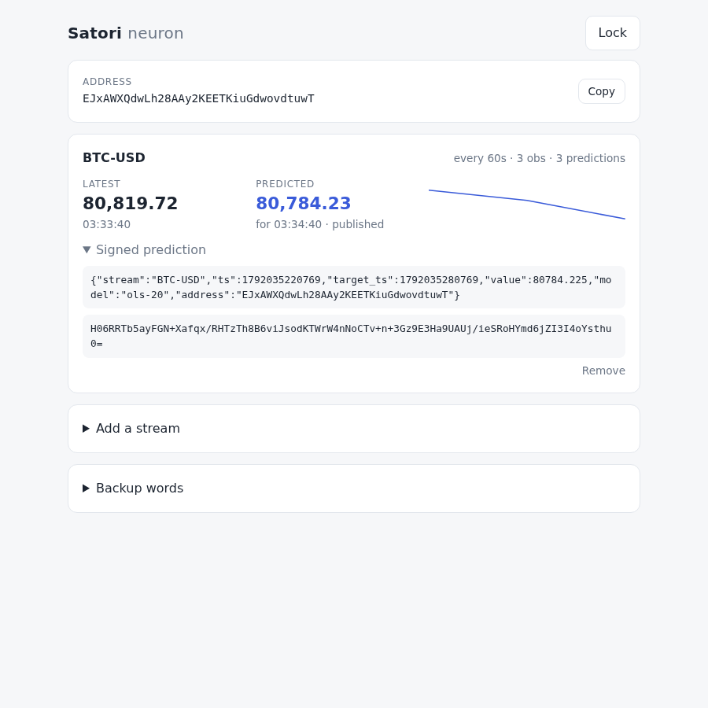

# satori

The Satori neuron as a client-side browser app. Step 1 (MVP): key management,
a DuckDB-WASM database in the browser, and the core flow:

```
source ──fetch──▶ observations ──▶ engine (OLS line) ──▶ prediction ──sign──▶ publish (local)
```

Each stream (default: Coinbase BTC-USD spot) ticks once per interval (60s by
default) and right away on Unlock. No server of our own; the only network call
is to each stream's source URL.



## Run

```sh
npm install
npm run dev        # http://localhost:5180 (CSP header on every response)
```

Create a key (24 words, confirm three, set a passphrase) or import 24 words.
**Lock** wipes the key from memory; **Unlock** asks for the passphrase. Only
one tab runs the neuron; others say so.

## Test

```sh
npm test           # vitest: keys (Docker parity vectors), engine, db (DuckDB-WASM in node), neuron, ui helpers
npm run e2e        # playwright, system Chrome: full flow + OPFS persistence smoke
```

## Code

| Folder | Does |
|---|---|
| `src/keys/` | 24 words ↔ secret, passphrase seal (PBKDF2 → AES-GCM), Evrmore address, sign/verify |
| `src/db/` | DuckDB-WASM on OPFS; schema with a version for migrations; small async API |
| `src/engine/` | `predict(values, steps)`: least-squares line |
| `src/neuron/` | `tick`, scheduler, publisher shape, single-tab Web Lock |
| `src/ui/` + `src/main.js` | ArrowJS screens and app wiring |

## Docs

- Intent: [docs/intent/INTENT.md](docs/intent/INTENT.md)
- Design (source of truth for this step): [docs/design/OVERVIEW.md](docs/design/OVERVIEW.md)
- Later steps, already researched: [docs/future/README.md](docs/future/README.md)
