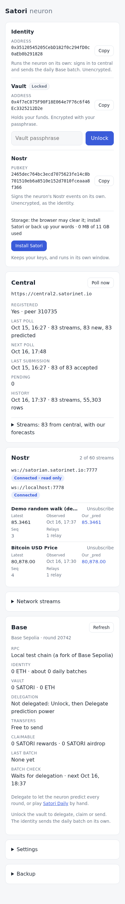

# satori

The Satori neuron as a client-side browser app: no server of our own, built to
be driven by people and by AI agents alike.

## Quick start

Node `^20.19` or `>=22.12` (Vite 8's range), then:

```sh
npm install
npm run dev                          # the app on http://localhost:5180
node scripts/test-relay.mjs 7778     # a local Nostr relay to publish to; without it the Nostr card shows ws://localhost:7778 "Disconnected (…); retrying"
node scripts/fork.mjs start          # a local fork of Base Sepolia (needs Foundry's anvil); without it the Base card says "The chain did not answer"
```

Open the app, **Create a new neuron**, and it runs: it registers with central,
polls it, forecasts, sends its predictions back. AI agents: read
[/llms.txt](public/llms.txt); the page exposes `window.satori`.

## What it does

Satori's two keys (identity and vault, Docker-compatible), a DuckDB-WASM
database in the browser, central's data flow as the Docker neuron (Satori
Lite) runs it, Lite's Nostr flow (subscribe to streams, publish
`<stream>_pred`), and Lite's Base flow (the vault delegates its prediction
power to the identity, which sends a batch of up/down predictions every UTC
round on its own):

```
register ─▶ poll central (5–30 min after start, then every 11 h) ─▶ store ─▶ forecast new rows ─▶ submit the batch
relays ─▶ subscribed stream's observation (34601) ─▶ store ─▶ forecast two cadences ahead (t2) ─▶ publish <stream>_pred (34601)
Base: Unlock ─▶ delegate ─▶ each round the identity: registry streams ─▶ forecast ─▶ UP/DOWN ─▶ one batch tx; claims, sends
```

The **identity** is stored unencrypted, so the neuron runs and signs from page
load; the **vault** holds the funds, encrypted with your passphrase. **Unlock**
opens the vault (needed for backup and Base's delegate, claims and sends);
**Lock** wipes it from memory. Setup can also restore from words or import a
Docker neuron's `wallet.yaml`, `vault.yaml` and `nostr.yaml`. Only one tab
runs the neuron; others say so. The engine (`bar1`, after the owner's
`namaste_club`) is a Bayesian AR(1) on 12 h returns, faded toward the last
value as far as its own backtest says it trails it ([engine](docs/design/engine.md)).





## The dev server

The dev server talks to the dev central, `https://central2.satorinet.io`; a
build (`npm run build`) defaults to `https://network.satorinet.io`. Change it
under **Settings**.

**Nostr.** On the dev server central's relay (`ws://satorian.satorinet.io:7777`,
production) is read only: the app reads the real catalog and streams and
never writes there; it writes to the test relay on 7778. For a stream to
follow there:

```sh
node scripts/provider.mjs ws://localhost:7778 demo-walk 60   # a demo stream, a value a minute
```

Open **Network streams**, search `demo-walk`, **Subscribe**: the Nostr card
shows the latest observation and our `_pred`. Tick **Publish to central's
relays** under Settings to write to satorian too (a build does by default).
An https deployment needs a `wss://` relay ([issue](docs/issues/relays-not-wss.md)).

**Base.** The dev server's RPC is `/rpc`, proxied to the anvil fork on
127.0.0.1:8545 (the real D6 addresses; by default a dev checkout sends
nothing to a public chain). Fund the neuron's Base addresses (in the Keys
card), then Unlock and **Delegate prediction power**:

```sh
node scripts/fork.mjs fund 0xIDENTITY                  # gas for the daily batch
node scripts/fork.mjs fund 0xVAULT --satori 100        # gas, and SATORI: the prediction power
node scripts/fork.mjs --help                           # airdrop, merkle, advance, predict, stream, stop
```

A build uses central's RPC (`https://sepolia.base.org`), then publicnode; any
https RPC can be set under **Settings**, and so can the daily batch's max fee
(2 gwei by default).

## Test

```sh
npm test           # vitest (2 workers): parity with satorilib, the Docker image and namaste_club; central, the neuron, the engine, the db, Nostr, Base against a fake D6, ui text
npm run e2e        # playwright, system Chrome: the app against a stub central, two test relays (7781/7782) and a fake chain behind /rpc
node scripts/fork.mjs start --port 8546 && BASE_FORK=http://127.0.0.1:8546 npx vitest run src/chain/fork.test.js   # the chain module against the real contracts
node scripts/backtest.mjs   # the engine vs persistence at 24 h on real history (read only)
```

Run the two suites one after the other. Playwright starts Chrome without its
sandbox (its default), so the e2e also runs as root or in a container; Chrome
launched by hand there needs `--no-sandbox`.

## Docs

- Intent: [docs/intent/INTENT.md](docs/intent/INTENT.md)
- Design, the source of truth, with the file map:
  [docs/design/OVERVIEW.md](docs/design/OVERVIEW.md) (keys, central, engine,
  Nostr, Base, storage)
- For agents, and the `window.satori` reference: [public/llms.txt](public/llms.txt)
- Roadmap and what is left: [docs/plans/README.md](docs/plans/README.md);
  issues outside this repo: [docs/issues/](docs/issues/README.md); questions
  for the owner: [docs/inbox/QUESTIONS.md](docs/inbox/QUESTIONS.md)

MIT licensed. Pull requests are welcome at https://github.com/lastmeta/Satori.
