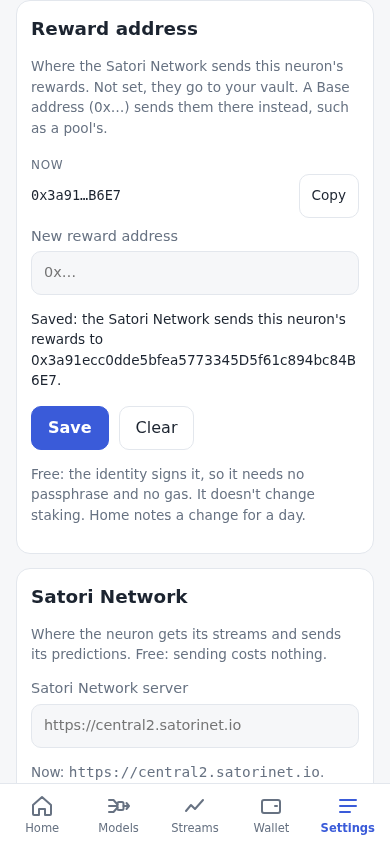
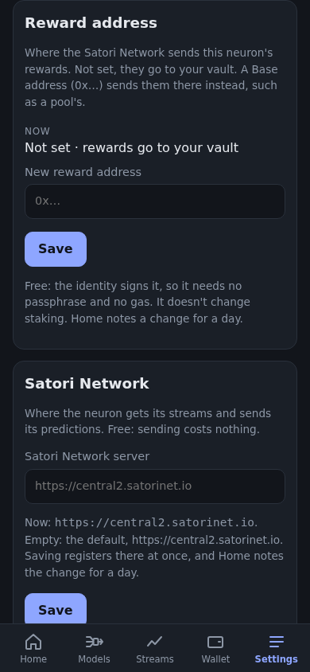
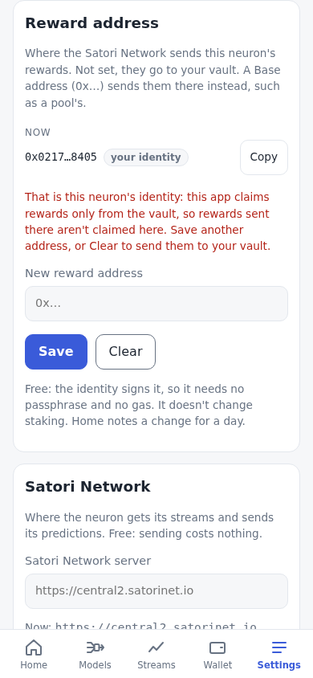
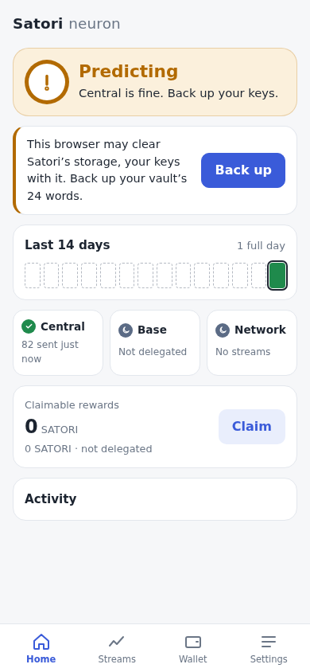
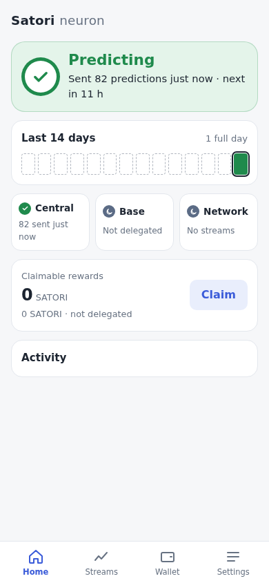
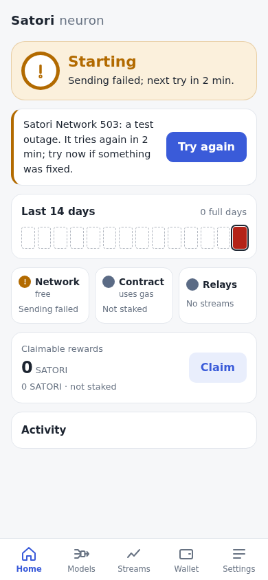
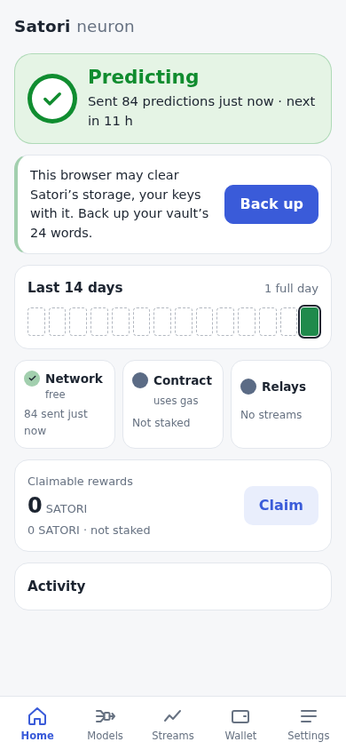

# Central: register, poll, predict, submit

[← OVERVIEW](OVERVIEW.md)

The neuron's data comes from central and its predictions go back to central,
the way Satori Lite (`../neuron`, the Docker neuron) does it today. The browser
calls central directly with `fetch`; there is no proxy. Central's CORS allows
any origin and header (`central/src/main.py:63-69`, `allow_origin_regex=r".*"`
at `:65`).

```
page load ─▶ register (alias-pubkey, the wallet's link)         once per start
         └─▶ schedule: first poll at once (a stored time still ahead is kept), then every 11 h
poll ─▶ GET observations/batch ─▶ store (insert or ignore) ─▶ history for new streams ─▶ forecast streams not predicted yet
     ─▶ queue {value: t2, t1_value: t1, observed_at, hash} ─▶ login (alias) ─▶ POST predictions/batch
```

**How it earns** (verified in central's code, 2026-10-14): central scores
these predictions in its daily run (`central/src/scripts/daily_run.py:1-8,25`)
and keeps a predictor only with a reward, or a balance plus pool contribution
of at least `stake_requirement` = 250 SATORI (`central/src/scripts/score.py:1992`,
`mint.py:5`). Payouts go to `base_earnings` under the Base address of the
**wallet** linked to the alias (`central/src/scripts/distribution.py`),
which the merkle drop publishes (`publish_merkle_root.py`) and the wallet
claims on Base ([base.md](base.md)). So register's link
([wallets.md](wallets.md#the-satori-network-register-login-and-the-link)), and
250 SATORI on the wallet's Base address (or pool membership), are what make
central-lite earn.

Short names: `start.py` = `neuron/neuron-lite/start.py`; `engine.py` =
`neuron/engine-lite/engine.py`; `server.py` =
`satorilib/src/satorilib/server/server.py`; `c/main.py` =
`central/src/main.py`; `c/auth.py` = `central/src/api/v1/endpoints/auth.py`;
`data_helper.py` and `stream_store.py` are in `neuron/engine-lite/satoriengine/`.

## What Satori Lite does, and what the browser does

| Step | Satori Lite | Browser (`src/central/`, `src/neuron/`) |
|---|---|---|
| Register | On every start, `checkin` → `POST /api/v1/peer/register` with headers `alias-pubkey`, optional `nostr-pubkey`, `neuron-version`, and the wallet's link (`wallet-link`, `wallet-signature`) once the wallet is set up; no body, no token, 10 s timeout; a failure is only logged (satorilib `server.py`). | The same on every page load, with `nostr-pubkey` (the Nostr key, [nostr.md](nostr.md)), `neuron-version: browser-<package version>+<git short sha>` (stamped at build) and the link from the keys record ([keys.md](keys.md#the-record)), made when the wallet was in hand. The result is shown, never retried in a loop. |
| Central's side | Creates the peer for the alias; accepts the link when its signature, alias and time check out ([wallets.md](wallets.md#the-satori-network-register-login-and-the-link)), moving the wallet off any other alias; answers `wallet_address` (the linked wallet, or null) and `wallet_link_error` when it refused the link. | Compares the returned `wallet_address` with our wallet's Base address, case-insensitively, and shows a **wallet mismatch** with both addresses when they differ, or **wallet not linked** when central has none ([below](#the-wallets-link)). The result is `walletMismatch: false \| 'other' \| 'none' \| null` (null: a central without the field, unknown) and `walletLinkError`. |
| Schedule | First poll after `random.randint(300, 1800)` s (`start.py:4777-4779`), on every start, then `sleep(11 h)` after every poll, whatever the result (`start.py:4785-4876`). | The first poll right after register, with no random wait: a new neuron at once, a reopened one at once when a poll came due while it was closed; then 11 h after every good poll, as Lite; after a failed cycle it tries again 2, 10 and 30 min later, then on the 11 h rhythm ([Errors](#errors)). `meta.next_poll_at` is stored, so a reload keeps a time still ahead (see Deviations). **Poll now** runs a cycle at once. A poll whose time passed while the device slept with the page open runs within one heartbeat of waking ([the catch-up pass](../plans/runtime.md#catch-up-pass)). |
| Poll | `GET /api/v1/observations/batch?limit=100` (`server.py:1304-1377`). Central returns each stream's latest observation if under 48 h old (`c/main.py:292-341`). `value` and `observed_at` are strings. | Same call, no token (central needs none). |
| Store | `value` = float; epoch = `observed_at`, falling back to `ts` (`data_helper.py:40-93`), truncated to whole seconds (`engine.py:669-673`); `INSERT OR IGNORE` on `(stream_uuid, epoch)` (`stream_store.py:48-56,150-170`); the stream's name/meta are upserted (`server.py:1334-1358`). | Same rule into `observations (stream_uuid, ts, value)`, primary key `(stream_uuid, ts)`; `streams (uuid, name, meta)`. Rows with no stream, no finite value or no time are dropped. |
| Which streams | Every stream in the batch; a model predicts only when its stream got a **newly inserted** row (`engine.py:695-712`, test at `:707`). | Each stream in the batch whose latest stored observation has **no prediction made from it** (`db.unpredicted()`: newer than `streams.predicted_ts`, which each prediction sets): a new row, as in Lite, and also a row an interrupted cycle stored but never forecast (a reload mid-poll, a local failure). An observation is still predicted once ([Deviations](#deviations-from-satori-lite-and-why)). |
| Forecast | `t1` = one step ahead; `t2` = forecast again with `t1` appended, falling back to `t1` (`engine.py:1153-1186`). | `runModels` (`src/engine/evolve.js`) for those streams, over every central stream's history: each target's own `bvar` spec (a Bayesian VAR(1) with 1–3 companion streams, drawn from the alias and evolved), falling back to `bar1` (a Bayesian AR(1) on 12 h returns) or `naive` ([engine.md](engine.md)): t1 is 12 h ahead, t2 24 h. |
| Payload | `{stream_uuid, stream_name, value: str(t2), t1_value: str(t1), observed_at: str(time.time() at prediction), hash: sha256(value + observed_at)[:16]}` (`engine.py:1044-1106,1188-1206`). | The same fields. Numbers are text as JS prints them (`String(n)`: `100`, `1e-7`), not as Python's `str` (`100.0`, `1e-07`): central keeps the text and reads it with `float()` ([the protocol audit](#the-protocol-audit)). |
| Queue | `collectAndSubmitPredictions` right after the poll (`start.py:4693-4736`, called at `:4870`); `flushPredictionQueue` keeps the whole queue when `successful == 0` or the call failed, and clears it otherwise (`engine.py:432-454`). | Predictions are stored with `status = 'pending'`; after every successful poll the pending ones made in the last 2 × 11 h are sent (older ones are dropped); on `successful > 0` all are marked `sent`, otherwise they stay pending for the next cycle. |
| Submit | Log in (`POST /api/v1/auth/login`, headers `alias-pubkey`, `message`, `signature`: an [EIP-191 signature](#login-signature) by the **alias**, `wallet.ethSign` since satorilib 5028913; `server.py:86-118`), then `POST /api/v1/predictions/batch` with `Authorization: Bearer`, body `{"predictions": [...]}`; on a 401 log in again and retry once (`server.py:170-230`, retry at `:210`); when the call raises (a network error or a timeout), resend it once (`server.py:231-268`). Timeouts 10–15 s. | Same, with one fresh login per submission. Timeouts 15 s. Every call is resent once on a network error, a timeout or a 5xx. |

Not used (dropped from Lite): the `checkinCheck` watchdog and restarts
(`start.py:4883-4892`), `/auth/refresh` and its timer (`server.py:120-140`), the
10-minute reconnect delay (`start.py:4902-4908`), `setMiningMode` (a route
central no longer has), the stake and pool routes, and about 90
other `server.py` methods for routes central-lite does not serve. The reward
address is used ([below](#the-reward-address)).

## Endpoints

| Call | Auth | Central | When |
|---|---|---|---|
| `POST /api/v1/peer/register` (headers `alias-pubkey`, `nostr-pubkey`, `neuron-version`, `wallet-link`, `wallet-signature`) → `{success, peer_id, wallet_address, wallet_link_error, nostr_pubkey, message}` (`peer_id`, `message`, `wallet_address` and `wallet_link_error` are read) | none | `c/main.py` register; the link: `base-upgrade`, 2026-10-23 | every page load; again when the central URL changes; after an Unlock that made the link; before each poll while the last one failed |
| `GET /api/v1/observations/batch?limit=100` → `[{id, observed_at, value, hash, stream_id, stream: {uuid, name, meta, …}, ts, stream_uuid}]` | none | `c/main.py:292-341` | each poll |
| `GET /api/v1/observations/history?stream_uuid=<uuid>&limit=1000&since=<now − 1,000 h>` → `[{id, stream_uuid, observed_at, value, ts}]`, oldest first | none | `central` bc043d2 (the most recent `limit` rows; 404 `Stream not found: <uuid>` for an unknown or malformed uuid, 422 for a bad limit or since); not deployed on central2 yet (404 `Not Found`) | once per stream ([below](#history-an-addition-beyond-lite)) |
| `GET /api/v1/auth/challenge` → `{challenge}` (a UUID) | none | `c/main.py:268-281` | before each login |
| `POST /api/v1/auth/login` (headers `alias-pubkey`, `message`, `signature`: EIP-191) → `{access_token, expires_in: 3600, …}` | signature | `c/auth.py:21-86`, `central/src/utils/auth.py:20-56` | before each submission, once more on a 401 |
| `POST /api/v1/predictions/batch` → `{total_submitted, successful, failed, prediction_ids, errors}` | Bearer | `c/main.py:483-602`; schema `central/src/models/schemas.py:92-113` | right after each poll, when anything is pending |
| `GET /api/v1/peer/relays` → `[{relay_url, nostr_pubkey, …}]`; `GET /api/v1/peer/relay-config` → `{max_streams}` | none | `central/src/api/v1/endpoints/peer.py:123-173` | Nostr ([nostr.md](nostr.md)): relays at start and hourly, the config once per start |
| `GET /api/v1/peer/reward-address` → `{reward_address}`; `POST` the same with `{"reward_address": "0x…" \| null}` → the stored one | Bearer (the login's) | `central/src/api/v1/endpoints/peer.py:26-120`; the Base check is central's change on `base-upgrade` (2026-10-19) | read when Settings opens (once per page load and central) and by `rewardAddress()`; set and cleared from Settings or `setRewardAddress()` ([below](#the-reward-address)) |

Central silently maps an unknown `stream_uuid` to its `bitcoin` stream
(`c/main.py:536-551`), so the browser only submits uuids it received.

## History: an addition beyond Lite

Lite has no history call: its local history grows by one row per stream per
poll, about two a day, so `bvar` (and `bar1`) would wait days for aligned
rows. Central is adding `GET /api/v1/observations/history` (2026-10-15):
`stream_uuid`, `limit` 1..1000 (default 500), `since` (unix seconds,
exclusive), answering `[{id, stream_uuid, observed_at, value, ts}]` oldest to
newest. `src/neuron/history.js`:

- **Which streams**: those with `streams.history_at` null: a stream first seen
  in a poll, and on load every stream that has never been fetched (all of
  them, the first time a neuron runs this version). Once per stream per
  central; another central (Settings) fetches again.
- **When**: on load (in the background), and in each poll right after its
  rows are stored, before the forecasts, so the first poll of a new neuron
  already forecasts from history. One run at a time; a call during a run
  gets one more run after it.
- **The call**: `limit=1000&since=<now − 1,000 h>`. Central observes hourly
  (`central/scheduler.py:76`), so that is the last ~41 days whether the route
  counts `limit` from `since` forward or back from now. At most 8 calls at a
  time: a call takes about 0.3 s on central2, so about 25 calls a second,
  under central's nginx limit (50 r/s per address, burst 100,
  `central/nginx.conf`). It was 4.
- **The writes**: one writer stores what has arrived each time its last
  commit ends, up to 20 streams a commit, about 10,000 rows a statement
  (every commit is a checkpoint, and every statement a round trip to
  DuckDB's worker: [storage.md](storage.md#the-checkpoint-rule)). It was a
  commit per stream.
- **The rows**: normalized exactly as poll rows (`observed_at`, else `ts`, in
  whole seconds; rows with no finite value, no time or another stream are
  dropped), then **insert or ignore, only rows older than the stream's
  newest polled row**. A backfilled row never triggers a prediction: it is
  never a stream's latest, and only the latest is predicted. (A row newer
  than the last poll would otherwise be stored by history first, and
  predicted from history instead of from the poll that brings it.)
- **Failures** never break the poll. A stream central doesn't know (404
  `Stream not found: <uuid>`, a stream deleted on central or a malformed
  uuid; `central` bc043d2) is done with no rows, and the others go on. Any
  other failure stops the run; the streams not fetched wait for the next run
  (the next poll or load). A **404 with any other detail** (FastAPI's `Not
  Found`) means the route is missing on this central: it is quiet (no
  warning) and remembered for a day (`meta.central_history.retryAt`), then
  asked again. (Before, one deleted stream failed first every day and held
  all the others with it.)
- **Shown**: the Streams tab's Central card has a History line ("Oct 16, 09:30 · 83
  streams, 81,234 rows", or "Not on this central (central 404: Not Found);
  next try …"); `status().central.history` = the last run `{at, url, streams,
  rows, left, error, retryAt}` and `needed` (streams with no history yet).

## Login signature

The alias signs central's challenge with **EIP-191** (Ethereum
`personal_sign`), the one way central's `/auth/login` is to verify it
(central `base-upgrade` f4d72f5, `central/src/utils/auth.py:20-56`) and the
way Satori Lite signs it since satorilib 5028913 (`wallet.ethSign`,
`satorilib/src/satorilib/wallet/identity.py:706-715`):

- the digest is keccak256(`"\x19Ethereum Signed Message:\n"` + the UTF-8
  byte length of the challenge, in decimal + the challenge);
- the signature is `0x` + r ‖ s ‖ v in 130 hex characters: RFC 6979
  (deterministic), low s, v = 27 or 28;
- central recovers the signer and compares it with the Ethereum address of
  the `alias-pubkey` header (the compressed pubkey), which is the alias's
  Base address.

`src/central/login.js` (`loginSignature`) is that: viem's `hashMessage`, and
the same `signDigest` that signs the alias's Base transactions
(`src/keys/keys.js`). The keys module gives the alias's signer a
`signCentralLogin(challenge)`; the wallet has none. Tests: central's own vector
reproduced exactly, and a login against a mock central that verifies with
viem's `verifyMessage` (`src/central/login.test.js`); the e2e's stub central
verifies EIP-191 only and refuses anything else (`e2e/stub.js`). Checked live
on central2 on 2026-10-16: a fresh profile's login was answered 200 and its
batch "83 of 83 accepted" ([screenshot](../screenshots/central-login.png)).

Central still takes an Evrmore signed message from neurons in the field
until they upgrade, a marked transitional branch it will remove. This app
never sends one: there is no Evrmore code in it.

### The wallet's link

Register carries the wallet's link to the alias: an EIP-191 signature by the
wallet of a fixed text naming both addresses and when it was made
([wallets.md](wallets.md#the-satori-network-register-login-and-the-link)).
Central recovers the wallet from the signature, checks the text, and pays
that wallet; its answer names it, `wallet_address` (EIP-55), or null when it
holds no link, with `wallet_link_error` when it refused the one sent. The app
makes the link whenever the wallet is in hand: at Create, Restore and Import,
and for a stored wallet without one at its next Unlock, which registers again
at once (`src/keys/index.js` `linkOf`, `src/main.js` `unlock`).

`register()` (`src/neuron/index.js`) compares `wallet_address` with the
wallet's own Base address, case-insensitively. The result carries both,
`wallet` (ours) and `wallet_address` (central's), `walletLinkError`, and
`walletMismatch`:

- `false`: the same address;
- `'other'`: a different one. Home's action card and the Central card say
  that central pays this wallet's rewards to a different Base address, and
  show both;
- `'none'`: null, no wallet linked: the card says so and that an Unlock
  links it;
- `null`: unknown. A central without the field shows no mismatch.

The `'other'` text on a phone: [Home](../screenshots/wallet-mismatch-phone.png),
[the Central card](../screenshots/wallet-mismatch-central-phone.png).

## The reward address

The owner (2026-10-19, [../intent/INTENT.md](../intent/INTENT.md)): "We need
to be able to specify a reward address, in the settings or in the wallet."
It is where the Satori Network sends this neuron's rewards instead of the
wallet, such as a pool. Satori is Base only, so it is a Base (0x) address.
With none set, rewards go to the wallet (register's `wallet_address`,
[above](#the-wallets-link)). It has nothing to do with staking:
Stake with this app gives the wallet's prediction power on the Satori
contract; the reward address only says where the Satori Network pays.

**Where: Settings › Reward address**, a card of its own after Keys and
Backup (`#settings-reward`). Not the Wallet: the Wallet is the Base card,
the wallet's balances and its transactions, each one asking for the
passphrase and using gas. The reward address is none of that: the Satori
Network keeps it, the alias signs it on its own, it is free, and it is
set and forgotten. The UI intent puts addresses and endpoints behind
Settings ([../intent/ui.md](../intent/ui.md)); the card comes right after
the keys, whose wallet it replaces as the payee.

**The calls** (central `peer.py:26-120`): `GET /api/v1/peer/reward-address`
→ `{"reward_address": "0x…" | null}`, and `POST` the same path with
`{"reward_address": "0x…"}` to set it (central stores it EIP-55
checksummed and answers it) or `{"reward_address": null}` to clear it. Both
are signed in: the alias's login (the challenge, EIP-191,
[below](#login-signature)), then `Authorization: Bearer`, and a 401 logs in
again and retries once, as the predictions batch does. Central answers 400
"Invalid Base address" for anything that is not a 20-byte 0x address, and
for the zero address. Lite reads it without a login
(by its alias's pubkey, satorilib `server.py`) and keeps a copy in its
config, synced on each start (`start.py`); this app keeps no copy:
the Satori Network's answer is the one source.

**When it is read**: when Settings opens, once per page load and Satori
Network (again after a read that failed, or with Try again), and by
`window.satori.rewardAddress()`. Never in a loop, and not at load unless the
page opens on Settings (a link or a reload on `#settings`: then at once,
beside the first poll; central takes both logins): a load's first poll logs
in to send its batch, and a second login at the same moment buys nothing
while nobody is looking at the address. `status().central.reward`
is the last read (`at` null: not read yet).

**Checked before any call** (`src/neuron/reward.js`, `checkRewardAddress`):
trimmed; `0x` and 40 hex characters; a mixed-case address must match its
EIP-55 checksum (viem's `isAddress`, strict, as Send's recipient), while
all lower or all upper case carries no checksum (EIP-55) and is taken as
it is; not the zero address; not this neuron's alias (the app claims
rewards only from the wallet, Wallet › Claim, so rewards paid to the
alias would sit unclaimed); sent checksummed (viem's `getAddress`). The
wallet's own address is allowed: it is where they go anyway. An empty field is not
a clear: Clear is its own button (and `setRewardAddress(null)` or `''`).
The words: "A reward address is a Base address: 0x and 40 hex characters.",
"That address's capital letters don't match its checksum: check it for a
typo.", the zero address's (as Send's), "That is this neuron's alias.
This app claims rewards only from the wallet, so rewards sent to the
alias would sit unclaimed. Use another address, or Clear to send them to
your wallet."

**Central's answer** (`rewardFrom`): since `base-upgrade` 8dcc016 the GET
answers the Base address the reward is paid at: a value set before Base
reads as the same key's Base address (a pool's, or this neuron's own
alias or wallet), and null when unset or unknown. A 0x address is shown
checksummed; null (or `''`) is **not set**: rewards go to the wallet.
Anything else (it should not happen) is an error, "The Satori Network
answered a reward address that isn't a Base address, so it isn't shown.",
never read as not set. This neuron's own addresses are named: "your wallet",
or "your alias" with a note that rewards there aren't claimed in this
app (Save another address, or Clear). `status().central.reward.whose` and
`rewardAddress().whose` say the same (`'wallet'`, `'alias'` or null).

**Shown**: "Not set · rewards go to your wallet", or the address shortened
(`0x3a91…B6E7`, as the Wallet shortens a recipient; the full one in its
hover) with Copy and its name when it is this neuron's own; while it is read,
"Reading it from the Satori Network…"; when it could not be read, the error
with Try again. A field for a new one, **Save**, and **Clear** (only while
one is set). Save and Clear say "Saving…", "Clearing…", and the card's line
says each step at Home's pace (`src/ui/hold.js`): "Signing in to the Satori
Network…", "Saving the reward address…" (or "Clearing the reward
address…"), then "Saved: the Satori Network sends this neuron's rewards to
0x…" with the full address, or "Cleared: rewards go to your wallet". It is
the `reward` task in `health().work`, which Home's hero shows too. While it
reads or saves, a small ring turns beside the words: the hero's ring
(`.spin`, the same `ring-turn`, still under reduced motion), so the wait is
never silent on Settings, where the hero is not; it is the only moving thing
there. Errors are the check's words, or the Satori Network's ("Satori
Network 400: Invalid Base address", "Satori Network unreachable: …"). A
change of the Satori Network's address forgets the last one's: its reward
address, and the card's saved line and error; a new read drops the last
save's line ("Cleared: …" may no longer hold when it changed elsewhere).

**Noted**: like an address change, a reward address set or cleared, from
Settings or an agent, is a `setting` row, and Home notes it for 24 h
("Reward address set to 0x…", "Reward address cleared: rewards go to your
wallet"; [health.md](health.md#address-changes)). Saving the same address
again is not a change.

**Central**: the route's Base check (`base-upgrade` be14949: a 0x address
stored EIP-55, or an old-kind address only with its pubkey, which this app
never sends) and the GET's Base answer (8dcc016) are live on central2.
Tests: the stub central (`e2e/stub.js`) answers as that route
(`e2e/reward.spec.js`: not read at load; read when Settings opens, its
words and turning ring meanwhile; a checksum typo, a non-Base address and
this neuron's alias refused before any call; Save's steps with the ring,
the address shortened with its hover, Home's note; the same address again
is no change; Clear; this neuron's wallet and alias named; the agent API;
a refusal in the Satori Network's words; another Satori Network forgets the
last words). Unit tests: `src/neuron/reward.test.js` (the checks, the
alias refused, central's answers, an unreadable one never "not set",
whose, the read and the set, a read overtaken by a set),
`src/central/central.test.js` (signed in, the body, a 401 retried once, a
400's words).

  
[desktop](../screenshots/reward-set-desktop-light.png),
[desktop, dark, not set](../screenshots/reward-none-desktop-dark.png),
[desktop, the alias](../screenshots/reward-alias-desktop-light.png),
[saving, the ring turning](../screenshots/reward-saving-phone-light.png).

**Live** (2026-10-19, the dev server on :5180 against central2, fresh
profiles with throwaway keys). Read only, before central2 took the Base
check: register, the first poll at once, 84 of 84 accepted; nothing asked
of the reward address until Settings opened; then the signed `GET
/api/v1/peer/reward-address` (Bearer) answered 200 `{"reward_address":
null}` and the card read "Not set · rewards go to your wallet" 0.8 s after
the tab opened; `rewardAddress()` the same; in a first try Settings opened
during the first poll, and both logins and both calls were answered
([phone](../screenshots/reward-live-central2-phone.png),
[desktop](../screenshots/reward-live-central2-desktop.png)). Then on
central2 with `base-upgrade` 8dcc016 (a reviewer's probe): 84 of 84
accepted; `setRewardAddress()` with a padded lower-case address answered
it checksummed in about 1 s, and `rewardAddress()` read it back; a set
alongside a poll went through; Save in the card said "Saving…" with
"Signing in to the Satori Network…", then "Saving the reward address…",
then "Saved: …"; the alias's own address was refused before any call;
cleared at the end (null). Nothing was sent to prod.

## The protocol audit

The owner's direction of 2026-10-16 ("migrate in, never back"): Satori Lite
is the reference for how the network behaves, not for local formats. Each
place that copied Lite's exact text was checked against the code that reads
it (central `base-upgrade`, satorilib, Lite), and kept only where a reader
depends on it.

| Item | Kind | Verdict | Evidence |
|---|---|---|---|
| Prediction numbers as Python's `str(float)` (`pyFloatStr`, a 439-float parity fixture) | network | **Plain JS text** (`String(n)`); the fixture, `src/py.js` and `scripts/central-parity.py` are gone | The batch schema is `value: str`, `t1_value`, `observed_at`, `hash: Optional[str]` (`c/models/schemas.py:103-110`), stored as given in `String` columns (`c/main.py:624-631`, `c/models/prediction.py:16-19`); `value` is only read with `float()` / `astype(float)` (`c/scripts/score.py:203,504,595,893,2222,2243`, `c/services/consensus_service.py:131`, `c/scripts/consensus_snapshot.py:74-84`), `t1_value` with `pd.to_numeric` (`consensus_service.py:142`); the hash is never recomputed or compared, and a prediction's `observed_at` is never parsed (scoring orders by central's own `ts`, `score.py:345-376`). Python 3.11 and pydantic 2.5.3 read `0.00001`, `1e-7`, `100`, `-0`, `1e+21`, `1760000000` to the same numbers. They must stay JSON strings: a JSON number is a 422. |
| The hash `sha256(value + observed_at)[:16]` | network | Kept, over the text sent | Lite's field; central stores it unread. |
| Login: an Evrmore signed message by the alias | network | **Changed to EIP-191** (2026-10-16): central's login since f4d72f5, Lite's since satorilib 5028913; the Evrmore signing is gone | [Login signature](#login-signature). |
| Register's wallet check | network | **The wallet's link** (2026-10-23): the wallet signs its link to the alias, central answers `wallet_address` | [The wallet's link](#the-wallets-link). |
| Pubkeys as lowercase hex | network | Kept | Peers are found by exact string (`c/main.py:180,576`, `auth.py:53`); ours are lowercase. |
| `neuron-version` | network | Kept (`browser-<version>+<git short sha>`, e.g. `browser-0.1.0+3f11d8c`) | Stored and shown only (`c/main.py:790,841-842`). |

Nostr's part of the audit is in [nostr.md](nostr.md#the-protocol-audit).

## Settings

`meta.central_url`, set under **Settings** or by
`window.satori.setCentral(url)`. It must be `https://` (the page's CSP allows
only https). Empty means the default:

- a production build: `https://network.satorinet.io` (satorilib's default,
  `satorilib/src/satorilib/config/__init__.py:99`), or the build's
  `VITE_CENTRAL_URL` ([deploy.md](deploy.md#build-variables); the deployment at
  neuron.satorinet.io uses central2 for now);
- the dev server (`import.meta.env.DEV`): `https://central2.satorinet.io`, the
  dev central, so nobody writes to prod from a dev checkout.

Only a change here resets what belonged to the old central; a new build with
another default does not ([deploy.md](deploy.md#moving-to-the-production-central)).

Changing it registers with the new central at once and drops what belonged to
the old one: the pending predictions, the stream list, and the last poll and
submission. Another central has other stream uuids (central2's
`safetrade_soq` is not prod's), and central files an unknown uuid under its
`bitcoin` stream (`c/main.py:536-551`), so a queue from one central must not
go to another. A poll still running with the old central finishes first, so
its rows never land after the reset. The list refills with the next poll;
each uuid's observation history stays. The poll schedule stays. Nostr's
relay list and Base's config are read from the new central at once.

## Errors

- Every call has a 15 s timeout (`AbortSignal.timeout`), body included.
- A network error, a timeout or a 5xx is resent once, at once.
- A network failure is a `TypeError` in the browser. nginx's 429 and 502 pages
  carry no CORS header, so they look the same. Both are reported as "central
  unreachable" with the browser's message.
- Central's own errors carry `{detail}` and are shown as `central <status>: <detail>`.
- Register, poll and submit failures are logged to the console, stored in the
  status (last poll, last submission), logged in the activity log and shown on
  Home ([health.md](health.md)) and on Streams. A failure that never reached
  central (a network error or a timeout: status 0) carries `unreachable:
  true`, so Home names it ("Couldn't reach the Satori Network") apart from
  a refused batch ("Sending failed") and a refused login.
- **Retries** (2026-10-19). A failed cycle (its poll or submission failed, a
  local failure, or central took none of the batch: `failedCycle`) is tried
  again 2, 10 and 30 min later (`RETRY_S`), then on the 11 h rhythm, whose
  try, if it fails too, gets the same three; a good cycle sets the next poll
  11 h after it (`nextPollAfter`). When the browser fires `online` after a
  failure, the poll runs at once. The time is `meta.next_poll_at` and the
  count `meta.poll_failures`, so a reload keeps both: a reload 1 min after
  the second failure still waits the 10 min, and the next failure 30.
  `status().central.failures` is the count. Before, one failed send waited
  the full 11 h, and a second failure minutes later (a manual Try again)
  turned Home red. Home stays amber while it retries, and goes red only once
  nothing good went out for a cycle's 12 h of open time
  ([health.md](health.md#reasons-in-priority-order)).
- **Register again.** While the last register failed, each poll registers
  first (Home's step "Signing in to the Satori Network…"), until it succeeds;
  a poll runs whatever register's result. Lite registers on every start, and
  restarts daily. A local failure in a
  cycle (a database write) is logged with `console.error` and shown as the last
  poll's error. Nothing throws out of the schedule: the next timer is set
  before `next_poll_at` is saved, and a failed save is only logged.

## Deviations from Satori Lite, and why

| Deviation | Why |
|---|---|
| No start delay: Lite waits a random 5–30 min on every start; we poll at once, right after register, when the poll is due (a new neuron: none stored; a reopened one: `next_poll_at` passed while it was closed). | Lite's jitter spreads a fleet of containers that restart together (an update, a reboot); browser opens are not synchronized, so there is no herd to spread, and the person who just opened Satori sees it get to work. |
| `meta.next_poll_at` is stored; on load a time still ahead (by at most 11 h) is kept; a due, missing or too-far one means poll now. | A tab reloads far more often than a Docker container restarts. Polling on every load would poll on every reload; storing the time keeps the 11 h cadence. |
| The [catch-up pass](../plans/runtime.md#catch-up-pass): on the 30 s heartbeat and on every wake (visible, resume, pageshow, online), a poll whose time has passed runs now. Lite sleeps 11 h in one `time.sleep`. | A browser's timers don't count the time a device sleeps, and a laptop or phone sleeps with the page open: one 11 h timer could leave a due poll waiting hours. |
| **Poll now** (Streams) and `window.satori.poll()` run a cycle at once; the next poll is then 11 h later. A second call while one runs returns the same run. | The owner reviews in the running app and agents drive it: neither should wait up to 11 h to see a cycle. |
| Pending predictions live in the `predictions` table, so they survive a reload; Lite's queue is in memory. | The browser has no long-lived process; a queue lost on every reload would rarely be resent. |
| Pending predictions older than 2 × 11 h are dropped before a submission; Lite's queue has no cap. | Lite's queue is emptied by every restart; ours is not, so a central that refused every batch would grow it without end. Two polls' worth is enough to ride out one failed cycle. |
| Changing the central URL drops the pending queue and the stream list (see Settings). | Lite has one central per install; uuids differ between centrals. |
| Every call (register, challenge and login too) is resent once on a network error, a timeout or a 5xx. satorilib resends only through `_makeAuthenticatedCall`, when it raises (`server.py:231-268`): the observations GET and the predictions POST pass `raiseForStatus=False` (`server.py:1282,1325`), so there a 5xx answer is not resent, only a network error or a timeout. | One rule in one place (`call`). A 5xx that carries CORS headers comes from central itself and a second try is cheap; nginx's 502/429 have no CORS header and arrive as network errors anyway. |
| A poll forecasts every stream in its batch whose latest observation has no prediction made from it, not only those that got a new row (Lite: `engine.py:695-712`). `streams.predicted_ts` (migration 9) is the observation each stream was last predicted from; a stream predicted before this version counts as predicted through its latest observation. | Lite forecasts in the same long-lived process that stored the rows. A tab can reload mid-poll, after the rows are committed and before the forecasts: with Lite's trigger those streams waited for their next new row (up to 11 h), and the next poll, with nothing to send, counted as good. The owner's intent is that the neuron predicts everything it sees; an observation is still predicted once, as in Lite (a dropped, never-sent prediction too). A stream whose model gives no forecast is tried again at the next poll. A polled row older than the stream's latest (central's latest went back) is stored and not predicted: its latest was (Lite would predict again). |
| After a successful poll, anything pending is sent even if this cycle made no new prediction; Lite flushes only when it collected a new one (`start.py:4724`). | One rule ("send what is pending after each poll") is simpler, and a kept queue does not wait for the next new observation. |
| Login signs central's challenge UUID (`GET /auth/challenge`), not `str(time.time())` (`server.py:91`). | Central accepts any signed message today (`c/auth.py:45`); the challenge keeps working when central makes challenges single-use ([issue](../issues/central-login-replayable.md)). |
| A fresh login for each submission; no stored token, no refresh. | The token lives 1 h and the neuron submits every 11 h. |
| The observations GET sends no token; satorilib sends one through `_makeAuthenticatedCall` (`server.py:1322`). | Central does not ask for one (`c/main.py:292-293`), and the poll then never needs a login. |
| A failed register is tried again before each poll until it succeeds (and on the next load or a central URL change), not in a loop of its own (Lite's `authWithCentral` backs off from 30 s up to 6 h, `start.py:4976-5006`). | In practice Lite does not retry in that loop: `checkin` swallows register errors (`server.py:405-414`) and `_getChallenge` falls back to a timestamp when central is down (`server.py:65-85`), so `checkin` almost never raises; Lite registers again on every start, and restarts daily. Before each poll is that cadence, with the retries below. |
| A failed cycle is tried again 2, 10 and 30 min later, then every 11 h; Lite waits 11 h whatever the result (`start.py:4785-4876`). | A browser neuron runs only while open: a send that failed for a blip (a network change, a 502) would otherwise lose a whole cycle of a short session. The retries are three requests per failure, under central's limits. |
| No per-prediction signature (step 1 signed each prediction locally). | Lite does not sign predictions; the login signature authenticates the batch. |
| Prediction numbers are sent as JS prints them (`100`, `1e-7`), not as Python's `str` (`100.0`, `1e-07`). | Central reads them with `float()`; nothing depends on the layout ([the protocol audit](#the-protocol-audit)). |
| The register result checks the wallet (`walletMismatch`, with both Base addresses). | Central pays the linked wallet: a mismatch, or no link, means this wallet is not paid ([the wallet's link](#the-wallets-link)). |
| The reward address is read signed in (the login's Bearer token), not by the alias's pubkey alone; no copy is kept in the app, and it is read when Settings opens (and by `rewardAddress()`), not synced both ways (Lite: `start.py:5020-5085`). | The owner's call (2026-10-19): read it as the app's other signed calls. The Satori Network is the one source, so nothing local can disagree with it ([the reward address](#the-reward-address)). |
| The model is `bvar`/`bar1`/`naive` after namaste_club, not Lite's adapters; each target's spec is drawn from the alias and evolved after each poll. | [engine.md](engine.md#deviations-and-why) |
| Central's history is fetched once per stream (`/observations/history`, [above](#history-an-addition-beyond-lite)); Lite never asks for history. | The owner's direction (2026-10-15): a new neuron starts with data instead of from nothing ([../intent/engine.md](../intent/engine.md)). |

## Live: the first poll at once

2026-10-17 15:15, the dev server on :5180 against central2, a fresh browser
profile, new random keys, no stubs and no Poll now: `setup()` returned in
0.8 s; register, then the first poll began about 1.5 s later: 82 streams,
82 new, 82 forecast, and central accepted 82 of 82 16.2 s after setup.
Home read *Starting* until then, then *Predicting*. Nothing was sent to
prod.



## Live: a reload mid-poll

2026-10-17 16:59, the dev server on :5180 against central2, two fresh
browser profiles with new random keys (the wallet's words given at setup),
no stubs:

- A new neuron: register, the first poll at once: 82 streams, 82 new, 82
  predicted, 82 of 82 accepted; Poll now again: 0 new, 0 predicted,
  nothing sent, and Home reads "Up to date · next in 11 h"
  ([health.md](health.md#live)).
- The exact interruption: as soon as the first poll had stored its 82 rows
  and none was forecast, the page was reloaded. The next page load polled
  at once (the same batch): **0 new, 82 predicted, 82 of 82 accepted**
  (before this fix, nothing until each stream's next row). Poll now again:
  0 predicted, nothing sent (an observation is predicted once).

Nothing was sent to prod.



## Live: a failed send, retried in 2 min

2026-10-19, the dev server on :5180 (restarted) against central2, fresh
browser profiles, no stubs, nothing sent to prod:

- A new profile: register, the first poll at once: 84 streams, 84 of 84
  accepted, `failures` 0, the next poll 11 h out; Home *Predicting*. Its
  `base().claimable` was `{ rewards: '0', drop: '0', airdrop: '0', total:
  '0' }` with no error (a new peer has no entry in central2's drop).
- Another new profile, its predictions batch answered 503 twice by network
  interception (the send and its one resend): `lastSubmit.error` "Satori
  Network 503: a test outage", `failures` 1, 84 pending, the next poll
  120 s out; Home amber, "Sending failed; next try in 2 min." (*Starting*:
  no good cycle yet). With no hook and no Poll now, the retry ran 123 s after
  the failure: 84 of 84 accepted, `failures` 0, the next poll 11 h out, Home
  green. (The first run showed "next try in 3 min": Home's clock was the
  last 30 s tick; it now moves with the schedule.)

 
