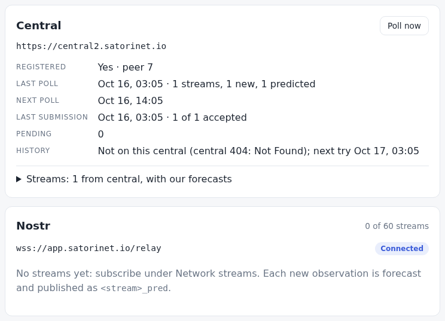

# Deploy: neuron.satorinet.io

The app is a static site, so a deployment is one container of files. The
image `satori-neuron` is nginx serving `dist/`. It runs on Satori Central
(the host of `network.satorinet.io`), behind the nginx-proxy that is already
there. The proxy owns ports 80 and 443 and terminates TLS. The container
serves plain http on port 80, to the proxy only. The app lives at
`neuron.satorinet.io`. `satori.satorinet.io` only redirects there (301, path
kept), because each origin is a separate browser storage: one name means one
neuron per browser (owner, 2026-10-16).

```
browser ─ https://satori.satorinet.io ─ 301 ─▶ https://neuron.satorinet.io
browser ─ https://neuron.satorinet.io ─▶ nginx-proxy on central (:443, TLS) ─ http :80 ─▶ satori-neuron (nginx, dist/)

then, from the page in the browser:  central (VITE_CENTRAL_URL) · wss:// relays · the Base RPC
```

The container only serves files. The neuron runs in each visitor's browser,
which calls central, the relays and the Base RPC itself, so none of that
traffic passes through this container.

## The files

| File | Does |
|---|---|
| `deploy/Dockerfile` | `nginx:1.30.5-alpine3.24`, pinned by the digest of its index (stable; the amd64 image was built 2026-09-23). Writes `/etc/nginx/csp.conf` from the `CSP` build argument (`add_header Content-Security-Policy "…" always;`) and empties the default site. Copies `deploy/nginx.conf` over `conf.d/default.conf` and `dist/` into the html root. Writes a `.gz` beside each html, js, css, wasm, txt and webmanifest file. Runs `nginx -t`. |
| `deploy/nginx.conf` | The server ([below](#what-it-sends)). |
| `deploy/build.env` | This deployment's [build variables](#build-variables). |
| `scripts/deploy-image.sh` | Runs `npm ci` if `node_modules` is missing or older than the lock file. Builds `dist/` with `deploy/build.env` (a variable already set in the environment wins) and checks the bundle for those values. Writes DuckDB's wasm in brotli beside it (`scripts/brotli.mjs`, [compression](#compression)). Builds `satori-neuron:<git short sha>` (`-dirty` with uncommitted changes) and tags it `:latest`, passing the CSP from `csp.js`. Then checks the image: `nginx -t`, its CSP line equal to `csp.js`'s, and the values in its bundle. Exits 2 if docker is not reachable; `dist/` is then built and checked, but there is no image. |
| `.dockerignore` | The build context is the repo; only `dist/` and `deploy/nginx.conf` go in. |
| `e2e/deploy.spec.js` | `npm run e2e:deploy`: the image (or a deployment) at `DEPLOY_URL` ([verify](#verify)). |

`csp.js` is the only source of the CSP. The script reads it with node and
passes it as a build argument, and the image writes the header line from it.
Neither file holds a copy. The script refuses a CSP that contains `"`, `$` or
`\`, because nginx would read those inside its string.

## What it sends

Every response, 404s included, carries:

- `Content-Security-Policy` (`csp.js`). It sits at the server level; the
  one location with an `add_header` of its own (the wasm's, for brotli,
  [below](#compression)) includes it again, because an `add_header` in a
  location drops the server's headers there;
- `X-Content-Type-Options: nosniff`.

| Path | Cache-Control | Content-Type |
|---|---|---|
| `/assets/*` (hashed) | `public, max-age=31536000, immutable` | by extension; `.wasm` is `application/wasm`, `.js` is `application/javascript; charset=utf-8` |
| `/`, `/index.html` | `no-cache` | `text/html; charset=utf-8` |
| `/sw.js` | `no-cache` | `application/javascript; charset=utf-8` |
| `/manifest.webmanifest` | `no-cache` | `application/manifest+json` (set here; nginx's `mime.types` lacks it) |
| `/llms.txt` | `no-cache` | `text/plain; charset=utf-8` |
| the icons | `no-cache` | `image/png` |
| any other path that is not a file | `no-cache` | the page, `index.html` (SPA) |
| a missing `/assets/` file | none | a 404, not the page |

`no-cache` means revalidate each time: nginx answers 304 on a matching ETag.
Only 2xx and 3xx responses get a Cache-Control, so a 404 is never cached for a
year.

### Compression

The `.gz` copies go to any client that accepts gzip (`gzip_static`), with
`Vary: Accept-Encoding`. Two settings keep this working behind a proxy:
`gzip_proxied any` and `gzip_http_version 1.0`. The second matters because
nginx's `proxy_pass` speaks HTTP/1.0 unless the proxy sets
`proxy_http_version 1.1`.

**DuckDB's wasm in brotli** (2026-10-19): 34.2 MB raw, 7.64 MB gzipped,
**5.07 MB in brotli** (quality 11, a 16 MB window: −34 %), the largest part
of a first visit ([storage.md](storage.md#the-first-visit)). The pinned
nginx has no brotli module (its image ships acme, geoip, image-filter, njs
and xslt; `brotli_static` needs ngx_brotli), so:

- `scripts/brotli.mjs` (run by `deploy-image.sh` after the build) writes
  `dist/assets/duckdb-eh-*.wasm.br` with node's zlib. Quality 11 takes
  about 6 minutes on this box, so each is kept by the wasm's sha256 in
  `node_modules/.cache/satori-brotli` and made once per DuckDB version.
- `deploy/nginx.conf`: a `map` on `Accept-Encoding` picks the `.br` copy
  (`try_files $uri$satori_br $uri`), a second `map` on the file actually
  served sets `Content-Encoding: br` only for a `.br` (DuckDB's mvp wasm has
  no copy and falls back to its `.gz`), the type stays `application/wasm`,
  and `Vary: Accept-Encoding` is said once (`gzip_vary off` there). Its
  location repeats the server's headers (the CSP, nosniff, Cache-Control),
  since an `add_header` in a location drops them.
- Checked by `e2e/deploy.spec.js`: br, gzip and identity each give the same
  wasm with the CSP and the cache rule; br under 70 % of gzip; the mvp
  wasm's gzip.

The proxy in front passes `Accept-Encoding` through (nginx's `proxy_pass`
does by default) and does not recompress an encoded response.

This covers what [pwa.md](pwa.md#csp-and-hosting) asks of a host, except https,
which the proxy provides.

## Build variables

These set the defaults that a user can change under **Settings**. Vite bakes
them into the bundle when the app is built (`src/config.js`), so changing one
means a new build.

| Variable | Sets | A build's default | The dev server's default | This deployment (`deploy/build.env`) |
|---|---|---|---|---|
| `VITE_CENTRAL_URL` | central, https only (Settings › Central URL) | `https://network.satorinet.io` | `https://central2.satorinet.io` | `https://central2.satorinet.io` |
| `VITE_NOSTR_RELAYS` | the user's relays, a comma list of `ws://` or `wss://` URLs (Settings › Nostr relays) | none | `ws://localhost:7778` | `wss://app.satorinet.io/relay` |
| `VITE_NOSTR_CENTRAL_WRITE` | `true` or `false`: whether central's relays are written to (Settings › Publish to central's relays) | `true` | `false` | unset (`true`) |
| `VITE_BASE_RPC` | the Base RPC used, alone, when none is saved: `https://…` or a same-origin path (Settings › Base RPC) | none: central's `rpcUrl`, then publicnode | `/rpc` (the local fork) | unset |

- An empty variable counts as unset.
- A bad value stops `vite build`, because `vite.config.js` runs the same
  check as the app. A bad value is an http central, a relay that is not
  ws/wss, a `VITE_NOSTR_CENTRAL_WRITE` other than true or false, or an RPC
  that is neither https nor a path.
- The dev server reads these variables too, so set them only for a build.
  `scripts/deploy-image.sh` sets them for its own run only.
- A build has only its own defaults in the bundle: the dev server's
  (central2, `localhost:7778`, `/rpc`) are dropped from it. That is why the
  script's check for `central2.satorinet.io` in the bundle is a real check.
- These are defaults. A value the user has saved in Settings wins. A user who
  has saved nothing gets a new build's default on the next load.

This deployment uses the dev central until the owner moves to the production
one. Its relay is Satori's public relay over TLS. Central lists only
`ws://satorian.satorinet.io:7777`, and an https page can't open `ws://`
([issue](../issues/relays-not-wss.md)): the app shows that relay as blocked.

## Two names, two origins

Both names serve the same image, but each is a separate origin to the browser.
Each has its own storage (OPFS: the keys and the database), its own service
worker and its own installed app. A neuron set up on one name does not exist
on the other. To move it, use Backup on one and Restore from words on the
other (each key's 24 words, and the Nostr key: [keys.md](keys.md#backup)). Central
answers CORS for both origins: checked 2026-10-16 with a GET of
`/api/v1/peer/relays` from each origin on central2 and prod, and a preflight
of `POST /api/v1/peer/register` on central2.

## Verify

Locally, with docker:

```sh
./scripts/deploy-image.sh                  # satori-neuron:<sha> and :latest, checked
docker run --rm -p 8090:80 satori-neuron:latest
npm run e2e:deploy                         # DEPLOY_URL=http://localhost:8090 by default
curl -sI http://localhost:8090/sw.js       # CSP, nosniff, no-cache
```

`e2e/deploy.spec.js` makes two checks:

1. The headers above on each kind of path, the SPA fallback, the 404 for a
   missing asset, and the gzipped wasm.
2. Chrome with a fresh profile, every host but the app's unresolvable. Central
   is the stub, and the build's relays are routed to nothing. The page loads
   under the CSP with no violation and DuckDB opens. The service worker takes
   over, and the manifest is valid and installable. A new neuron gets this
   deployment's central and relays: it registers with the stub and opens the
   relay. A poll stores and forecasts a stream, and a reload comes from the
   worker.

After a deploy, run the same spec against the live site:
`DEPLOY_URL=https://neuron.satorinet.io npm run e2e:deploy`. The neuron it
creates still talks only to the stub.

Verified 2026-10-16, without docker (this box has no daemon). The image's
own nginx 1.30.5 binary, taken from the pinned image, ran through its musl
loader with the image's `nginx.conf` and `mime.types`. `deploy/nginx.conf`
served as `default.conf`, changed only in `listen` (8090) and `root`.
`csp.conf` was written by the Dockerfile's `printf`, and `dist/` was gzipped
by the image's busybox. `npm run e2e:deploy` passed against it on
http://localhost:8090.

Screenshot below: the deploy build on that nginx, in a fresh profile, with
its defaults in place. Central2 and the relay are answered inside the test.



## Redeploy

Central has a docker daemon and this box does not, so the image is built on
central. The build only copies files: no npm runs next to the production
database. `S` means `ssh -i ~/.ssh/id_ed25519 -p 2222 root@157.180.104.175`
(central; access in `../central/CLAUDE.md`).

1. Commit, then build `dist/` with this deployment's defaults:
   `./scripts/deploy-image.sh`. It exits 2 at the docker step on a box without
   docker, after `dist/` is built and checked.
2. Ship the build context and build the image on central:

   ```sh
   tar -czf /tmp/ctx.tgz dist deploy/Dockerfile deploy/nginx.conf
   CSP=$(node --input-type=module -e "import { CSP } from './csp.js'; process.stdout.write(CSP)")
   SHA=$(git rev-parse --short HEAD)
   $S 'mkdir -p /root/satori-neuron/ctx && rm -rf /root/satori-neuron/ctx/*'
   scp -i ~/.ssh/id_ed25519 -P 2222 /tmp/ctx.tgz root@157.180.104.175:/root/satori-neuron/
   $S "cd /root/satori-neuron/ctx && tar -xzf ../ctx.tgz && docker build -q -f deploy/Dockerfile --build-arg CSP=\"$CSP\" -t satori-neuron:$SHA -t satori-neuron:latest ."
   ```

3. Replace the container. It publishes no port and sits on the network
   nginx-proxy reaches:

   ```sh
   $S "docker rm -f satori-neuron; docker run -d --name satori-neuron --network central-lite_default --restart unless-stopped satori-neuron:$SHA"
   ```

   nginx-proxy resolves `satori-neuron` per request, so it needs no reload.

4. nginx-proxy (one-time, done 2026-10-16). Its one `nginx.conf`
   (`/root/nginx/nginx.conf`, a single-file bind mount) has three server
   blocks:
   - port 80 for both names: the ACME webroot, everything else to https;
   - 443 `neuron.satorinet.io`: `proxy_pass http://$satori_neuron:80`;
   - 443 `satori.satorinet.io`: `return 301 https://neuron.satorinet.io$request_uri`.

   The copies on central are `/root/nginx/satori-neuron.80.conf` and
   `satori-neuron.443.conf`. They were inserted before the `http` block's
   closing brace, after a backup (`nginx.conf.bak-satori-neuron*`), and loaded
   only after `nginx -t` passed. Don't add a CSP or nosniff there; the
   container sends both. One certificate covers both names:
   `certbot certonly --webroot -w /var/www/certbot -d neuron.satorinet.io -d satori.satorinet.io --cert-name neuron.satorinet.io --key-type ecdsa`.
   It renews with certbot's timer, and the deploy hook reloads nginx-proxy.
   DNS: two A records to `157.180.104.175` in Cloudflare, proxy off, as for
   `app` and `coined`.

5. Check: `curl -sI https://neuron.satorinet.io/sw.js` (expect the CSP,
   nosniff and `no-cache`), then
   `DEPLOY_URL=https://neuron.satorinet.io npm run e2e:deploy`.

Live since 2026-10-16. The check passed then, and a real smoke test also
passed: a fresh profile registered with central2, which accepted 83 of 83
predictions, and the relay was open. Central2 has no history route yet, so
it shows "Not on this central".

## Moving to the production central

To switch, set `VITE_CENTRAL_URL=https://network.satorinet.io` in
`deploy/build.env`, or delete the line, which gives a build's default. Then
rebuild and redeploy.

There is a fixable problem with this. A browser that never saved a central
follows the new default on its next load, but it keeps central2's stream
list, its specs and its pending predictions. Only a change in Settings resets
those (`setCentral` → `db.resetCentral()`); a new default does not. So if
that browser's queue is under 22 h old, its next submission sends central2's
stream uuids to prod, which files an unknown uuid under its `bitcoin` stream
([central.md](central.md#settings)).

- **Fix (not built):** store which central the data belongs to (a meta key),
  and reset at start when the central in use differs.
- **Until then:** a tester can save the prod URL once under Settings, which
  resets the data.
