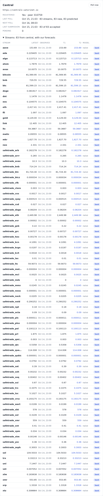
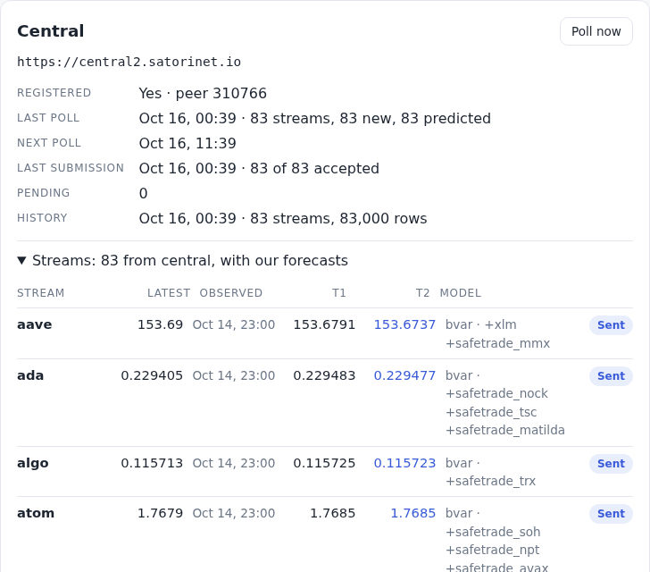

# Engine

[← OVERVIEW](OVERVIEW.md)

`src/engine/index.js`: `forecast(points) → {model, t1, t2, phi?, weight?} | null`.
Pure functions. Step 4 replaced step 3's least-squares line
(`ols-20`) with a one-stream, lag-1 cut of the engine the owner built in
`../namaste_club` ("a simplified engine… take inspiration from it").

Central's streams now get more: **`bvar`**, a multivariate model per target
stream whose companions and priors each neuron draws and evolves on its own
([below](#bvar-a-model-per-central-stream-unique-to-each-neuron)). `bar1`
stays: it is `bvar`'s fallback and the model for Nostr and Base streams.

Short names: `NC` = `../namaste_club`; `engine.py` = `../neuron/engine-lite/engine.py`.

## What namaste_club does

A pool of about 4,300 workers that submit to central once a day. The parts that
make one forecast:

- **Grid.** All of a stream's history, binned to one row per 12 h UTC bucket
  (the last value in the bucket); empty buckets are dropped
  (`NC/models.py:254-267`; `BUCKET = 43200` at `NC/features.py:22`,
  `NC/regrid_history.py:39`).
- **Returns.** Values become percent changes, and ±inf and NaN become 0
  (`NC/models.py:295-305`). A zero coefficient then means "tomorrow ≈ today",
  a random walk in price space.
- **Model.** A Bayesian VAR in closed form, one regression per target
  (`NC/bvar.py:95-251`):
  - regressors: 5 cyclical time features (`NC/bvar.py:13-27`), the lag-1
    (or lag-2) returns of every stream, and exogenous features;
  - a Minnesota prior centred on zero: own-lag variance λ1² with λ1 = 0.2
    (`NC/bvar.py:88,199`); other streams' lags (λ1·λ2)² scaled by their
    variance ratio (`:200-207`); time features loose, λ1²·100 (`:194`);
  - noise σ² = the variance of the OLS residuals, floored at 1e-6
    (`NC/bvar.py:177-180`);
  - posterior mean (Σ0⁻¹ + XᵀX/σ²)⁻¹·Xᵀy/σ² (`NC/bvar.py:215-229`);
  - it needs rows ≥ features + 5 (`NC/bvar.py:157-164`). A stream it does not
    train on gets the last value (`NC/pool.py:1019-1031`).
- **Forecast.** Two 12 h steps in return space (`NC/bvar.py:283-339`, called at
  `NC/pool.py:979-991`). Each predicted return is the next step's lag; a
  non-finite return is 0; each step is clamped to ±0.5 (`:334-336`); growth
  compounds. The first lag is the return from the newest observation back to
  the newest one at least 6 h older (`NC/pool.py:869-900`).
- **Fade.** submitted = last × (1 + w·(g − 1)) (`NC/calibration.py:108-119`).
  A non-finite or non-positive g counts as 1, and a non-positive result
  becomes last (`NC/pool.py:1003-1016`). w = clamp(2 − model error /
  persistence error, 0, 1); a persistence error of 0 gives w = 0 if the model
  erred, else 1 (`NC/calibration.py:39-50`). The errors are medians of the
  stream's own logged forecasts (`NC/calibration.py:53-94`), each scored
  against the first observation ≥ 24 h later (`NC/measurement.py:101-165`).
  Fewer than 5 → w = 1 (`NC/calibration.py:33-34`). `MODEL_WEIGHT` forces w
  (`NC/pool.py:1001-1010`).
- **Spread between workers.** Random stream subsets and feature hands; λ's
  drawn each day from a tuner's 28-row holdout (`NC/models.py:552-666`);
  coefficients drawn from the posterior (`NC/bvar.py:254-280`); a jitter on the
  blend (`NC/calibration.py:122-127`).
- **Evidence.** Across 1,880 scored forecasts the median absolute error was
  4.09% for the model and 3.32% for persistence (`NC/calibration.py:4-10`),
  hence the fade.

## What Satori Lite does

- `t1` = the model's next value; `t2` = the model again on the history with
  `t1` appended, falling back to `t1` (`engine.py:1153-1186`, the appended row
  at `:1128-1151`).
- Central gets `value` = t2 and `t1_value` = t1 (`engine.py:1052,1102-1103`)
  and scores `value` against the first observation ≥ 24 h after it
  (`central/src/scripts/score.py:249-253`).
- The model sees the stream's whole local history (`engine.py:641-652`).

For a linear AR on returns, appending t1 and predicting again *is* namaste_club's
second iterated step. So here t1 is the first 12 h step and t2 the second:
Lite's two values, namaste_club's 24 h horizon. The payload is unchanged
([central.md](central.md)).

## The engine here: `bar1`, a Bayesian AR(1) on 12 h returns

For each stream that got a new observation, on all its stored observations
(as Lite and namaste_club do):

1. Drop points with a non-finite time or value and sort by time. None left →
   `null`. `last` = the newest value.
2. **Buckets**: b = floor(ts / 43,200) (12 h, UTC-aligned), the last value in
   each.
3. **Returns** between back-to-back buckets: r = v_k / v_{k−1} − 1
   (non-finite → 0). Across a gap there is no return. A series with any
   value ≤ 0 is modeled on changes instead (`bar1d`, below).
4. **Pairs** (r_{k−1}, r_k), both present. Fewer than 6 (lag 1 + 5) →
   **`naive`**: t1 = t2 = last. A pair needs three back-to-back buckets, each
   with an observation, so `bar1` needs **an observation every step** (12 h for
   central): 8 gapless buckets give 6 pairs, about 4 days of polls every 11 h.
   A stream observed once a day never gets a pair and stays `naive`. That
   covers a daily central stream such as `crypto_fear_greed`, observed at 00:01
   (`central/src/scripts/extra_streams.py:27`). It also covers a neuron that
   polls once a day, such as a tab open only 9:00–18:00. Gaps are not bridged
   (see Deviations).
5. **φ** = Σxy / (Σxx + σ²/λ1²), where σ² = max(var(y − φ_ols·x), 1e-6) and
   φ_ols = Σxy/Σxx (0 when Σxx = 0). This is namaste_club's posterior mean with
   one regressor; λ1 = 0.2 shrinks φ toward 0 (the random walk) unless the data
   say otherwise.
6. **First lag** r0 = last / (the newest value at least 6 h older) − 1. It is 0
   when there is no such value or when it is more than 24 h older.
7. **Iterate** twice: q = clamp(φ·r, ±0.5) (non-finite → 0), r = q,
   g ← g·(1 + q). This gives g1 (12 h) and g2 (24 h).
8. **Weight** w from a rolling backtest on the stream's own buckets. Take the
   last 28 origins (bucket positions), then drop those whose buckets o, o+1,
   o+2 are not back to back or which have fewer than 6 pairs up to o. On each
   one left, fit φ on the pairs up to o, predict v_o·g2 from r_o, and score it
   against v_{o+2}; persistence predicts v_o. Both errors are relative,
   |x − a|/a. w = clamp(2 − median(model)/median(persistence), 0, 1),
   with namaste_club's rule for a zero persistence error. Fewer than 5 origins →
   w = 1.
9. **Fade**: t1 = last·(1 + w·(g1 − 1)), t2 = last·(1 + w·(g2 − 1)), with
   namaste_club's guards.
`bar1` returns `{model: 'bar1', t1, t2, phi, weight}` and `naive` returns
`{model: 'naive', t1, t2}`.

### `bar1d`: a series with values ≤ 0 (step 6)

A named Base stream's value is a signed counter that starts at 0
(docs/design/base.md); returns of such a series mean nothing (a step from 0,
a sign change). Until step 6 a non-positive bucket was a gap and a
non-positive last value gave `naive`, so such a stream always forecast its
last value, and the Base batch voted DOWN on it forever. Now, when any value
is ≤ 0, the same model runs on additive changes:

- r = v_k − v_{k−1} between back-to-back buckets; the first lag is last − the
  value ≥ 6 h older; the pairs, φ and the 6-pair minimum are as above;
- each iterated step is φ × the one before, clamped to ± the largest change
  seen in the series (in the backtest, up to the origin; the ±50 % clamp is
  relative, and has no meaning here);
  t1 = last + w·q1, t2 = last + w·(q1 + q2);
- the backtest scores v_o + q1 + q2 and persistence v_o against v_{o+2} by
  absolute error (a level may be 0), on origins from the series' first value
  ≤ 0 on ([the transform as known at the origin](#the-backtest-score-and-fade)),
  and w is the same function of the two medians.

It returns `{model: 'bar1d', t1, t2, phi, weight}`. A shift of the whole
series shifts the forecast by the same amount and leaves φ and w unchanged
(tested). A series of positive values is untouched (namaste_club's parity
tests run as before). Central's and Nostr's streams take the same rule, so a
stream with zeros or negatives (a temperature, a rate) is modeled on changes
too, where before its non-positive values were gaps.

`phi` and `weight` are stored on the prediction,
and the Streams list (in the Central card) shows the model, with φ and w on hover. An option
`{weight}` forces w, as `MODEL_WEIGHT` does; the backtest uses it.

### Constants

Copied from namaste_club, except `HOLDOUT`: namaste_club's calibration uses
every logged forecast, so the backtest window borrows its λ tuner's holdout.

| Constant | Value | namaste_club |
|---|---|---|
| `STEP_S` | 43,200 s (12 h), UTC-aligned | `features.py:22`, `regrid_history.py:39` |
| `LAMBDA1` | 0.2 | `bvar.py:88` |
| `SIGMA2_FLOOR` | 1e-6 | `bvar.py:180` |
| `MIN_EXTRA_ROWS` | 5 (rows ≥ features + 5) | `bvar.py:158` |
| `HORIZON_STEPS` | 2 | `bvar.py:285`, `pool.py:991` |
| `MAX_STEP_RETURN` | 0.5 | `bvar.py:286` |
| `MIN_SPACING_S` | 6 h | `pool.py:872` |
| `HOLDOUT` | 28 | the λ tuner's holdout, `models.py:552` (borrowed) |
| `MIN_SAMPLES` | 5 | `calibration.py:34` |
| `DEFAULT_WEIGHT` | 1 | `calibration.py:33` |

## `bvar`: a model per central stream, unique to each neuron

The owner's direction (2026-10-15): every neuron builds its own models, at
least one per stream it predicts, unique in the algorithm, in its
hyperparameters and priors, and above all in its **data**: which other
streams it reads next to the target ("predict gold from gold + jobs +
weather"). The uniqueness comes from exploring what relates to what and
keeping what works, not from noise on identical models; over time each
neuron finds its niche. The MVP: one algorithm, multivariate, with drawn
priors and a drawn set of 1–3 companion streams per model, improved over
time. Specs are stored locally only (Nostr subscriptions will make the
choices public later).

`src/engine/bvar.js` (the model) and `src/engine/evolve.js` (specs and
evolution) are pure; the cycle stores the specs (`model_specs`,
[storage.md](storage.md)).

### The spec

One per central target stream, in `model_specs`:

```
{ companions: [uuid, …] (1–3 other central streams), lambda1 ∈ {0.05, 0.1, 0.2, 0.5}, lambda2 ∈ {0.25, 0.5, 1.0} }
+ score (the champion's backtest error), generation (mutations proposed), accepted (mutations kept)
```

The λ grids are namaste_club's tuner's (`NC/models.py:589-590`). Lag stays 1.

- **First draw**, when a target is first forecast: a deterministic RNG
  seeded from the identity's public key and the target's uuid
  (sha256 of `identity|target|draw|i` per draw), so neurons start
  differently and each one reproducibly. The number of companions is drawn
  from 1–3, then the companions from the pool (sorted by uuid), then λ1 and
  λ2, each uniformly.
- **The pool**: the other central streams aligned with the target
  **recently**: a row shared with it within the target's last 4 row buckets
  (2 days, counted from the target's newest row, so a closed tab doesn't
  empty it), and 7 rows in all, enough for a one-companion model (below). A
  stream that stopped long ago, or one that never has three buckets in a row
  (a daily stream), is out: before, a stream aligned once was in for good,
  and a spec reading it fit only its old rows while showing `bvar`. A young
  neuron has no aligned stream, so it draws from every other central stream:
  the spec exists from the first poll, falls back until the data arrive, and
  is repaired then (Evolution, step 2).
- **Mutations** are seeded from identity + target + generation, so a
  neuron's whole path is reproducible.

### The model

A Bayesian VAR(1) over [target, companions] on the 12 h UTC buckets
(`NC/bvar.py:95-251`, `NC/models.py:254-305`):

1. Each series: buckets as `bar1` (the last value in each 12 h bucket) and
   its **own transform**: percent returns if all its values are > 0, else
   additive changes (as `bar1d`). A bucket has a return only when the bucket
   before it has a value.
2. **Rows**: buckets k where every series has a return at k and at k − 1
   (x = the returns at k − 1, y = those at k). Gaps break the chain: a row
   needs three back-to-back buckets in every series. Fewer than
   features + 5 rows (`NC/bvar.py:157-164`; 1 + companions features, so
   7–9) → the spec can't fit.
3. **Prior** (Minnesota, mean 0 = the random walk, `NC/bvar.py:188-213`):
   for equation j, own lag variance λ1²; series k's lag (λ1·λ2)² ·
   clip(σ_j²/σ_k², 1e-2, 1e2), σ² being each series' variance of y over the
   rows, floored at 1e-12 (`:171`). No intercept, no time features.
4. **Noise** σ_j² = the variance (ddof 0) of the OLS residuals of equation j,
   floored at 1e-6 (`NC/bvar.py:177-180`). A singular XᵀX (a series that
   never moves) is solved as `lstsq` does: its residuals are unique.
5. **Posterior mean** per equation, (Σ0⁻¹ + XᵀX/σ_j²)⁻¹ Xᵀy_j/σ_j²
   (`:215-229`): a k×k solve in plain JS, from running sums of the rows
   (XᵀX, Xᵀy, Σx, Σy, Σy²), so a backtest adds each row once.
6. **Forecast**: the first lags are each series' newest step, as `bar1`
   takes it (the newest value against the newest one ≥ 6 h older, 0 if more
   than 24 h older; `NC/pool.py:869-900`); a companion whose newest
   observation is more than a step older than the target's gets 0. Iterate
   two steps over all equations (`NC/bvar.py:316-339`): each predicted step
   is the next lag, non-finite → 0, clamped as `bar1` clamps (±50 % for
   returns, ± the largest change seen for changes). The target's two steps
   give t1 (12 h) and t2 (24 h), turned back into values by its transform.
7. **Fade** toward persistence as `bar1`: the weight from the spec's own
   rolling backtest (below).

**Fallbacks**: a spec that can't fit (not enough aligned rows, or a
companion with no history) gives `bar1`'s forecast, which itself falls back
to `naive`. The prediction's `model` says which: `bvar`, `bar1`, `bar1d` or
`naive`.

### The backtest: score and fade

On the target's own buckets, the same origins as `bar1`'s backtest: of the
last 28 bucket positions, those whose buckets o, o + 1, o + 2 are back to
back and which have the 6 target pairs `bar1` needs up to o. At each origin
the spec is fit on the rows up to bucket o only, iterated from the returns
at o, each step clamped by the largest step up to o, and its unfaded t2
scored against the value at o + 2 (24 h later): relative error |x − a|/a,
absolute for a target on changes. Where the spec can't fit at an origin,
`bar1`'s forecast there is scored instead (what the live neuron would have
sent).

**The transform as known at the origin.** A series' transform (returns, or
changes once any value is ≤ 0) is the one its data up to the origin would
choose. A target whose first value ≤ 0 came at bucket z is on changes now
and was on returns before z, so it is scored only on origins from z on: one
model, one error unit (absolute) throughout. A companion whose first value
≤ 0 came after an origin was still on returns there, so at that origin the
spec can't be fit as it is now and `bar1`'s error stands in. `bar1`'s own
backtest does the same. So each scored forecast uses nothing after its
origin except the actual at o + 2 (tested: a late zero, a late large change
for the clamp, and every series changed after an origin's actual). What a
late value ≤ 0 does change is which origins are scored. (Before the review,
the transform was the whole series', so a late zero turned earlier origins'
models from returns into changes.)

- **score** = the median of those errors; none below 5 origins.
- **fade weight** = namaste_club's `weight_from_errors` on the medians of
  the same errors and persistence's (`NC/calibration.py:39-50`), as `bar1`.

With no companions this is exactly `bar1` (tested on the parity cases).

### Evolution

After each poll that brought new rows, for each target that got one:

1. Read the champion spec (or draw the first one).
2. **Repair** it: each companion not in the pool now is replaced, in its
   place, by one drawn from the pool (seeded by identity + target +
   generation + "repair"), or dropped when the pool has none left. A spec
   drawn blind before there was history, or reading a stream that stopped,
   is fixed before it is scored. With no aligned stream at all the draw
   stays. (Before, such specs kept their dead companions until a mutation
   happened to swap them: in a simulation, 2–8 of 20 targets were still on
   `bar1` after 30 days.)
3. Score it on the backtest. With fewer than 5 origins, stop here: no
   proposal, the generation stays.
4. Propose **one** mutation (seeded by identity + target + generation), one
   of those that apply, uniformly: swap a companion for another from the
   pool, add one (fewer than 3), drop one (more than 1), or move λ1 or λ2 to
   a neighbouring grid value.
5. Score the challenger on the same origins.
6. Keep it only if its score beats the champion's by the margin (5 %:
   challenger < champion × 0.95). generation + 1; accepted + 1 if kept.
7. Forecast with the champion; store the spec, its score and counts.

The margin keeps a neuron from swapping on noise. It started at 2 %; the
backtest showed that chasing noise (7 % of proposals kept, the λ's drifting
to the loosest values, 0.27 % worse than `bar1`), so it ships at 5 %
([Measured](#measured)).

**CPU.** Everything is running sums and k×k solves (k ≤ 4); the slow part
is reading the histories. The cycle records the engine's time in the last
poll (`engine_ms`); measured below.

### History from central (backfill)

`bvar` needs aligned history, which 11 h polls build slowly (about 4 days
for 7 rows). Central now serves a stream's past
([central.md](central.md#history-an-addition-beyond-lite)); each stream is
fetched once (up to 1,000 rows, the last ~41 days of central's hourly
observations), and its rows are stored older than the newest polled row
only. Backfilled rows never trigger a prediction: only a poll's new row
does, as in Lite.

### Scope

Only central's streams get `bvar` and evolution. Nostr streams and Base's
registry stay on `bar1` (univariate): a Nostr stream has its own cadence and
its own history from its provider, and Base's daily batch reads the
registry. They can join later: a Nostr stream as a companion once its
cadence is regridded to central's 12 h buckets (the same bucketing works on
any grid), and their targets once their histories are aligned with
central's.

## The step and the horizon

The owner's rule (2026-10-15, [../intent/engine.md](../intent/engine.md)): **a
forecast predicts a stream one cadence ahead**; the default cadence is a day,
what central and the Base contract score. Lite's t2 exists only because Lite
polls every ~11 h and predicts two of those steps, about 24 h.

`forecast(points, { step, horizon })` keeps the two apart:

- `step`: the bucket in seconds, the engine's internal grid. The default is
  `STEP_S` (12 h), central's. Everything is counted in buckets (6 lag pairs of
  back-to-back buckets before `bar1`, 28 backtest origins, the clamp), and the
  first lag's minimum spacing is half a step (6 h at 12 h), so a series on any
  grid gives the same model (tested: the same values on a 15 min grid with
  `step: 900` give exactly the 12 h result).
- `horizon`: how far ahead `value` is. The engine iterates n = horizon / step
  steps (the nearest whole number, at least one; callers pick a step that
  divides the horizon) and returns `value`, the
  forecast n steps ahead, and `horizon` = n × step. The backtest that sets the
  fade scores that same forecast against the value n buckets after each origin
  (tested against the engine forecasting each origin's history). The default
  is two steps. `t1` and `t2` (one and two steps ahead) stay for Lite's payload.

| Path | Step | Horizon | Sent |
|---|---|---|---|
| Central | 12 h | 24 h (2 steps) | `value` = t2, `t1_value` = t1: Lite's payload, unchanged |
| Nostr `_pred` | the source's `cadence_seconds` (a day when none: the default cadence) | one cadence (1 step) | `value`, = t1 ([nostr.md](nostr.md#the-engines-step)) |
| Base daily batch | horizon / n, n = max(1, floor(horizon / max(12 h, cadence))) | max(24 h, cadence) | UP/DOWN from `value`: an hourly stream in two 12 h steps, the daily default stream in one 24 h step ([base.md](base.md)) |

With the default horizon the numbers are the ones before the rule (the
namaste_club parity cases are unchanged). `bvar` is central's, so it keeps
two 12 h steps.

## Deviations, and why

From namaste_club:

- **`bar1`: one stream, lag 1, no time or exogenous features.** Time
  features enter almost unshrunk (λ1²·100) and add 5 coefficients, so they
  need far more rows than a young neuron has; the research simulation put
  the 24 h error at 1.4–2.5× persistence's with few rows. Lag 2 is left out
  too, so one setting is pinned by the tests and the parity fixture.
- **`bvar`: one small VAR per target, not one big VAR per worker.**
  namaste_club fits one model over bitcoin, `safetrade_sat` and a random half
  of the streams with ≥ 100 fresh observations (`NC/models.py:15-128`) and
  predicts all of them with it. Here each target has its own model over
  itself and 1–3 companions, so a neuron's spec for gold says what *it*
  thinks gold depends on, and evolution can keep or drop each choice on that
  target's own error. Few series also keep the fit within the aligned rows a
  young neuron has (features + 5 = 7–9).
- **`bvar`: the λ's are part of the spec, evolved locally.** namaste_club
  tunes λ1 × λ2 × lag on a 28-row holdout once a day (one-step,
  variance-normalised MSE, `NC/models.py:552-631`) and each worker samples a
  pair weighted by (best/err)⁴ (`:637-666`). Here the first λ's are drawn
  uniformly from the same grids and then move one grid step at a time,
  kept only when the 24 h backtest error improves by the margin. No lag 2.
- **`bvar`: gaps break the chain.** namaste_club merges the streams with an
  outer join, back- and forward-fills the gaps and turns the filled cells
  into 0 returns (`NC/models.py:255-305`). Here a row needs every series
  present in three back-to-back buckets, so no fake zero enters the fit.
- **`bvar`: each series has its own transform** (returns, or changes for a
  series with a value ≤ 0); namaste_club takes percent changes of all.
- **`bvar`: a stale companion's first lag is 0** (its newest observation more
  than a step older than the target's). namaste_club takes each stream's
  newest step whatever its age (`NC/pool.py:869-900`).
- **The clamp on a change series in a backtest** is the largest change seen
  up to the origin, and a series is on the transform its data up to the
  origin choose (above), so a backtest looks at nothing after the origin.
- **The fade comes from a rolling backtest, not a log of past submissions.** It
  needs no new storage and no wait for submissions to be scored: the history
  is the record, and it has an opinion from 14 buckets (about 7 days). It also
  avoids namaste_club's feedback loop, where the logged values are the fleet's
  mean of what was submitted, already faded and jittered (`NC/pool.py:516-534`),
  so a faded model is scored as part persistence.
- **Gaps.** namaste_club drops empty buckets, so a return across a gap counts
  as one 12 h step. A browser tab gets closed, so here a gap breaks the
  return, and a first lag more than 24 h old counts as 0. The cost: a stream
  with fewer than one observation per step (a daily stream, or a neuron that
  polls once a day) stays `naive`, rather than being fit on 24 h returns
  labelled 12 h.
- **Values ≤ 0: changes, not returns.** namaste_club computes percent
  changes on any value and only guards the final result. Here a series with
  any value ≤ 0 is modeled on additive changes (`bar1d`, above): a named
  Base stream is a signed counter from 0. (Until step 6 such values were
  gaps and a non-positive last value gave `naive`.)
- **Left out:** posterior draws and the jitter. They spread 4,300 workers
  around the truth; for one node they only add error. Also left out: the
  random model and its 100,000 default (`NC/pool.py:840-845,881`).

From Satori Lite:

- The model is `bvar`/`bar1`/`naive`, not Lite's Starter/XGBoost adapters, and it
  steps by 12 h buckets rather than by rows. Lite's rows arrive every ~11 h, so
  a step is about the same length.
- Per-node diversity comes from the spec (the data each model reads, and
  its λ's), drawn from the identity and evolved on the neuron's own
  backtest; Lite redraws hyperparameters at random on every fit
  (`adapters/_rng.py`).

## Verified

- `npm test` (`src/engine/engine.test.js`):
  - namaste_club's tests ported as they are (`NC/tests/test_engine.py`):
    iterate (`:179-200`), the weight rules (`:391-404`), blend (`:406-409`),
    weights from error samples (`:418-433`) and too few samples (`:435-439`);
  - recovery: φ = 0.5 over 400 buckets comes back in (0.4, 0.6) with λ1 = 0.5
    and with 0.2; λ1 = 1e-4 shrinks it below 0.1;
  - minimum data (7 buckets → naive, 8 → bar1); once a day stays naive (a
    daily stream at 00:01, a 9:00–18:00 tab), polls every 11 h reach bar1;
    several points in a bucket; a constant series (φ = 0, t1 = t2 = last); a
    gap; a stale first lag; non-finite values; any order;
  - `bar1d`: a series with a 0 or a negative is modeled on changes; a steady
    counter rising from −10 forecasts last + 2 and + 4 (UP), falling the
    mirror; a shift moves the forecast by the shift (φ and w unchanged); an
    AR(1) of changes gives φ > 0;
  - a model that keeps losing in the backtest gets w < 1;
  - a random-walk guard: over 500 seeds of 8–40 buckets with 1% steps, the mean
    |t2/last − 1| is 0.06% (bound 0.1%, a tenth of one step's typical move).
- **Parity with namaste_club's own code.** `scripts/engine_parity.py` runs
  namaste_club's `create_dataset`, `train_bvar_model` (lag 1, one stream,
  `TIME_COLS = []`), `_gather_market_state` (compiled alone from `pool.py`),
  `iterate_forecast`, `weight_from_errors` and `blend` on 10 series. It writes
  `test/fixtures/engine-parity.json`, and the JS engine matches it to 9 decimal
  places. The backtest weight is this app's deviation, so the script rebuilds
  it from those same calls on each origin's truncated history. The series have
  no gaps and no stale lag, where the two engines differ on purpose. The step-4
  brief's golden values (zigzag φ = −0.705304, t1 = 103.56200, t2 = 104.56234;
  1% compounding t1 = 148.87674, t2 = 150.34611 with 28 samples; the point an
  hour on, r0 = 110/104 − 1, t1 = 108.50565, t2 = 108.85275) came out the
  same from namaste_club's code, and the zigzag also by hand from the formula.
- `npm test`, `bvar` (`src/engine/bvar.test.js`, `evolve.test.js`):
  - **parity with namaste_club's `bvar.py`**: `scripts/bvar_parity.py` runs
    `train_bvar_model` (no time features) and `iterate_forecast` on 6 tables
    of returns (2–4 series, 7–150 rows, every λ grid edge, a series that never
    moves, a step at the ±50 % clamp) and catches the prior variances on
    their way into `np.diag`; every equation's prior, posterior mean, σ² and
    each series' growth match to 9 decimals (`test/fixtures/bvar-parity.json`);
  - with no companions it is `bar1` (φ, weight, t1, t2 on every parity case);
    a companion that leads the target is learned (its coefficient 0.6 comes
    back in 0.45–0.75) and beats `bar1` in the backtest; λ2 → 0 shrinks it
    away; rows need every series in three back-to-back buckets; each series'
    own transform; the fallbacks (too few rows, no companion, a companion
    with no history); a stale companion's first lag is 0;
  - **no look-ahead**: changing every series after an origin's actual leaves
    that origin's error unchanged; where the spec can't fit at an origin,
    `bar1`'s error stands in;
  - the identity-seeded RNG (the same parts the same stream); the first
    draw (reproducible, valid, 40 identities give 36+ specs and every count
    and λ); each mutation changes one thing to a valid spec (no add at 3, no
    drop at 1, λ at a grid end moves inward); the 5 % rule; one proposal per
    poll, none below 5 origins; evolution finds a leading companion and
    keeps it; six identities end with different champions.
- `npm test`, the cycle: history and engine (`src/neuron/history.test.js`,
  `neuron.test.js`): the backfill against a mocked fetch (200, 404 held a
  day per central, partial lists, a failure stopping the run, 4 calls at a
  time, rows counted across overlapping calls), backfilled rows never
  predicted while the poll's new row is; specs drawn, stored and evolved
  over 40 polls, `bvar` predictions; the same identity draws the same specs.
- `npm run e2e`: the app in Chrome makes `naive` until the stream has 8
  back-to-back buckets, then `bar1` with the same t1, t2, φ and weight as
  node, and sends them as Lite's payload. With a stub central that serves
  history, the first Poll now backfills 3 streams (600 hourly rows each) and
  forecasts each with `bvar`, with the same specs, scores and numbers as node
  running `runModels` with the identity's pubkey; the Model column shows
  "bvar · +eth +gold" and the History line "3 streams, 1,800 rows".
- Live, on the dev server against central2 (2026-10-16), in a fresh profile
  with throwaway keys: Poll now stored 83 streams; each got its own spec,
  drawn from the identity (31 with 1 companion, 28 with 2, 24 with 3; a
  second fresh profile drew others); central accepted 83 of 83 predictions.
  Central2 has no history route yet: the first 4 calls (in flight together)
  answered 404, the rest were not asked, and the History line says "Not on
  this central (central 404: Not Found); next try Oct 17, 00:35". So every
  stream was `naive` (one observation each) and its Model column reads
  "naive · spec +safetrade_soq +safetrade_noid +safetrade_arrr", the spec
  waiting for aligned rows. `engine_ms` 22.



- The same, with central2's history route and predictions batch answered in
  the browser by a script (Playwright routes: synthetic hourly random walks,
  1,000 rows per stream ending an hour before its latest observation; the
  predictions answered there, none sent to central2): the first Poll now
  fetched 83 streams' history (83,000 rows) and forecast all 83 with `bvar`.
  **The engine took 204–209 ms in Chrome for the 83 targets** (`engine_ms`);
  the whole poll 10 s, once, almost all of it the 83 history fetches and
  inserts (17 s before the insert became one statement per stream).



## Measured

`node scripts/backtest.mjs` (read only) runs the neuron as the app does: a
poll every 11 h stores the latest value, and the engine forecasts from all the
history stored so far, starting from none. Each t2 is scored against the first
observation ≥ 24 h later, as is persistence (the last value). Errors are
median |forecast − actual| / actual, pooled over forecasts.

History available on 2026-10-15:

- **Central** serves only each stream's latest observation, so it has none
  (its history route is being added).
- **Base registry**: one stream, 2 daily entries. Too little to score.
- **Binance 1 h closes** (the series namaste_club trains on): 21 of its 24
  symbols over the last 400 days (MKR, EOS and XMR are gone). 871 forecasts
  each, 18,291 in all.

### `bar1` against persistence

| | forecasts | engine | unfaded (w = 1) | persistence | engine / persistence |
|---|---:|---:|---:|---:|---:|
| all | 18,291 | 1.860% | 1.859% | 1.854% | 1.0035 |
| first 30 days of history | 1,386 | 2.003% | 2.003% | 1.974% | 1.0147 |
| after 30 days | 16,905 | 1.844% | 1.844% | 1.841% | 1.0016 |

- Per symbol, engine / persistence ranges from 0.984 (ETH) to 1.049 (FIL).
  It is at or below 1 on 10 of the 21 symbols.
- The engine is closer than persistence on 48.6% of forecasts and farther on
  49.7%. The rest are equal (`naive`, or w = 0).
- `bar1` makes 99% of the forecasts (88% in the first 30 days). Its mean
  weight is 0.99.

(An earlier run the same day, before the window moved, gave 1.0006 overall.)

### `bvar` with evolution: 5 neurons

`--neurons 5` simulates five neurons (identity seeds `backtest-neuron-0…4`),
each running `runModels` on all 21 symbols at once, as the app runs
central's streams: every symbol a target, the other 20 its pool, one
proposal per target per poll. The same polls, the same scoring; `bar1` and
persistence on the same forecasts.

| margin | scored on | start | bvar | bar1 | persistence | bvar / bar1 | bvar / persistence | after 30 days, bvar / bar1 | proposals kept |
|---|---|---|---:|---:|---:|---:|---:|---:|---:|
| 2 % | 28 origins | no history | 1.865% | 1.860% | 1.854% | 1.0027 | 1.0062 | 1.0035 | 7.1% |
| **5 % (shipped)** | 28 origins | no history | 1.860% | 1.860% | 1.854% | **1.0000** | 1.0035 | 1.0013 | 1.9% |
| 10 % | 28 origins | no history | 1.863% | 1.860% | 1.854% | 1.0014 | 1.0049 | 1.0021 | 0.45% |
| 2 % | 84 origins | no history | 1.860% | 1.860% | 1.854% | 0.9999 | 1.0034 | 1.0016 | 4.5% |
| 5 % | 28 origins | 1,000 hourly rows (central's history) | 1.801% | 1.799% | 1.803% | 1.0011 | 0.9988 | 0.9975 | 1.7% |

91,455 forecasts per row (81,795 with the backfill, which starts 1,000 h
later). Each neuron at the shipped setting, bvar / bar1: 0.9990, 1.0023,
1.0031, 0.9990, 0.9972 (vs persistence 1.0024, 1.0058, 1.0066, 1.0025,
1.0007); with the backfill: 0.9992, 0.9988, 1.0036, 1.0020, 1.0017 (vs
persistence 0.9969, 0.9965, 1.0013, 0.9997, 0.9993). Per symbol, all
neurons pooled, bvar / bar1 runs from 0.984 (FIL) to 1.017 (XRP). `bvar` is
closer than `bar1` on 49.4% of forecasts and farther on 49.5%.

**Divergence** (shipped setting): the 105 final champions (21 targets × 5
neurons) are 105 different specs. Two neurons' companion sets for the same
target overlap by 0.081 on average (Jaccard). 30 champions read 1 companion,
46 read 2, 29 read 3; λ1 ends at 0.05 / 0.1 / 0.2 / 0.5 in 21 / 18 / 34 / 32
champions, λ2 at 0.25 / 0.5 / 1 in 26 / 43 / 36. Bitcoin's five champions:
TRX + XLM (λ1 0.2, λ2 0.5), UNI + FIL (0.5, 0.5), ETH + AAVE (0.5, 0.5),
XRP + FIL (0.5, 1), BNB + XLM (0.2, 0.5). Kept by mutation: swap 676 of
20,682, λ1 319 of 20,615, add 273 of 13,900, drop 264 of 13,978, λ2 163 of
20,705.

**The margin.** At 2 % the neurons chased noise: 7.1% of proposals were
kept, the λ's drifted to the loosest values (λ1 = 0.5 in 41 and λ2 = 1 in 48
of the 105 champions), and `bvar` ran 0.27% behind `bar1` (0.35% after 30
days). A 5 % margin keeps 1.9%, spreads the λ's, and ties `bar1`; 10 % keeps
almost nothing (0.45%) and is no better. Scoring on 84 origins at 2 % also
ties, at three times the CPU. So the margin is 5 % and the window stays 28.

**Reading.** On liquid crypto pairs `bvar` with evolution **ties `bar1` and
persistence**: every setting is within ±0.4% of `bar1`, and the five
neurons scatter around it by as much. Last 12 h's ETH says no more about the
next 24 h of BTC than BTC's own last step does, and the shrinkage and the
fade keep each model near the random walk, so neither the companions nor
the evolution find an edge here, and they cost nothing measurable either.
What the evolution does deliver is the owner's other aim: every neuron ends
with its own choice of data for every target. Where a stream does lead
another (a thin safetrade price trailing the exchanges' price, say), the
spec that reads the leader would win its backtest; the first unit test shows
it on a synthetic leader. Central's streams can't be backtested here until
its history route is live.

**CPU** (`runModels`, the engine of one poll, on this 8-core box): 21
targets on 400 days of polls, 45 ms in node; 83 targets with 1,000 hourly
rows each, **~205 ms in Chrome** (the live check above), and 0.3–0.6 s in
node with a year of polls on top and two backtests running alongside. It
runs on the main thread once per poll, well under a second, so it stays
there. Reading the 83 histories (83,000 rows) takes ~0.6 s, in DuckDB's
worker.

Not measured here: the research brief's simulation of time features
(1.4–2.5× persistence's error with few rows) was not re-run.
