# Health: is my neuron predicting, and is anything broken?

[← OVERVIEW](OVERVIEW.md) · intent: [../intent/ui.md](../intent/ui.md) · the approved
mockup: [home-mockup.html](home-mockup.html)

Home answers one question at a glance: is the neuron predicting every day on
its own, and is anything broken? A browser neuron only runs while Satori is
open, so being closed is normal and never shows as an error. The answer is
built from two things:

- an **activity log**: what the neuron did, kept in the database;
- the **current state**: central's, Base's and the relays' status, the
  storage and the install state, as the rest of the app already reads them.

`src/neuron/health.js` turns both into one object (pure, unit-tested with
fabricated logs), with what the neuron is doing right now
([Work](#work-what-it-is-doing-now)) and the colour it shows
([the tone](#the-tone-three-greens)). Home draws it, and agents read the same object:
`window.satori.health()` → `{ status, tone, title, line, action, days, channels, feed, reasons, work }`.

**Words people see** (the owner, 2026-10-18, [../intent/ui.md](../intent/ui.md)):
central is the **Satori Network** ("Network"; free to submit to), the
Base contracts are the **Satori contract** ("Contract"; it costs gas), the
Nostr relays are the **Satori relays** ("Relays"). The channels are named
so for agents too: `network`, `contract`, `relays` (they were `central`,
`base`, `network`). The code's identifiers (the log's kinds `central`,
`base`, `nostr`; the reason ids; the work tasks) keep their names. The live
records below, from before that day, quote the words of their day.

This is local to the browser. Nothing new goes over the network, and Satori
Lite has no counterpart to follow: its dashboard shows raw state. The rules
reuse Lite's 11 h poll for their thresholds. The first poll runs at once
(no start jitter, [central.md](central.md#deviations-from-satori-lite-and-why)).

## The activity log

Migration 8 adds one table ([storage.md](storage.md#migrations)):

```
activity (id, at, until, kind, level, data, count, mkey)
```

`at` is when it happened (unix seconds). `until` is when a merged row last
changed (a session's heartbeat, a repeated failure). `level` is the feed's
icon: `ok`, `warn`, `bad` or `idle`. `data` is JSON. `count` is how many
identical events a row stands for, and `mkey` is the key they were merged on.
Rows older than 90 days are deleted at start and once a day.

| kind | level | data | when |
|---|---|---|---|
| `open` | `ok`, or `idle` when work was missed | `{ gap, missed }` | each page load, and each wake after the page did not run for 15 min (a closed lid, a frozen tab). `until` is a heartbeat, every 5 min |
| `central` | `ok` / `bad` | `{ streams, new, predicted, sent, accepted, pending, error?, login?, local?, caughtUp? }` | each cycle (poll and submit). `local`: the database or the engine failed, not central. `login`: central refused the login. `caughtUp`: the first good cycle after a session that missed work (the closed time, in seconds) |
| `history` | `ok` / `warn` | `{ streams, rows, error? }` | a history run that loaded streams or failed (not a central without the route) |
| `base` | `ok` sent, `warn` fixable skip, `idle` other skip, `bad` error | `{ round, hash?, games?, dropped?, skipped?, error? }` | each batch check that sent, skipped or failed, except "already predicted" and "waiting for the batch already sent". The same skip or error again is merged into its row (`count`, `until`) |
| `nostr` | `ok` | `{ published }` | each `_pred` a relay took, merged per hour |
| `wallet` | `ok` | `{ action, text }` | Stake, Unstake, Claim, Send |
| `setting` | `idle` | `{ what: 'central' \| 'rpc' \| 'reward', to, default? }` | the Satori Network's address, the Base RPC or the reward address changed, in Settings or by `window.satori` (`to` `''`: the default, `default` its URL; a reward address cleared); Home notes it for 24 h ([below](#address-changes)) |
| `config` | `warn` | `{ url, keys }` | central's `base/config` named contract addresses that are not the app's (`keys`); the app's were kept ([base.md](base.md#config)). Merged per central and keys |
| `error` | `bad` | `{ where, message }` | an engine or database failure outside central's cycle (a relay stream's intake) |

Times, in `src/neuron/health.js`:

| Name | Value | Meaning |
|---|---|---|
| `CADENCE_S` | 11 h | Lite's poll interval |
| `GRACE_S` | 1 h | slack for a slow cycle or a throttled tab |
| `WINDOW_S` | 12 h | `CADENCE_S + GRACE_S`: the open time a good cycle may take after the last one |
| `FIRST_S` | 1 h | `GRACE_S`: the open time the first good cycle may take (it polls at once) |
| `HEARTBEAT_S` | 5 min | how often a session's `until` moves |
| `SLEEP_S` | 15 min | a heartbeat this late means the page did not run: a new session |

**Open time** is the time covered by the sessions (`open` rows, `at` to
`until`; the current one runs to now). Only open time counts against the
neuron: two days closed is not two days late.

A **good cycle** is a `central` row with no error that either had central
accept predictions or had nothing to send. A **failed cycle** is any other
`central` row.

A session **missed work** when a poll came due while Satori was not running:
the last good cycle before it, plus `CADENCE_S`, falls outside every session
and before this one (`missedBy`). The open row records it (`missed`, and
`gap`: how long it was closed).

## The status

There is exactly one status. Each thing worth saying is a **reason**, at one
of four levels, and the status is the worst `bad`, `warn` or `idle` one:
`bad` > `warn` > `idle` > `ok`. An `advice` reason never moves it.

- **ok** (predicting): central took predictions within `WINDOW_S` of open
  time. If the wallet is staked, Base has this round's batch or its
  check has not run yet. No channel is in error.
- **idle**: not predicting right now, for a calm reason. It is never red,
  and on Home never grey either: it is green, by [the tone](#the-tone-three-greens)
  (working while it starts or catches up, sky at rest).
  - *Was asleep*: a session missed work. It catches up at once on open
    ("Catching up now…") and shows until the next normal cycle, which is the second
    good cycle after that session (the title says *Predicting* once it
    caught up). A device that slept with the page open catches up within
    one heartbeat ([the catch-up pass](../plans/runtime.md#catch-up-pass)).
  - *Starting*: a new neuron before its first good cycle, within `FIRST_S`:
    "Getting its first predictions…" (it polls at once, after register).

  "Catching up now…" and "Getting its first predictions…" are said only
  while central's work runs (`central.polling`, or the `central` task: the
  poll, or its sign-in before it). A poll that is due with nothing running
  says "Catching up soon." / "First predictions soon." (`fmtIn` of a time
  passed is "soon"), and a poll still ahead says when: "Catching up in
  2 min." It used to say "now" whenever the poll was due, so a device that
  slept with the page open read "Catching up now…" for hours while nothing
  ran (the review, 2026-10-19).
- **warn** (needs you, amber): predictions go out, but something is wrong or
  needs fixing for predicting or earning.
- **bad** (problem, red): predictions are failing.

**Advice** is a reason's level, not a status: nothing is wrong with the
neuron, but there is a good thing to do (back up the keys; install). It
never changes the status, the tone, the title or the line, so the hero
stays regular, vivid or sky green. It is offered as the action card when no
warn or bad reason has a button, and it may give its channel's chip its
words (in a green tone).

Advice is never in the hero's line, which is the cleaner of the two
options: while the neuron works the line says the step, and at rest it says
"Sent 82 predictions just now · next in 11 h", the answer to "is it
predicting?". The card right under the hero carries the suggestion. A
gentle line ("Back up your keys when you can") would repeat the card and
push out the neuron's own news.

### Reasons, in priority order

The action card shows the highest one that has words for it (`text`), so
there is at most one card. Its button does the thing, or goes to the place
it is done; `stake-out-of-sync` alone has no button (there is nothing to
press until the contract fix: the card says what to know). The order is by
level (`LEVEL` in `src/neuron/health.js`), so advice owns the card only when
no warn or bad reason is present.

| # | Reason | Level | Why this level | Channel | When | Button |
|---|---|---|---|---|---|---|
| 1 | `db-error` | bad | nothing is stored or forecast, so nothing goes out | network | the last cycle failed locally (the database or the engine) | Reload |
| 2 | `login-refused` | bad | central takes nothing from this neuron until it is fixed | network | the last cycle's login was refused (after its one retry) | Open Settings (central) |
| 3 | `central-failing` | bad | the failures span a real cycle: nothing went out for 12 h of open time | network | the last cycle failed, and no good cycle within `WINDOW_S` of open time (`FIRST_S` with none yet) | Try again (a poll) |
| 4 | `central-overdue` | bad | nothing went out for a whole cycle of open time | network | no good cycle within `WINDOW_S` of open time (`FIRST_S` with none yet) | Poll now |
| 5 | `base-failing` | bad | the paying Base batch keeps failing: each round's earning is lost | contract | the batch check failed twice in a row while Base is in use (staked, or a batch sent before) | Open Settings (Base) |
| 5b | `stake-out-of-sync` | bad | the wallet's SATORI can't be unstaked until the contract fix (the token-hook bug), and more SATORI in the wallet only adds to it | contract | staked with this app, the alias accepts only this wallet, and its power is under the wallet's SATORI (`base.wallet.inSync === false`, [below](#staking-out-of-sync)) | none: the card says "Unstaking will fail until the contract fix. Don't add SATORI to the wallet." |
| 6 | `relays-down` | bad | the streams the person subscribed are not predicted at all | relays | streams are subscribed and every relay is down: not open for 10 min (`RELAY_GRACE_S`, [below](#relays-blocked-and-reconnecting)); a blocked one is not counted | Open Settings (relays) |
| 7 | `central-failed` | warn | it retries in minutes on its own (2, 10, 30 min), but something may need fixing | network | the last cycle failed (once or more), within `WINDOW_S` of open time of the last good one | Try again |
| 8 | `wallet-mismatch` | warn | central pays this wallet's rewards to another address, or to none: earning lost | network | register's `wallet_address` is another Base address than this wallet's (the card shows both), or null (central has no wallet for this alias); not when a central does not send it | Open Settings (keys) |
| 9 | `not-registered` | warn | central may not count or pay this neuron until it registers | network | registering failed (each poll registers again first, until it succeeds) | Try again (a poll) |
| 11 | `gas-low` | warn | under 7 days of batches left, then Base earning stops; only the person can add ETH | contract | staked, and the alias's ETH pays for under 7 batches | Add gas (Wallet) |
| 12 | `base-skipped` | warn | this round's Base batch, and its earning, is lost unless it is fixed | contract | staked, and this round's check skipped for a fixable reason (the gas ceiling; no game passed its simulation) | Open Settings (Base) / Open Wallet |
| 12b | `base-stuck` | warn | the round's batch is not on the chain, and the alias's later transactions wait behind it | contract | a batch sent and not mined for 10 min ([base.md](base.md#a-batch-that-never-mines)): sent again with a higher fee ("The Satori contract batch is stuck; retrying with a higher fee."), or a higher fee would pass the max fee ("The Satori contract batch is stuck.") | none (it retries) / Open Settings (Base) |
| 13 | `base-unreachable` | warn | the Base batch and the wallet can't be read or sent while the chain does not answer | contract | the chain did not answer, while the contract is in use (staked with this app, or a batch sent before) | Open Settings (Base) |
| 14 | `asleep` | idle | not a problem: it catches up on its own; a calm state the title names | network | *Was asleep* (above) | none |
| 15 | `starting` | idle | not a problem: its first poll runs at once; a calm state the title names | network | *Starting* (above) | none |
| 16 | `backup` | advice | nothing is wrong: the browser may clear storage some day, and a backup protects the wallet | – | storage is not persistent and no backup is confirmed | Back up |
| 16b | `stake` | advice (warn until 2026-10-19) | nothing is wrong: the wallet's SATORI could earn on the Satori contract; the chip stays "Not staked" (off, grey) | contract | not staked, and the wallet holds SATORI: "Stake with this app to earn on the Satori contract. While staked, your SATORI can't be sent until you unstake." (until D7 it also said the token-hook risk) | Stake |
| 16c | `staked-elsewhere` | advice | nothing is wrong: the wallet is staked with another address (often another app's alias, after a new phone or a restore), so this app sends no Satori contract batch; Stake moves it here in one step ([wallets.md](wallets.md)); the chip says "Staked elsewhere" (off, grey) | contract | staked with another address: "Your wallet is staked with another address, so this app doesn't send its predictions to the Satori contract. Stake with this app to move the stake here." | Stake here |
| 17 | `install` | advice | nothing is wrong now: installed, Satori stays open in its own window and misses less | – | not installed, the browser can add Satori (its prompt, or the steps on iOS, Safari on a Mac, Firefox on Android: `app.addTo`), and the card was not put away on this device; any state, not only *Was asleep* ([pwa.md](pwa.md#install)) | Install and Not now (the prompt); Got it (the steps) |
| 18 | `relay-down` | advice | another relay still carries the predictions and it keeps retrying; the network is not paid | relays | streams are subscribed and some relay, not all, is down (10 min, not blocked) | Open Settings (relays) |
| 19 | `base-unused-unreachable` | note | nothing is predicted or earned there: not staked, no batch ever sent | contract | the chain did not answer while the contract is unused: the Contract chip says "Unreachable", grey; no card, never the status, the tone, the title, the line or the day strip ([below](#the-contract-unused)) | none |

**Failures, by what failed** (2026-10-19). The line and the chip name it:
"Sending failed" (central refused the batch, or took none of it), "Couldn't
reach the Satori Network" (chip "Unreachable": a network error or a
timeout, the row's `unreachable`), "The poll failed" (central answered the
observations with an error), "Login refused". While it retries the line says
when: "Sending failed; next try in 2 min." ("trying again now…" while the
poll runs), the card the error: "Satori Network 503: boom. It tries again in
2 min; try now if something was fixed." Red only once the failures span a
real cycle: "Nothing sent for 13 h: sending failed." A failed login is red
at once (only the person can fix it), as a database failure is. Before, any
failure read "The last poll failed; next try in 11 h", and a second one, even
a manual retry minutes after predictions were accepted, turned Home red
("Not predicting", "2 failed in a row"); the review saw both
([central.md](central.md#errors) has the retries).

`asleep` and `starting` are neither warn nor advice: they are the calm
states the title names (*Was asleep*, *Starting*), their line says what the
neuron is doing, and they have no button. They keep the status `idle`,
green on Home. The Install suggestion that `asleep` carried is its own
advice reason now, `install`, so each reason has one level; since
2026-10-19 it is offered whenever the browser can add Satori, once
([pwa.md](pwa.md#install)).

### Staking out of sync

The token-hook bug ([../issues/token-hook-gas-estimate.md](../issues/token-hook-gas-estimate.md),
live on D6 until D7 deploys): SATORI that reaches a staked wallet in a
transaction sent with a normal gas estimate (anyone can send 1 wei, or call
`claimAirdropFor(wallet)`) lands in its balance but not in the alias's
booked power, and unstaking then underflows (Panic 0x11), for good, until the
contract fix. So while it is live:

- **Stake is advice, not warn** (2026-10-19): Home is no longer amber for an
  unstaked wallet, and the card says the risk, short and calm, before
  anyone stakes. The Wallet card's staking note says it too.
- **The frozen state is detected exactly.** Once the alias accepts only
  this wallet (`allowedDelegator == wallet`, set by Stake) and the wallet
  stakes with it, the wallet is the alias's only staker, so
  `predictionDelegateInfo(alias).power` must equal the wallet's SATORI
  (both in the status multicall, one block). Under it is `stake-out-of-sync`
  (bad): the hero "Staking is out of sync.", the Contract chip "Out of
  sync", a card with no button ("Unstaking will fail until the contract fix.
  Don't add SATORI to the wallet."), the Wallet card's line and its Staking
  fact ("· out of sync"). The batch still goes out (the alias keeps its
  power), so the title stays *Predicting*: only `base-failing` makes it
  *Partly predicting*.
- **Not checked** when `allowedDelegator` is not the wallet (another
  address, or open to anyone): other stakers are possible, and their SATORI
  in the power would hide or fake a shortfall, so nothing is said
  (`inSync: null`). Also not when not staked here, or not read.
- **Unstake** simulates first; the underflow (Panic 0x11) is said in the same
  plain words ("Staking is out of sync. Unstaking will fail until the
  contract fix. Don't add SATORI to the wallet."), not "reverted: Panic", and
  nothing is sent.

Checked live on the fork of Base Sepolia (the real D6 contracts; 2026-10-19,
the dev app, a fresh profile): Stake (three transactions), then `node
scripts/fork.mjs grief <wallet>`: 1 wei at the bare estimate (110,514 gas),
`TransferHookFailed`; the alias's power 100, the wallet's SATORI
100.000000000000000001: Home red with the reason, the Wallet card and
Unstake said it, and `satori.unstake()` rejects with it.

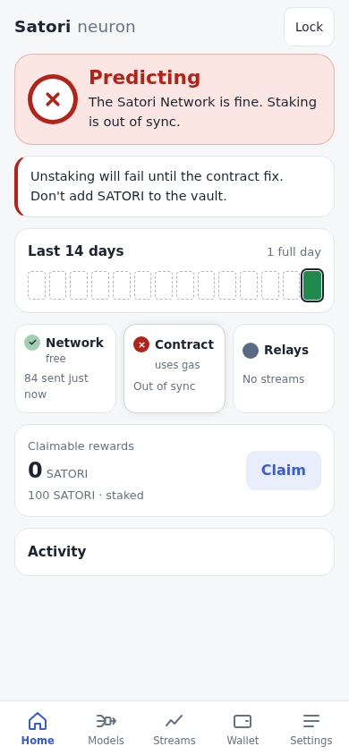 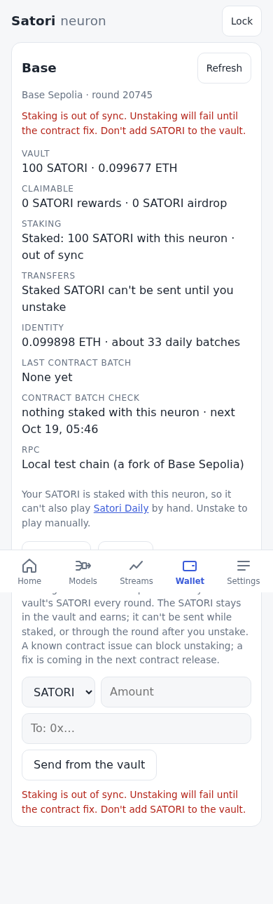

The card has no button here: the card is the highest reason with words for
it (a reason with an action has a button; this one has only what to know).

**Backup confirmed** (`meta.backup_at`) is set when the wallet's words are
confirmed in Create, given at Restore (also `setup({ walletWords })`), brought
by a Dockerized Neuron import, or shown under Backup. The wallet holds the
funds. A lost alias is replaced by a new one, and the wallet stakes with it.

An action needing the wallet (Stake and Home's Claim) opens one inline
passphrase prompt in place when the wallet is locked, does the action, then
locks the wallet again ([keys.md](keys.md#the-wallet-locks-on-its-own)). Back
up opens Settings › Backup with the passphrase asked there, as it is each
time ([keys.md](keys.md#backup)).

### Title and line

The title answers "is my neuron predicting?" across the channels that pay:
central (read from the log), and Base when it should be predicting. It holds
whichever reason leads the status, the line and the card. The first that
holds:

| Title | When |
|---|---|
| *Not predicting* | central's predictions are failing: a bad central reason (`db-error`, `login-refused`, `central-failing`, `central-overdue`) |
| *Partly predicting* | central predicts (a good cycle in the log, no bad central reason; one failed poll still counts, as for *Predicting*), but Base, which should be predicting, has a red reason (`base-failing`). Base should be predicting when the wallet is staked with this app, or when the stake is not read (its RPC down since the page loaded) and a batch went out before |
| *Starting* | no good cycle in the log yet (the rows this session read) |
| *Was asleep* | a session missed work and has not caught up: no good cycle since it began |
| *Predicting* | otherwise |

Nostr never changes the title: every relay down is red, one down is
advice, and the title stays central's and Base's. So a new neuron with a wallet mismatch
is *Starting*: amber, with the mismatch's line and card (it was
*Predicting*, from the mismatch, a central reason above `starting`). A first
poll that failed once is still *Starting*; a later one that failed once is
still *Predicting*. A failing Base batch while staked is *Partly
predicting* (it read a red *Predicting*), also while catching up after
being asleep; not staked, a red Base leaves the title to central. Once
caught up after being asleep it is *Predicting*, its status still `idle`
until the next normal cycle (sky green on Home, not grey). `src/neuron/health.test.js` checks every one of these states
(starting, asleep, caught up, predicting, retrying after a failed poll,
failing for over 12 h of open time) with every reason (a table).

The line is the top reason's short text (advice has none), after "The
Satori Network is fine." when the network channel has no reason. With no reason, or only advice, it is
"Sent 83 predictions 2 h ago · next in 9 h", or "Up to date · next in 9 h" when the last poll had nothing
new to predict and nothing to send. Words appear only when something needs
them.

## Work: what it is doing now

A wait is never silent ([../intent/ui.md](../intent/ui.md)). `src/neuron/work.js`
keeps one entry per task in progress, `{ task, step, done, total, since,
critical }` (`since`: when the step began, ms; a count ticking keeps it),
set by the code doing the work; nothing polls:

| task | step | words (Home) | critical |
|---|---|---|---|
| `central` | `register` | Signing in to the Satori Network… (only when a poll follows at once: a new neuron, or one reopened with a poll due; and in a poll that registers again first, the last register having failed) | |
| | `observations` | Fetching today's observations… (the batch, stored) | |
| | `history` | Loading history · 34 of 82 streams (the streams in hand; [central.md](central.md#history-an-addition-beyond-lite)) | |
| | `models` | Building models · 40 of 82 (the engine yields to the page between targets: the same results) | |
| | `send` | Keep Satori open · Sending 82 predictions… (the login and the batch) | yes |
| `base` | `check` | Checking today's Satori contract games… (only once a batch is due: a check with nothing to do shows nothing) | |
| | `send`, `confirm` | Sending the Satori contract batch…, Waiting for Base to confirm… (also for a batch sent before) | yes |
| `stake`, `unstake`, `send` | `send`, `confirm` (k of n), `settle` | Step 1 of 3: sending…, Step 1 of 3: waiting for Base to confirm…, Checking it on Base… | yes |
| `claim` | `rewards`, `drop`, `airdrop`, `confirm` | Claiming rewards…, Claiming the reward drop…, Claiming the airdrop…, Waiting for Base to confirm… | yes |
| `keys` | `save` | Saving your keys… (an earlier version's record, rewritten at Unlock) | yes |
| `reward` | `login`, `save`, `clear` | Signing in to the Satori Network…, Saving the reward address…, Clearing the reward address… ([central.md](central.md#the-reward-address); a read is quiet: Settings' row says it) | |
| `discover` | `ask` (relays answered) | Asking the relays · 1 of 2 | |
| | `verify` (announcements checked) | Checking the announcements' signatures · 400 of 1,061 | |
| `subscribe` | `find` | Finding the stream on the relays… | |
| `watch` | `ask` (relays answered), `verify` (announcements checked) | Finding prediction streams · asking the relays 1 of 2, Finding prediction streams · checking signatures 400 of 1,061 (the scan for prediction streams to watch, [track-record.md](track-record.md#what-is-watched); on the Streams tab's Prediction streams card, not the hero) | |
| `train` | `score` | Scoring models · 12 of 81 (the [training pass](models.md#the-training-pass): models without a current fit, from stored history; never a prediction) | |

**Critical** means closing Satori now would lose work; its words begin
"Keep Satori open · ". **On a phone** (a coarse pointer, or a screen
640 px wide or less) every step of the hero begins so (2026-10-19, the
reliability review): a phone stops a tab as soon as it leaves the screen, so
any work in progress needs it open. Only the words change: the tone stays
regular green, vivid for what is critical, and `health().work.text` (for
agents) says the step alone.

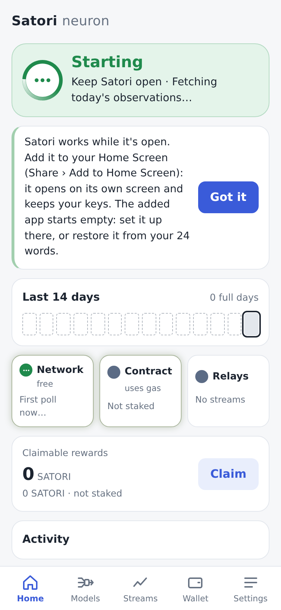 The load-time history and a poll can both hold
`central`: it ends with the last. A poll holds it from its start until the
next poll is armed (`createPoller`, with the cycle's row in the log before
that), so when the line comes back it reads "Sent 82 predictions just now ·
next in 11 h"; it never says "next now…" at rest (a recording on central2
caught that line right after the first submit). The status read for Home
also takes the schedule last, after its database reads, so a refresh that
began during a poll never writes it back as still running.
`src/neuron/neuron.test.js` checks both with fake timers at the exact
transitions.

**Home's hero** shows the hero's task: the first critical one among
`central`, `base`, `train`, the wallet's actions, `keys` and `reward`, else the first of them.
While it runs, a short arc of light turns around the ring (1.8 s a turn,
only its transform changes), the ring's icon is three dots, and the line
says the step. It is the only animation on the screen (the chips' glow is a
transition, [Traffic](#traffic)). `src/ui/hold.js` paces it: a step stays at
least 0.25 s on screen (the owner's minimum), counted from its paint (the frame that draws it, then a
task after it), not from when it was set: Home's first frame is late on a
busy page, and "Signing in to central…" read 930–946 ms; at most two wait, the next in order (so a short step that began
meanwhile still shows) and the latest (later ones take its place), so the
screen is at most about half a second behind; the same step with a new count
shows at once; the end waits at least 0.3 s and gives way to work that
comes meanwhile (register, then the poll, read as one). The hero keeps its
title and status from the health.

Elsewhere: the Models tab's status says the poll's or the Base batch's step,
the same words through its own pacer, with the still "working" mark and no
ring, so the hero's ring stays the one moving indicator
([models.md](models.md#the-engines-status-top-of-the-tab)); it uses the same
tones, amber only when the engine itself failed. The Wallet card's line says the wallet's action step (the hero is
on Home only); Home's Stake and Claim buttons say "Staking…",
"Claiming…"; the Wallet's Unstake says "Unstaking…". The Network streams line says discover's or subscribe's step,
only once it has lasted 1 s; the Prediction streams card's line says the
watch scan's. Settings › Reward address's line says its step, and its buttons "Saving…", "Clearing…".

**Reduced motion**: nothing turns; the three dots stay in the ring, and the
words change.

**Agents**: `health().work` is the entry that leads (a critical one, else
the first of central, base, the wallet's actions, keys, reward, discover, subscribe, watch)
with its `text`, or null; the hero has `data-work` (`central:history`) and
`aria-busy` while it shows a step.

## The tone: three greens

The colour Home shows. Green while all is well, on one scale; grey only for
what is deliberately off. `health().tone` and each `channels[x].tone`:

| tone | colour | when |
|---|---|---|
| `working` | regular green (`--ok`) | working as expected: signing in, fetching, history, models; starting and catching up are working |
| `critical` | vivid green (`--vivid`), "Keep Satori open · …" | closing now would lose work (the critical steps above) |
| `idle` | sky green (`--sky`) | all good, nothing to do, waiting for the next cycle |
| `warn`, `bad` | amber, red | something is wrong for predicting or earning; they win over every green (advice never does: it is not a status) |
| `off` | grey | a channel deliberately not used (Base not staked here, no stream subscribed or watched), and the strip's closed days; never the hero |

`toneOf(status, work)`: `warn` and `bad` from the status; else `critical`
or `working` while the hero's task runs; else `idle`. A chip: its state's
`warn` or `bad` (an `advice` state is green); `working` while its channel has work in progress (central's
poll; Base's batch and the wallet's actions; the network's discover,
subscribe and watch scan) or is connecting; `off` as above; else `idle`.

**The greens**, worked out in OKLCH from `--ok` (the comment in
`src/style.css`): **sky** is to `--ok` as sky blue is to blue (oklch(0.55
0.20 260) → oklch(0.80 0.10 235)): lightness × 0.80/0.55, chroma × 0.5, the
hue kept: oklch(0.814 0.067 152.5); in dark mode the same step toward white
(0.25/0.45 of the way), oklch(0.900 0.070 155.8), a calm light-on-dark
tint. **Vivid** is brighter along chroma, not lighter: `--ok`'s lightness,
as much chroma as sRGB holds up to the inverse of sky's ratio. sRGB has
almost none left at our hue and lightness (0.146 against 0.134), so the hue
leans 6.5° toward the green primary: oklch(0.560 0.166 146.0), chroma ×
1.24; dark oklch(0.775 0.211 149.3), × 1.50. Each has its fill; sky, too
light to read on a light page, has an ink for text and the ring's icon
(sky's chroma at `--ok`'s lightness) and dark icons on its discs.
`src/style.test.js` checks the derivation and 3:1 for each title on its
fill and on a card, and each icon on its disc, light and dark.

**The fade**: the hero's colours are registered (`@property --hero-tone`,
`--hero-soft`, `--hero-ink`), so they move: to green within 300 ms when work
starts (vivid when it is critical), and to amber or red in 300 ms. At rest
only a number moves, `--hero-rest` from 0 to 1, and the colours are mixed
from the tone before (`data-from`, set by `main.js`) toward sky: over
2.5 min, linear, after work (barely seen while watching), else in 300 ms.
The mix reads the current theme's tokens, so a theme change (the system's,
or Settings → Appearance) shows at once, mid-fade too. It used to fade the
colours themselves, so a theme change mid-fade kept the old theme's fill
under the new theme's text until the fade ended ("Sent 82…" unreadable on
dark). `e2e/work.spec.js` switches the theme half way through the fade,
both ways, and checks the line (4.5:1) and the title (3:1) on the fill.

 

## The channels (chips)

Each is `{ state: ok | warn | bad | idle | advice, tone, text }`, the state
from the reasons above (a channel's top reason with chip words, at its
level), the tone from [the tone](#the-tone-three-greens) (the chip's
colour and icon: a check on sky, three dots while working, a plain grey
disc when off: a moon there was not read as "not used",
[OVERVIEW](OVERVIEW.md#icons)).

Home shows them as **Network** · free, **Contract** · uses gas, and
**Relays** (`data-channel`: `network`, `contract`, `relays`; a tap opens
Streams, Wallet, Streams). Their traffic channels in `src/traffic.js` keep
the code's names (`central`, `base`, `network`: `TRAFFIC` and `CHIP_OF` in
health.js map them).

- **Network** (the Satori Network): ok "83 sent 2 h ago", or "Up to date · next in 9 h" when
  the last poll had nothing to send (never "0 sent"); idle "First poll now…",
  "Catching up now…" (while the poll runs; "Catching up soon" when due and
  not yet running, "… in 2 h" when a poll is still ahead); warn "Sending failed",
  "Unreachable", "Poll failed", "Wallet mismatch", "Not registered"; bad
  "Database error", "Login refused", the same failure words once they span
  12 h of open time, "Nothing sent for 14 h".
- **Contract** (the Satori contract): ok "Round 20742 sent", "Round 20742 due"; idle "Not staked"
  (off: with SATORI too, since staking is advice), "Staked elsewhere", "No SATORI staked", "Connecting…"; note
  "Unreachable" (off, grey: the contract unused); warn
  "Gas: 3 batches", "Skipped: …", "Batch stuck", "Unreachable" (in use); bad "Failed 3
  times", "Out of sync".
- **Relays** (the Satori relays): idle "No streams" (nothing subscribed or watched); ok "2 relays" (a blocked one is not
  counted); advice "1 of 2 relays down" (sky, or green while working); bad "Relays down". A
  relay that is connecting, or reconnecting within 10 min, counts as up.
  **Watching** (2026-10-20, [track-record.md](track-record.md#home)): with
  nothing subscribed but prediction streams watched (`nostr().watching.streams`),
  ok "Watching 112" (sky; green while the watch scan runs). Watching is use
  of the relays, so it is not "off"; but it predicts nothing, so it never
  colours the hero: with every relay down for 10 min the chip alone says
  "Relays down" in amber (no reason, no card), and Home's answer stays what
  the predicting says. With subscriptions the chip is as above.

### The contract unused

Not staked with this app and no batch ever sent: nothing is predicted or
earned on the Satori contract, so its RPC's trouble is not Home's
(the reliability review, 2026-10-19: an RPC error turned Home amber with
nothing staked). The error stays on the Contract chip as a grey note,
"Unreachable" (`base-unused-unreachable`, level `note`); the Wallet card
still says "The chain did not answer: …". The batch check that fails then is
marked `unused` in the activity log: logged calm (`idle`), "Couldn't reach
the Satori contract (not staked): …", and the day strip does not count it as
a failure. Once staked, or once a batch went out, the same error is
`base-unreachable` (amber) and, twice in a row, `base-failing` (red).

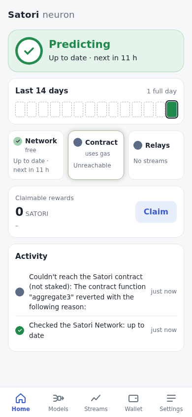

### Relays: blocked and reconnecting

- **Blocked**: a `ws://` relay on an https page, or anywhere in a build
  (its CSP has no `ws:`), that has no wss stand-in can never open there.
  Central's `ws://satorian…` has one, `wss://relay.satorinet.io`
  ([nostr.md](nostr.md#relays-and-the-read-only-flag)): it is reached there
  and counted like any relay, so it is not blocked.
  It is neither down nor counted: not toward "1 of 2 relays down", not in "2
  relays", not in the Streams card's "1 of 1 relay connected". Settings ›
  Satori relays says it once, under the list: "A ws:// relay can't be
  reached from this page (only wss:// can), so it is left out: it doesn't
  count as down." (`relays-blocked`); its own line reads
  "Not reachable here". Only blocked relays left: none can carry the
  streams, so it is "Relays down".
- **Reconnecting**: a relay counts as down only once it has not been open
  for 10 minutes (`RELAY_GRACE_S`; `src/nostr/relay.js` keeps `downSince`,
  from its first try or its last drop, through every reconnect; `nostr()`'s
  relays carry it). Its backoff reaches 5 min, so a relay that drops and
  comes back is never red; one that stays away is, 10 min on.

### A batch that never mines

A Base batch sent and not mined for 10 min is looked at again
([base.md](base.md#a-batch-that-never-mines)). While it is sent again with a
higher fee, Home is amber: "The Satori contract batch is stuck; retrying
with a higher fee." (the Contract chip "Batch stuck", the card: "…not mined
for 10 min, so it was sent again with a higher fee (0.00125 gwei), within
the max fee. It keeps checking."). Past the max fee it is not sent again:
"The Satori contract batch is stuck: a higher fee (2.5 gwei) would pass the
max fee (2 gwei), so it waits. Raise the max fee in Settings." with Open
Settings. The log keeps each ("Satori contract batch stuck: sent again with
a higher fee (…)"), amber in the feed and a failure on the strip; mined, it
is the round's batch and Home is green again.

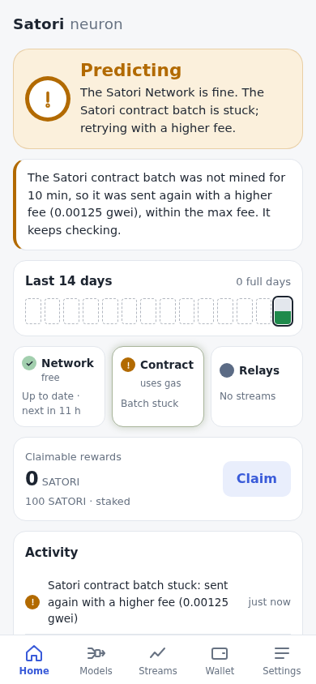

## Traffic

Each chip also glows, faintly, while its channel has real traffic: a
request to central or its answer (`src/central`'s fetch), a Base RPC call or
its answer (base.js traces its viem transport) or a relay message sent or
received (`src/nostr/relay.js`). They call one emitter (`src/traffic.js`),
which Home subscribes to; nothing polls. `health().channels[x].lastTraffic`
is that channel's last traffic in ms, or null.

- **Colour:** `--live` and `--live-glow`, a low-saturation earth green:
  faint on light, dark and subtle on dark, apart from `--ok`. The status's colour and icon never
  change with it, and it is never a call to act.
- **Motion** (`src/ui/glow.js`): a burst is one style update in the next
  frame (one per card at most), then the glow holds until 1.5 s after the
  last message (one timer that re-arms itself) and fades out in 600 ms; it
  fades in over 150 ms. Only an overlay's opacity changes (`.chan::after`),
  so nothing is laid out again.
- **`prefers-reduced-motion`:** no fades: a still, faint tint while traffic
  was within the last 3 s.
- Only the three chips glow: on a computer the Streams and Wallet tiles do
  not map one to one (Network has no tile, and Streams holds central's and
  the relays').

 

Close up (live on central2, a poll):

 

## The last visit

A revisit waits seconds for DuckDB and the neuron (11 s on Slow 4G with a
phone's CPU, [storage.md](storage.md#the-first-visit)). Meanwhile Home
shows the **last visit's** at once: a small snapshot of the last health
(`snapshotOf`, `src/ui/prefs.js`: the title, the status and tone, the line,
the day strip, the chips' words, the feed, and the claimable rewards, the
wallet and the gas; never the card, whose buttons need the neuron, the work,
or keys), kept in `localStorage` (`satori-home`, read and written in
try/catch; storage blocked: no snapshot) at most every 10 s while Home's
health changes, and when the page is hidden or left.

- Only on Home's route; another tab's shows "Opening…" with the step.
- **Marked**: the hero says "From your last visit, 2 h ago", the rest of
  Home is faded, the ring turns and the line says the step ("Opening…
  downloading the engine, 1.2 of 5.1 MB", "starting the engine…", "opening
  the database…", "starting the app…"). No tab bar and no card yet; the
  chips and Claim do nothing.
- The neuron's own Home replaces it as soon as it starts; for agents
  `<body data-screen>` stays `loading` until then.

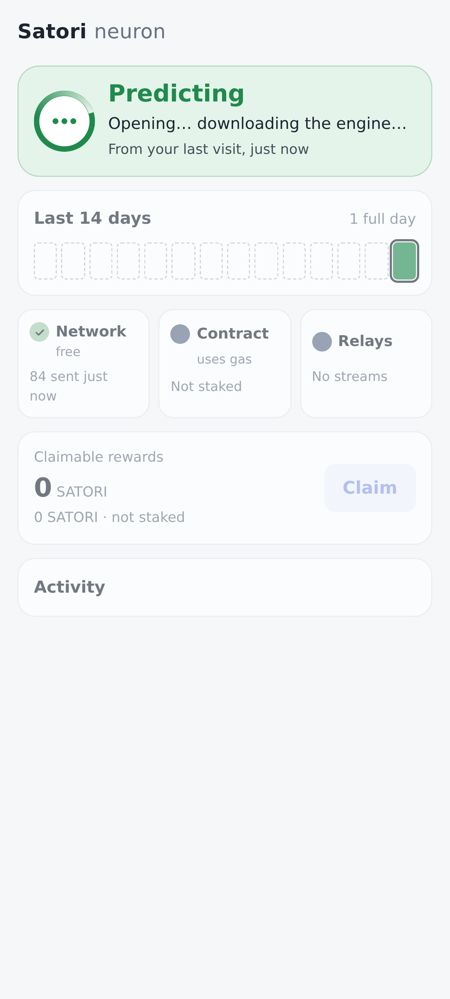

## The day strip

Local days, newest last: 14 on the phone, 30 on a computer (`health().days`
has 30). For each day, the log's outcomes per channel (a merged row counts
on every day from `at` to `until`):

- a success: a good central cycle, a Base batch sent, a `_pred` published;
- a failure: a failed central cycle, a Base error (not one marked `unused`:
  the contract not used, [above](#the-contract-unused)), a fixable skip or a
  stuck batch, an engine or database error.

| Code | Means |
|---|---|
| `full` | predictions went out on every active channel that day (each channel with a failure also had a success) |
| `part` | some channels |
| `error` | only failures |
| `closed` | nothing went out and nothing failed: the app never ran that day (`ran: false`), or ran with nothing due |
| `before` | the day ended before the neuron began: an empty outlined cell, "Before this app", not a closed day |

The neuron began at its first session in the log (`activity.first()`, read
from the whole log, not only the rows loaded), or when its keys were made
(the record's `created`, [keys.md](keys.md#the-record)) when that is earlier.
Records from before `created` have only the log.

Today has an outline. Each day is `{ date: 'YYYY-MM-DD', code, ran, today }`.
The summary counts the neuron's own days: "12 of 14 full days"; a neuron
younger than the strip, "1 full day" on its first day, then "2 of 3 full
days". The legend shows "Before this app" only while such a day is shown.

## Address changes

The security review (2026-10-19): whoever changes the Satori Network's
address or the Base RPC chooses whom the neuron trusts for its data, its
balances and its transactions' fees, and whoever changes the reward address
where its rewards go; a browser extension or a misled
agent can do it through `window.satori` as well as Settings. So each change
is a `setting` row (only a real change: saving the same address is none),
and Home shows a quiet line under the hero's for 24 h (`NOTICE_S`), newest
first, with how long ago:

- "Satori Network address changed to https://central.example · 2 h ago"
  ("… changed to the default, https://network.satorinet.io" when emptied);
- "Base RPC changed to https://rpc.example" ("… changed to the default,
  https://sepolia.base.org");
- "Reward address set to 0x3a91ecc0dde5bfea5773345D5f61c894bc84B6E7" (the
  whole address, so a swap is seen), "Reward address cleared: rewards go to
  your wallet" ([central.md](central.md#the-reward-address)).

It never changes the status, the tone, the card or the day strip.
`health().notices` is the same, `[{ at, what, text }]`; the feed keeps the
rows for 90 days.

## The feed

The log, newest first, 20 rows: `{ at, level, text }`. "Sent 83 predictions
to the Satori Network", "Checked the Satori Network: up to date" (nothing
to send), "Caught up: sent 83 predictions" ("Caught up: up to date"), "The
Satori Network refused the batch: Satori Network 401: Invalid signature",
"Satori contract batch for round 20742: 1 game", "Satori contract batch
skipped: gas above the ceiling (×3)", "Published 3 forecasts to the Satori
relays", "Satori was closed for 2 d", "Staked with this app",
"Satori Network address changed to https://central.example", "The Satori
Network's contract addresses differ from the app's (token): the app's are
used". A session that missed nothing is not shown.

## Verify

- `src/neuron/work.test.js` and `src/ui/hold.test.js` (fake timers): the
  work state's transitions (holders, steps, counts, critical, the leading
  entry) and its words; the pace (a step held 0.25 s from its paint, counts at
  once, the next in order and the latest, the end's grace, the network's
  delay).
  `src/neuron/health.test.js`: the chips' tones (the hero's: the table
  below);
  `src/style.test.js`: the greens' derivation and contrast.
- `e2e/work.spec.js`: a new neuron against the stub central: the turning
  ring as the only animation, at least three steps in order, each at least a
  second on screen, the history count ticking, working green, vivid while
  sending, then Predicting in sky green fading over 2.5 min; Poll now back to
  green; a theme change half way through the fade, readable at once (the
  system's light to dark, Settings' dark to light); reduced motion: no animation, the dots; random keys with storage
  not kept (the backup is advice): working, vivid, then sky, never amber,
  with the Back up card (it read amber from the start).
- `src/neuron/health.test.js`: every status and every reason from
  fabricated logs, each reason's level (`LEVEL`), the action priority, and
  a table of every title-defining state (starting, asleep, caught up,
  predicting, retrying, failing) with every reason → the title, the status,
  the tone (with no work, working and critical) and the card; an advice
  reason leaves the title, the status, the tone and the line as they were.
  Also *Partly predicting* (Base staked, or not read, and red), open time and missed work, the day codes, the chips and the feed.
- `src/traffic.test.js` and `src/ui/glow.test.js`: the emitter, a traced
  transport, a burst as one update, the hold after the last message, cards
  apart, reduced motion; central's, the relay's and Base's emits in their
  tests.
- `src/neuron/activity.test.js`: sessions and their heartbeat, a wake after
  sleep, merges, the 90-day prune, caught up, the log's first session.
  `src/db/db.test.js`: the table. `src/ui/format.test.js`: the strip's
  summary.
- `src/neuron/neuron.test.js`: the retries (2, 10, 30 min, then 11 h; a
  success resets them; kept over a reload; `online` at once).
- `e2e/home.spec.js`: the four states in Chrome with the stub central and a
  fake chain (idle from a seeded log); the send failing twice (a poll, then
  Try again minutes later) and then taken: amber, amber, green, never red
  (a MutationObserver on the hero), then a refused login red; a register
  that fails twice, then succeeds before a later poll; a new neuron (29 days before it,
  "0 full days", then "1 full day"); a new neuron with a wallet mismatch
  (*Starting* in `health()` and on Home, the mismatch's card; *Predicting*
  after the first poll); a chip glowing while central's stub serves a poll
  and fading after, `lastTraffic`, reduced motion still; and the screenshots below.

## Live

2026-10-19, after the review's last three fixes, the restarted dev server on
:5180 against central2, fresh profiles, no stubs, nothing to prod: setup to
84 of 84 accepted in 14.6 s (54,869 history rows), *Predicting*, Settings'
"Version browser-0.1.0+223cef2"
([phone](../screenshots/live-final-phone.png)); on another, Base RPC set to
`/rpc` and back: two quiet notes under the hero, newest first, the status
untouched; Stake on the fork refused above a 0.0001 gwei max fee, then sent;
the alias's batch for round 20745
([computer](../screenshots/live-home-hardening.png)).

2026-10-17, the dev server on :5180 against central2, a fresh browser
profile, no stubs: Create (the words confirmed) → Home *Starting* ("First
predictions in 18 min", every chip idle) → Poll now: 82 streams, central's
history for all 82 (81 on bvar), 82 of 82 accepted → *Predicting*, "Sent 82
predictions just now · next in 11 h"; Base idle (a new wallet, no SATORI),
Network idle (nothing subscribed); nothing sent to prod.

Again after the day strip's `before` (2026-10-17 01:55, a fresh profile, set
up with new random words): *Starting* with 29 outlined days ("Sep 18: Before
this neuron") and today, "0 full days"; Poll now, 13 s: 82 of 82 accepted,
today full, "1 full day" on the phone and the computer; nothing sent to prod.


The title with a reason above `starting` (2026-10-17 14:40, two fresh
profiles on central2 sharing one new wallet): the second registers with
`wallet_address` null, so before its first poll Home is amber with the
mismatch's card and reads *Starting*, "Central has no wallet for this
neuron." (it read *Predicting*); `health()` says the same.

 

Nothing to send (2026-10-17 16:59, a fresh profile on central2): after the
first poll (82 of 82 accepted), Poll now with nothing new: the line and the
Central chip read "Up to date · next in 11 h" (they read "0 sent just now"
and "Polled central just now, nothing new"), the feed "Polled central: up
to date".


Never a silent wait (2026-10-17 21:09 UTC, the dev server on :5180
restarted, a fresh Chrome profile on OPFS, central2's 82 streams, no
stubs), the hero from `satori.setup()`:

| s | hero | tone |
|---|---|---|
| 0.5 | Signing in to central… | working |
| 1.5 | Fetching today's observations… | working |
| 2.5 | Loading history · 14 of 82 streams, ticking to 82 of 82 at 5.0 | working |
| 5.4 | Building models · 0 of 82, 82 of 82 at 6.0 | working |
| 6.3 | Keep Satori open · Sending 82 predictions… | critical |
| 8.1 | *Predicting* · Sent 82 predictions just now · next in 11 h | idle (fading to sky) |

It took 17–19 s on this box before (the owner saw about 30 s): storing the
batch 2.0 s → 0.1 s, history 7–10 s (+ 1 s of screen refresh) → 3.8–4.4 s,
the specs and predictions 1.9–2.3 s → 0.1 s ([storage.md](storage.md#the-checkpoint-rule)).


The backup reminder as advice (2026-10-17 21:42 UTC, the dev server on
:5180 restarted, a fresh Chrome profile on disk, central2's 82 streams, no
stubs): `satori.setup()` with random words (no backup confirmed) and
storage not kept (`persisted: false`). The hero, sampled every 250 ms (it
read amber, `warn`, "Central is fine. Back up your keys.", from the first
step to rest):

| s | title | tone | line | card |
|---|---|---|---|---|
| 0.5 | *Starting* | working | Signing in to central… | Back up (from 0.75 s) |
| 1.8 | *Starting* | working | Fetching today's observations… | Back up |
| 2.8 | *Starting* | working | Loading history · 4 of 82 streams, ticking to 82 of 82 at 5.8 | Back up |
| 6.0 | *Starting* | working | Building models · 0 of 82, 82 of 82 at 6.8 | Back up |
| 7.0 | *Starting* | critical | Keep Satori open · Sending 82 predictions… | Back up |
| 9.3 | *Predicting* | idle (fading to sky) | Sent 82 predictions just now · next in 11 h | Back up |

82 of 82 accepted; `health()`: `ok`, `idle`, reasons `backup:advice`;
nothing sent to prod.


Fixes 4–7 of the review, live (2026-10-19 09:42 UTC, the dev server on
:5180 restarted, a fresh Chrome profile as a phone (390 × 844, touch),
central2 for real, Base on the local fork; nothing sent to prod): Setup on
screen at 2.6 s, saying "Satori works while it's open. Leave it open, or
install it, and it predicts on its own."; the first poll 84 of 84
accepted in 15.9 s, every hero step on the phone beginning "Keep Satori
open · " (Signing in, Fetching today's observations, Loading history · 2 of
84 … 84 of 84, Building models, Sending 84 predictions); Unlock: "Locks in
5 min"; `backup('wallet')` and `send()` without the passphrase refused, with
it 24 words and a send; the Wallet's review ("0.001 ETH", the recipient in
full, "about 0.000021 ETH"), then Sent; the zero address refused; the RPC
broken while unstaked: Home green, the Contract chip "Unreachable" in grey
(`base-unused-unreachable`, note); the revisit: the last visit's Home at
2.4 s ("From your last visit, just now", "Opening… downloading the
engine…"), live at 8.2 s.

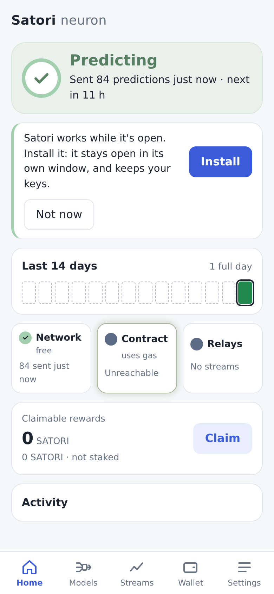 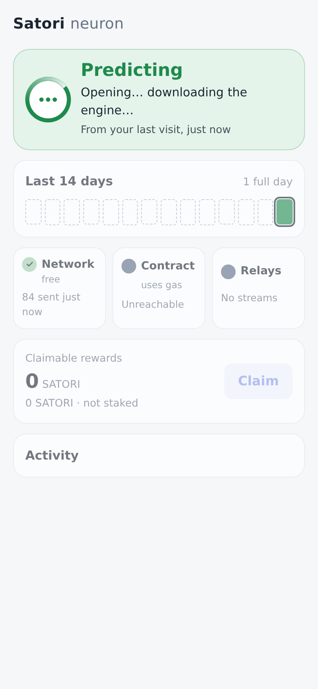

## Screenshots

What it is doing, and the three greens (`e2e/work.spec.js`, `SHOTS=1`): working
(Loading history), critical (Keep Satori open · Sending), at rest (sky),
light and dark:

  

  

From `e2e/home.spec.js` (`SHOTS=1 npx playwright test e2e/home.spec.js`):
each state on a phone (390 × 844, the first screen) and a computer (1280
wide), light and dark, `docs/screenshots/home-<state>-<phone|desktop>-<light|dark>.png`
for `ok`, `idle`, `warn` and `bad`, and `new` (a new neuron's first day).

   

The Stake card, advice (the hero stays green; the risk said before staking):

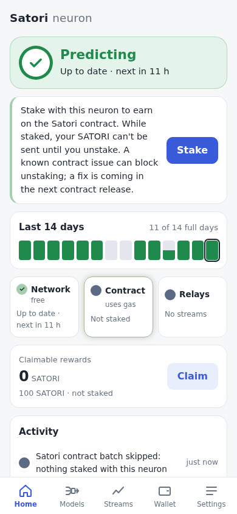

A failed send, retried (`e2e/home.spec.js`, the second failure minutes
after the first: amber, "Sending failed; next try in 10 min."; it was red):

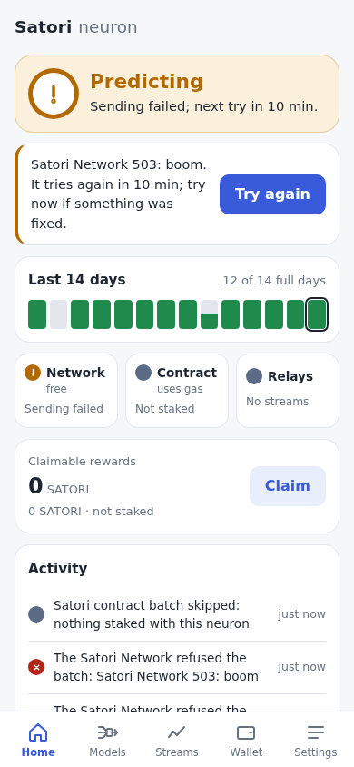 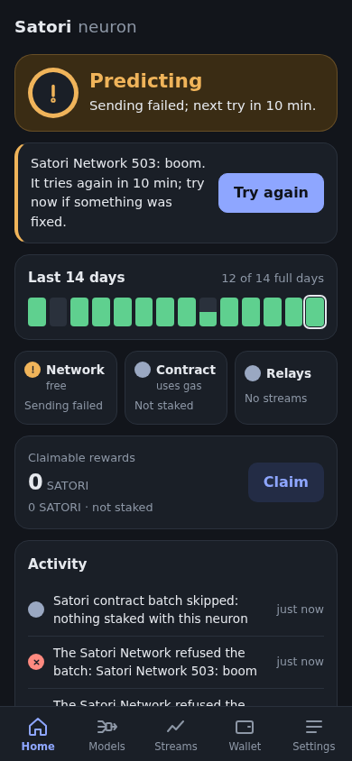


*Partly predicting* (the e2e's fake chain with its RPC aborted after
staking: the batch check failed twice while central is fine; it read a
red *Predicting*):

 

A new neuron after its first poll: the days before it are empty outlines,
not closed days.

 
