# Health: is my neuron predicting, and is anything broken?

[← OVERVIEW](OVERVIEW.md) · intent: [../intent/ui.md](../intent/ui.md) · the approved
mockup: [home-mockup.html](home-mockup.html)

Home answers one question at a glance: is the neuron predicting every day on
its own, and is anything broken? A browser neuron only runs while Satori is
open, so being closed is normal and never shows as an error. The answer is
built from two things:

- an **activity log**: what the neuron did, kept in the database;
- the **current state**: central's, Base's and the relays' status, the
  storage and the install state, as the rest of the app already reads them.

`src/neuron/health.js` turns both into one object (pure, unit-tested with
fabricated logs), with what the neuron is doing right now
([Work](#work-what-it-is-doing-now)) and the colour it shows
([the tone](#the-tone-three-greens)). Home draws it, and agents read the same object:
`window.satori.health()` → `{ status, tone, title, line, action, days, channels, feed, reasons, work }`.

This is local to the browser. Nothing new goes over the network, and Satori
Lite has no counterpart to follow: its dashboard shows raw state. The rules
reuse Lite's 11 h poll for their thresholds. The first poll runs at once
(no start jitter, [central.md](central.md#deviations-from-satori-lite-and-why)).

## The activity log

Migration 8 adds one table ([storage.md](storage.md#migrations)):

```
activity (id, at, until, kind, level, data, count, mkey)
```

`at` is when it happened (unix seconds). `until` is when a merged row last
changed (a session's heartbeat, a repeated failure). `level` is the feed's
icon: `ok`, `warn`, `bad` or `idle`. `data` is JSON. `count` is how many
identical events a row stands for, and `mkey` is the key they were merged on.
Rows older than 90 days are deleted at start and once a day.

| kind | level | data | when |
|---|---|---|---|
| `open` | `ok`, or `idle` when work was missed | `{ gap, missed }` | each page load, and each wake after the page did not run for 15 min (a closed lid, a frozen tab). `until` is a heartbeat, every 5 min |
| `central` | `ok` / `bad` | `{ streams, new, predicted, sent, accepted, pending, error?, login?, local?, caughtUp? }` | each cycle (poll and submit). `local`: the database or the engine failed, not central. `login`: central refused the login. `caughtUp`: the first good cycle after a session that missed work (the closed time, in seconds) |
| `history` | `ok` / `warn` | `{ streams, rows, error? }` | a history run that loaded streams or failed (not a central without the route) |
| `base` | `ok` sent, `warn` fixable skip, `idle` other skip, `bad` error | `{ round, hash?, games?, dropped?, skipped?, error? }` | each batch check that sent, skipped or failed, except "already predicted" and "waiting for the batch already sent". The same skip or error again is merged into its row (`count`, `until`) |
| `nostr` | `ok` | `{ published }` | each `_pred` a relay took, merged per hour |
| `wallet` | `ok` | `{ action, text }` | Stake, Unstake, Claim, Send |
| `error` | `bad` | `{ where, message }` | an engine or database failure outside central's cycle (a relay stream's intake) |

Times, in `src/neuron/health.js`:

| Name | Value | Meaning |
|---|---|---|
| `CADENCE_S` | 11 h | Lite's poll interval |
| `GRACE_S` | 1 h | slack for a slow cycle or a throttled tab |
| `WINDOW_S` | 12 h | `CADENCE_S + GRACE_S`: the open time a good cycle may take after the last one |
| `FIRST_S` | 1 h | `GRACE_S`: the open time the first good cycle may take (it polls at once) |
| `HEARTBEAT_S` | 5 min | how often a session's `until` moves |
| `SLEEP_S` | 15 min | a heartbeat this late means the page did not run: a new session |

**Open time** is the time covered by the sessions (`open` rows, `at` to
`until`; the current one runs to now). Only open time counts against the
neuron: two days closed is not two days late.

A **good cycle** is a `central` row with no error that either had central
accept predictions or had nothing to send. A **failed cycle** is any other
`central` row.

A session **missed work** when a poll came due while Satori was not running:
the last good cycle before it, plus `CADENCE_S`, falls outside every session
and before this one (`missedBy`). The open row records it (`missed`, and
`gap`: how long it was closed).

## The status

There is exactly one status. Each thing worth saying is a **reason**, at one
of four levels, and the status is the worst `bad`, `warn` or `idle` one:
`bad` > `warn` > `idle` > `ok`. An `advice` reason never moves it.

- **ok** (predicting): central took predictions within `WINDOW_S` of open
  time. If the vault is staked, Base has this round's batch or its
  check has not run yet. No channel is in error.
- **idle**: not predicting right now, for a calm reason. It is never red,
  and on Home never grey either: it is green, by [the tone](#the-tone-three-greens)
  (working while it starts or catches up, sky at rest).
  - *Was asleep*: a session missed work. It catches up at once on open
    ("Catching up now…") and shows until the next normal cycle, which is the second
    good cycle after that session (the title says *Predicting* once it
    caught up).
  - *Starting*: a new neuron before its first good cycle, within `FIRST_S`:
    "Getting its first predictions…" (it polls at once, after register).
- **warn** (needs you, amber): predictions go out, but something is wrong or
  needs fixing for predicting or earning.
- **bad** (problem, red): predictions are failing.

**Advice** is a reason's level, not a status: nothing is wrong with the
neuron, but there is a good thing to do (back up the keys; install). It
never changes the status, the tone, the title or the line, so the hero
stays regular, vivid or sky green. It is offered as the action card when no
warn or bad reason has a button, and it may give its channel's chip its
words (in a green tone).

Advice is never in the hero's line, which is the cleaner of the two
options: while the neuron works the line says the step, and at rest it says
"Sent 82 predictions just now · next in 11 h", the answer to "is it
predicting?". The card right under the hero carries the suggestion. A
gentle line ("Back up your keys when you can") would repeat the card and
push out the neuron's own news.

### Reasons, in priority order

The action card shows the highest one that has an action, so there is at
most one card. Its button does the thing, or goes to the place it is done.
The order is by level (`LEVEL` in `src/neuron/health.js`), so advice owns
the card only when no warn or bad reason is present (each of those has a
button).

| # | Reason | Level | Why this level | Channel | When | Button |
|---|---|---|---|---|---|---|
| 1 | `db-error` | bad | nothing is stored or forecast, so nothing goes out | central | the last cycle failed locally (the database or the engine) | Reload |
| 2 | `login-refused` | bad | central takes nothing from this neuron until it is fixed | central | the last cycle's login was refused (after its one retry) | Open Settings (central) |
| 3 | `central-failing` | bad | two cycles in a row sent nothing: predictions are failing | central | the last 2 cycles failed | Try again (a poll) |
| 4 | `central-overdue` | bad | nothing went out for a whole cycle of open time | central | no good cycle within `WINDOW_S` of open time (`FIRST_S` with none yet) | Poll now |
| 5 | `base-failing` | bad | the paying Base batch keeps failing: each round's earning is lost | base | the batch check failed twice in a row while Base is in use (staked, or a batch sent before) | Open Settings (Base) |
| 6 | `relays-down` | bad | the streams the person subscribed are not predicted at all | network | streams are subscribed and every relay is down | Open Settings (relays) |
| 7 | `central-failed` | warn | one cycle sent nothing; it retries on its own, but something may need fixing | central | the last cycle failed (once) | Try again |
| 8 | `vault-mismatch` | warn | central pays this vault's rewards to another address, or to none: earning lost | central | register's `vault_base_address` is another Base address than this vault's (the card shows both), or null (central has no vault for this identity); not when a central does not send it | Open Settings (keys) |
| 9 | `not-registered` | warn | central may not count or pay this neuron until it registers | central | registering failed | Reload |
| 10 | `stake` | warn | the vault's SATORI earns nothing on Base until it is staked (with no SATORI there is no reason: the Base chip is off, grey) | base | not staked, and the vault holds SATORI: "Your vault's SATORI isn't earning on Base. Stake with this neuron." | Stake |
| 11 | `gas-low` | warn | under 7 days of batches left, then Base earning stops; only the person can add ETH | base | staked, and the identity's ETH pays for under 7 batches | Add gas (Wallet) |
| 12 | `base-skipped` | warn | this round's Base batch, and its earning, is lost unless it is fixed | base | staked, and this round's check skipped for a fixable reason (the gas ceiling; no game passed its simulation) | Open Settings (Base) / Open Wallet |
| 13 | `base-unreachable` | warn | the Base batch and the wallet can't be read or sent while the chain does not answer | base | the chain did not answer | Open Settings (Base) |
| 14 | `asleep` | idle | not a problem: it catches up on its own; a calm state the title names | central | *Was asleep* (above) | none |
| 15 | `starting` | idle | not a problem: its first poll runs at once; a calm state the title names | central | *Starting* (above) | none |
| 16 | `backup` | advice | nothing is wrong: the browser may clear storage some day, and a backup protects the vault | – | storage is not persistent and no backup is confirmed | Back up |
| 17 | `install` | advice | nothing is wrong now: installed, Satori stays open in its own window and misses less | – | *Was asleep*, and the browser offers Install | Install |
| 18 | `relay-down` | advice | another relay still carries the predictions and it keeps retrying; the network is not paid | network | streams are subscribed and some relay, not all, is down | Open Settings (relays) |

`asleep` and `starting` are neither warn nor advice: they are the calm
states the title names (*Was asleep*, *Starting*), their line says what the
neuron is doing, and they have no button. They keep the status `idle`,
green on Home. The Install suggestion that `asleep` carried is its own
advice reason now, `install`, so each reason has one level.

**Backup confirmed** (`meta.backup_at`) is set when the vault's words are
confirmed in Create, given at Restore (also `setup({ vaultWords })`), brought
by a Dockerized Neuron import, or shown under Backup. The vault holds the
funds. A lost identity is replaced by a new one, and the vault stakes with it.

An action needing the vault (Stake, Back up, and Home's Claim) opens one
inline passphrase prompt in place when the vault is locked, then does the
action.

### Title and line

The title answers "is my neuron predicting?" across the channels that pay:
central (read from the log), and Base when it should be predicting. It holds
whichever reason leads the status, the line and the card. The first that
holds:

| Title | When |
|---|---|
| *Not predicting* | central's predictions are failing: a bad central reason (`db-error`, `login-refused`, `central-failing`, `central-overdue`) |
| *Partly predicting* | central predicts (a good cycle in the log, no bad central reason; one failed poll still counts, as for *Predicting*), but Base, which should be predicting, has a red reason (`base-failing`). Base should be predicting when the vault is staked with this neuron, or when the stake is not read (its RPC down since the page loaded) and a batch went out before |
| *Starting* | no good cycle in the log yet (the rows this session read) |
| *Was asleep* | a session missed work and has not caught up: no good cycle since it began |
| *Predicting* | otherwise |

Nostr never changes the title: every relay down is red, one down is
advice, and the title stays central's and Base's. So a new neuron with a vault mismatch
is *Starting*: amber, with the mismatch's line and card (it was
*Predicting*, from the mismatch, a central reason above `starting`). A first
poll that failed once is still *Starting*; a later one that failed once is
still *Predicting*. A failing Base batch while staked is *Partly
predicting* (it read a red *Predicting*), also while catching up after
being asleep; not staked, a red Base leaves the title to central. Once
caught up after being asleep it is *Predicting*, its status still `idle`
until the next normal cycle (sky green on Home, not grey). `src/neuron/health.test.js` checks every one of these states
(starting, asleep, caught up, predicting, retrying after one failed poll,
failing) with every reason (a table).

The line is the top reason's short text (advice has none), after "Central
is fine." when central has no reason. With no reason, or only advice, it is
"Sent 83 predictions 2 h ago · next in 9 h", or "Up to date · next in 9 h" when the last poll had nothing
new to predict and nothing to send. Words appear only when something needs
them.

## Work: what it is doing now

A wait is never silent ([../intent/ui.md](../intent/ui.md)). `src/neuron/work.js`
keeps one entry per task in progress, `{ task, step, done, total, since,
critical }` (`since`: when the step began, ms; a count ticking keeps it),
set by the code doing the work; nothing polls:

| task | step | words (Home) | critical |
|---|---|---|---|
| `central` | `register` | Signing in to central… (only when a poll follows at once: a new neuron, or one reopened with a poll due) | |
| | `observations` | Fetching today's observations… (the batch, stored) | |
| | `history` | Loading history · 34 of 82 streams (the streams in hand; [central.md](central.md#history-an-addition-beyond-lite)) | |
| | `models` | Building models · 40 of 82 (the engine yields to the page between targets: the same results) | |
| | `send` | Keep Satori open · Sending 82 predictions… (the login and the batch) | yes |
| `base` | `check` | Checking today's Base games… (only once a batch is due: a check with nothing to do shows nothing) | |
| | `send`, `confirm` | Sending the Base batch…, Waiting for Base to confirm… (also for a batch sent before) | yes |
| `stake`, `unstake`, `send` | `send`, `confirm` (k of n), `settle` | Step 1 of 3: sending…, Step 1 of 3: waiting for Base to confirm…, Checking it on Base… | yes |
| `claim` | `rewards`, `drop`, `airdrop`, `confirm` | Claiming rewards…, Claiming the reward drop…, Claiming the airdrop…, Waiting for Base to confirm… | yes |
| `keys` | `save` | Saving your keys… (an earlier version's record, rewritten at Unlock) | yes |
| `discover` | `ask` (relays answered) | Asking the relays · 1 of 2 | |
| `subscribe` | `find` | Finding the stream on the relays… | |
| `train` | `score` | Scoring models · 12 of 81 (the [training pass](models.md#the-training-pass): models without a current fit, from stored history; never a prediction) | |

**Critical** means closing Satori now would lose work; its words begin
"Keep Satori open · ". The load-time history and a poll can both hold
`central`: it ends with the last. A poll holds it from its start until the
next poll is armed (`createPoller`, with the cycle's row in the log before
that), so when the line comes back it reads "Sent 82 predictions just now ·
next in 11 h"; it never says "next now…" at rest (a recording on central2
caught that line right after the first submit). The status read for Home
also takes the schedule last, after its database reads, so a refresh that
began during a poll never writes it back as still running.
`src/neuron/neuron.test.js` checks both with fake timers at the exact
transitions.

**Home's hero** shows the hero's task: the first critical one among
`central`, `base`, `train`, the vault's actions and `keys`, else the first of them.
While it runs, a short arc of light turns around the ring (1.8 s a turn,
only its transform changes), the ring's icon is three dots, and the line
says the step. It is the only animation on the screen (the chips' glow is a
transition, [Traffic](#traffic)). `src/ui/hold.js` paces it: a step stays at
least 0.25 s on screen (the owner's minimum), counted from its paint (the frame that draws it, then a
task after it), not from when it was set: Home's first frame is late on a
busy page, and "Signing in to central…" read 930–946 ms; at most two wait, the next in order (so a short step that began
meanwhile still shows) and the latest (later ones take its place), so the
screen is at most about half a second behind; the same step with a new count
shows at once; the end waits at least 0.3 s and gives way to work that
comes meanwhile (register, then the poll, read as one). The hero keeps its
title and status from the health.

Elsewhere: the Models tab's status says the poll's or the Base batch's step,
the same words through its own pacer, with the still "working" mark and no
ring, so the hero's ring stays the one moving indicator
([models.md](models.md#the-engines-status-top-of-the-tab)); it uses the same
tones, amber only when the engine itself failed. The Wallet card's line says the vault's action step (the hero is
on Home only); Home's Stake and Claim buttons say "Staking…",
"Claiming…"; the Wallet's Unstake says "Unstaking…". The Network streams line says discover's or subscribe's step,
only once it has lasted 1 s.

**Reduced motion**: nothing turns; the three dots stay in the ring, and the
words change.

**Agents**: `health().work` is the entry that leads (a critical one, else
the first of central, base, the vault's actions, keys, discover, subscribe)
with its `text`, or null; the hero has `data-work` (`central:history`) and
`aria-busy` while it shows a step.

## The tone: three greens

The colour Home shows. Green while all is well, on one scale; grey only for
what is deliberately off. `health().tone` and each `channels[x].tone`:

| tone | colour | when |
|---|---|---|
| `working` | regular green (`--ok`) | working as expected: signing in, fetching, history, models; starting and catching up are working |
| `critical` | vivid green (`--vivid`), "Keep Satori open · …" | closing now would lose work (the critical steps above) |
| `idle` | sky green (`--sky`) | all good, nothing to do, waiting for the next cycle |
| `warn`, `bad` | amber, red | something is wrong for predicting or earning; they win over every green (advice never does: it is not a status) |
| `off` | grey | a channel deliberately not used (Base not staked here, no stream subscribed), and the strip's closed days; never the hero |

`toneOf(status, work)`: `warn` and `bad` from the status; else `critical`
or `working` while the hero's task runs; else `idle`. A chip: its state's
`warn` or `bad` (an `advice` state is green); `working` while its channel has work in progress (central's
poll; Base's batch and the vault's actions; the network's discover and
subscribe) or is connecting; `off` as above; else `idle`.

**The greens**, worked out in OKLCH from `--ok` (the comment in
`src/style.css`): **sky** is to `--ok` as sky blue is to blue (oklch(0.55
0.20 260) → oklch(0.80 0.10 235)): lightness × 0.80/0.55, chroma × 0.5, the
hue kept: oklch(0.814 0.067 152.5); in dark mode the same step toward white
(0.25/0.45 of the way), oklch(0.900 0.070 155.8), a calm light-on-dark
tint. **Vivid** is brighter along chroma, not lighter: `--ok`'s lightness,
as much chroma as sRGB holds up to the inverse of sky's ratio. sRGB has
almost none left at our hue and lightness (0.146 against 0.134), so the hue
leans 6.5° toward the green primary: oklch(0.560 0.166 146.0), chroma ×
1.24; dark oklch(0.775 0.211 149.3), × 1.50. Each has its fill; sky, too
light to read on a light page, has an ink for text and the ring's icon
(sky's chroma at `--ok`'s lightness) and dark icons on its discs.
`src/style.test.js` checks the derivation and 3:1 for each title on its
fill and on a card, and each icon on its disc, light and dark.

**The fade**: the hero's colours are registered (`@property --hero-tone`,
`--hero-soft`, `--hero-ink`), so they move: to green within 300 ms when work
starts (vivid when it is critical), and to amber or red in 300 ms. At rest
only a number moves, `--hero-rest` from 0 to 1, and the colours are mixed
from the tone before (`data-from`, set by `main.js`) toward sky: over
2.5 min, linear, after work (barely seen while watching), else in 300 ms.
The mix reads the current theme's tokens, so a theme change (the system's,
or Settings → Appearance) shows at once, mid-fade too. It used to fade the
colours themselves, so a theme change mid-fade kept the old theme's fill
under the new theme's text until the fade ended ("Sent 82…" unreadable on
dark). `e2e/work.spec.js` switches the theme half way through the fade,
both ways, and checks the line (4.5:1) and the title (3:1) on the fill.

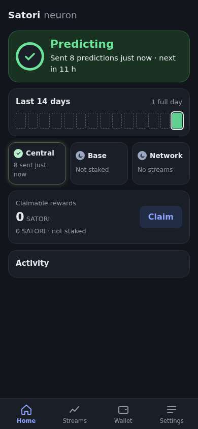 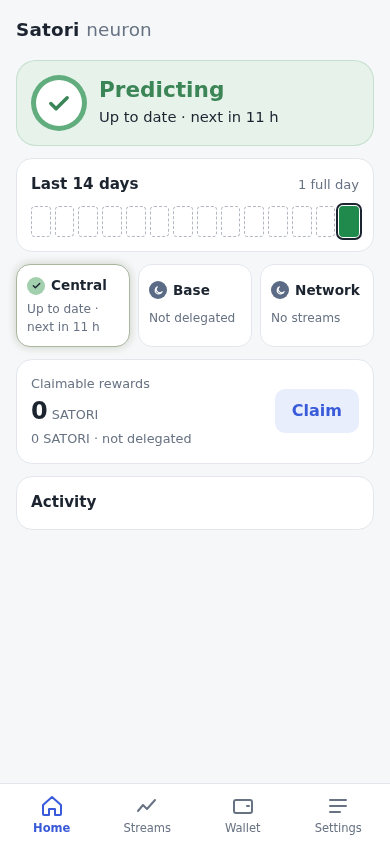

## The channels (chips)

Each is `{ state: ok | warn | bad | idle | advice, tone, text }`, the state
from the reasons above (a channel's top reason with chip words, at its
level), the tone from [the tone](#the-tone-three-greens) (the chip's
colour and icon: a check on sky, three dots while working, a moon when
off).

- **Central**: ok "83 sent 2 h ago", or "Up to date · next in 9 h" when
  the last poll had nothing to send (never "0 sent"); idle "First poll now…",
  "Catching up now…" ("… in 2 h" when a poll is still ahead); warn "Last poll failed", "Vault mismatch",
  "Not registered"; bad "Database error", "Login refused", "2 failed in a
  row", "Nothing sent for 14 h".
- **Base**: ok "Round 20742 sent", "Round 20742 due"; idle "Not staked"
  (no SATORI), "Staked elsewhere", "No SATORI staked", "Connecting…"; warn
  "Not staked", "Gas: 3 batches", "Skipped: …", "Unreachable"; bad "Failed 3
  times".
- **Network**: idle "No streams" (nothing subscribed); ok "2 relays"; advice
  "1 of 2 relays down" (sky, or green while working); bad "Relays down". A
  relay that is connecting counts as up.

## Traffic

Each chip also glows, faintly, while its channel has real traffic: a
request to central or its answer (`src/central`'s fetch), a Base RPC call or
its answer (base.js traces its viem transport) or a relay message sent or
received (`src/nostr/relay.js`). They call one emitter (`src/traffic.js`),
which Home subscribes to; nothing polls. `health().channels[x].lastTraffic`
is that channel's last traffic in ms, or null.

- **Colour:** `--live` and `--live-glow`, a low-saturation earth green:
  faint on light, dark and subtle on dark, apart from `--ok`. The status's colour and icon never
  change with it, and it is never a call to act.
- **Motion** (`src/ui/glow.js`): a burst is one style update in the next
  frame (one per card at most), then the glow holds until 1.5 s after the
  last message (one timer that re-arms itself) and fades out in 600 ms; it
  fades in over 150 ms. Only an overlay's opacity changes (`.chan::after`),
  so nothing is laid out again.
- **`prefers-reduced-motion`:** no fades: a still, faint tint while traffic
  was within the last 3 s.
- Only the three chips glow: on a computer the Streams and Wallet tiles do
  not map one to one (Network has no tile, and Streams holds central's and
  the relays').

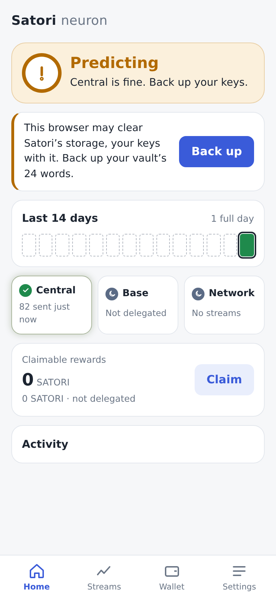 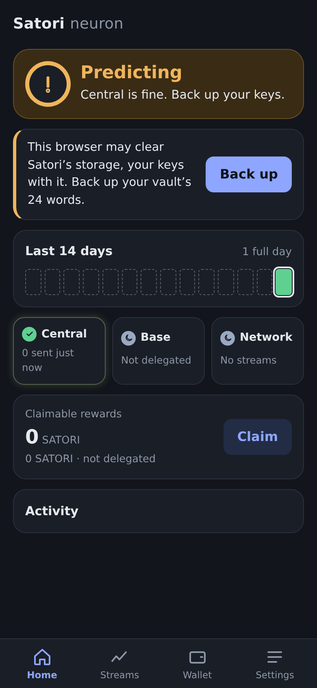

Close up (live on central2, a poll):

 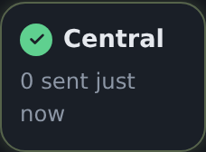

## The day strip

Local days, newest last: 14 on the phone, 30 on a computer (`health().days`
has 30). For each day, the log's outcomes per channel (a merged row counts
on every day from `at` to `until`):

- a success: a good central cycle, a Base batch sent, a `_pred` published;
- a failure: a failed central cycle, a Base error or fixable skip, an engine
  or database error.

| Code | Means |
|---|---|
| `full` | predictions went out on every active channel that day (each channel with a failure also had a success) |
| `part` | some channels |
| `error` | only failures |
| `closed` | nothing went out and nothing failed: the app never ran that day (`ran: false`), or ran with nothing due |
| `before` | the day ended before the neuron began: an empty outlined cell, "Before this neuron", not a closed day |

The neuron began at its first session in the log (`activity.first()`, read
from the whole log, not only the rows loaded), or when its keys were made
(the record's `created`, [keys.md](keys.md#the-record)) when that is earlier.
Records from before `created` have only the log.

Today has an outline. Each day is `{ date: 'YYYY-MM-DD', code, ran, today }`.
The summary counts the neuron's own days: "12 of 14 full days"; a neuron
younger than the strip, "1 full day" on its first day, then "2 of 3 full
days". The legend shows "Before this neuron" only while such a day is shown.

## The feed

The log, newest first, 20 rows: `{ at, level, text }`. "Sent 83 predictions
to central", "Polled central: up to date" (nothing to send), "Caught up:
sent 83 predictions" ("Caught up: up to date"), "Central refused the batch:
central 401: Invalid signature", "Base batch for round 20742: 1 game", "Base
batch skipped: gas above the ceiling (×3)", "Published 3 forecasts to the
network", "Satori was closed for 2 d", "Staked with this neuron". A
session that missed nothing is not shown.

## Verify

- `src/neuron/work.test.js` and `src/ui/hold.test.js` (fake timers): the
  work state's transitions (holders, steps, counts, critical, the leading
  entry) and its words; the pace (a step held 0.25 s from its paint, counts at
  once, the next in order and the latest, the end's grace, the network's
  delay).
  `src/neuron/health.test.js`: the chips' tones (the hero's: the table
  below);
  `src/style.test.js`: the greens' derivation and contrast.
- `e2e/work.spec.js`: a new neuron against the stub central: the turning
  ring as the only animation, at least three steps in order, each at least a
  second on screen, the history count ticking, working green, vivid while
  sending, then Predicting in sky green fading over 2.5 min; Poll now back to
  green; a theme change half way through the fade, readable at once (the
  system's light to dark, Settings' dark to light); reduced motion: no animation, the dots; random keys with storage
  not kept (the backup is advice): working, vivid, then sky, never amber,
  with the Back up card (it read amber from the start).
- `src/neuron/health.test.js`: every status and every reason from
  fabricated logs, each reason's level (`LEVEL`), the action priority, and
  a table of every title-defining state (starting, asleep, caught up,
  predicting, retrying, failing) with every reason → the title, the status,
  the tone (with no work, working and critical) and the card; an advice
  reason leaves the title, the status, the tone and the line as they were.
  Also *Partly predicting* (Base staked, or not read, and red), open time and missed work, the day codes, the chips and the feed.
- `src/traffic.test.js` and `src/ui/glow.test.js`: the emitter, a traced
  transport, a burst as one update, the hold after the last message, cards
  apart, reduced motion; central's, the relay's and Base's emits in their
  tests.
- `src/neuron/activity.test.js`: sessions and their heartbeat, a wake after
  sleep, merges, the 90-day prune, caught up, the log's first session.
  `src/db/db.test.js`: the table. `src/ui/format.test.js`: the strip's
  summary.
- `e2e/home.spec.js`: the four states in Chrome with the stub central and a
  fake chain (idle from a seeded log); a new neuron (29 days before it,
  "0 full days", then "1 full day"); a new neuron with a vault mismatch
  (*Starting* in `health()` and on Home, the mismatch's card; *Predicting*
  after the first poll); a chip glowing while central's stub serves a poll
  and fading after, `lastTraffic`, reduced motion still; and the screenshots below.

## Live

2026-10-17, the dev server on :5180 against central2, a fresh browser
profile, no stubs: Create (the words confirmed) → Home *Starting* ("First
predictions in 18 min", every chip idle) → Poll now: 82 streams, central's
history for all 82 (81 on bvar), 82 of 82 accepted → *Predicting*, "Sent 82
predictions just now · next in 11 h"; Base idle (a new vault, no SATORI),
Network idle (nothing subscribed); nothing sent to prod.

Again after the day strip's `before` (2026-10-17 01:55, a fresh profile, set
up with new random words): *Starting* with 29 outlined days ("Sep 18: Before
this neuron") and today, "0 full days"; Poll now, 13 s: 82 of 82 accepted,
today full, "1 full day" on the phone and the computer; nothing sent to prod.

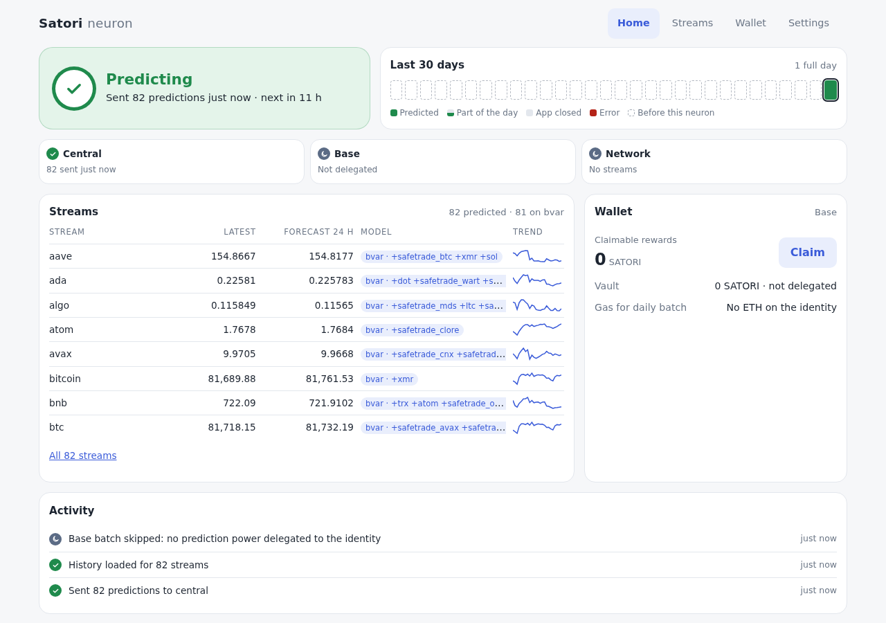

The title with a reason above `starting` (2026-10-17 14:40, two fresh
profiles on central2 sharing one new vault): the second registers with
`vault_base_address` null, so before its first poll Home is amber with the
mismatch's card and reads *Starting*, "Central has no vault for this
neuron." (it read *Predicting*); `health()` says the same.

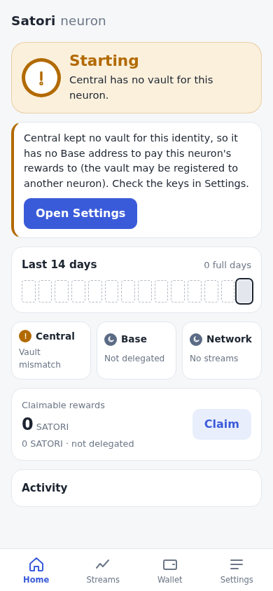 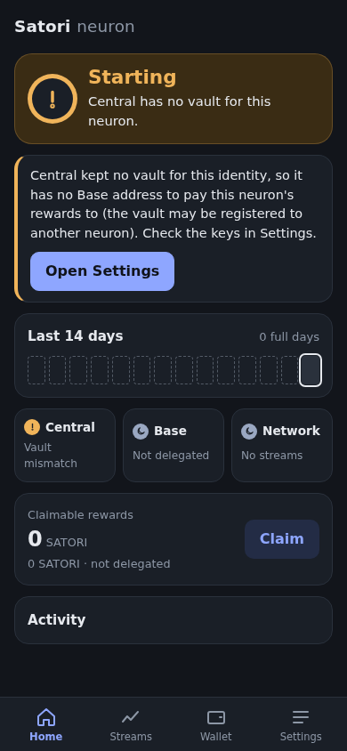

Nothing to send (2026-10-17 16:59, a fresh profile on central2): after the
first poll (82 of 82 accepted), Poll now with nothing new: the line and the
Central chip read "Up to date · next in 11 h" (they read "0 sent just now"
and "Polled central just now, nothing new"), the feed "Polled central: up
to date".

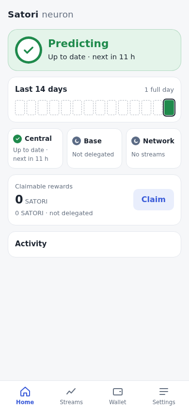

Never a silent wait (2026-10-17 21:09 UTC, the dev server on :5180
restarted, a fresh Chrome profile on OPFS, central2's 82 streams, no
stubs), the hero from `satori.setup()`:

| s | hero | tone |
|---|---|---|
| 0.5 | Signing in to central… | working |
| 1.5 | Fetching today's observations… | working |
| 2.5 | Loading history · 14 of 82 streams, ticking to 82 of 82 at 5.0 | working |
| 5.4 | Building models · 0 of 82, 82 of 82 at 6.0 | working |
| 6.3 | Keep Satori open · Sending 82 predictions… | critical |
| 8.1 | *Predicting* · Sent 82 predictions just now · next in 11 h | idle (fading to sky) |

It took 17–19 s on this box before (the owner saw about 30 s): storing the
batch 2.0 s → 0.1 s, history 7–10 s (+ 1 s of screen refresh) → 3.8–4.4 s,
the specs and predictions 1.9–2.3 s → 0.1 s ([storage.md](storage.md#the-checkpoint-rule)).

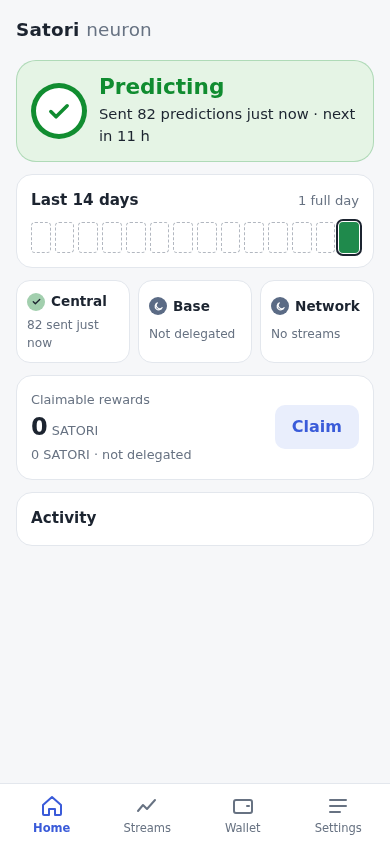

The backup reminder as advice (2026-10-17 21:42 UTC, the dev server on
:5180 restarted, a fresh Chrome profile on disk, central2's 82 streams, no
stubs): `satori.setup()` with random words (no backup confirmed) and
storage not kept (`persisted: false`). The hero, sampled every 250 ms (it
read amber, `warn`, "Central is fine. Back up your keys.", from the first
step to rest):

| s | title | tone | line | card |
|---|---|---|---|---|
| 0.5 | *Starting* | working | Signing in to central… | Back up (from 0.75 s) |
| 1.8 | *Starting* | working | Fetching today's observations… | Back up |
| 2.8 | *Starting* | working | Loading history · 4 of 82 streams, ticking to 82 of 82 at 5.8 | Back up |
| 6.0 | *Starting* | working | Building models · 0 of 82, 82 of 82 at 6.8 | Back up |
| 7.0 | *Starting* | critical | Keep Satori open · Sending 82 predictions… | Back up |
| 9.3 | *Predicting* | idle (fading to sky) | Sent 82 predictions just now · next in 11 h | Back up |

82 of 82 accepted; `health()`: `ok`, `idle`, reasons `backup:advice`;
nothing sent to prod.

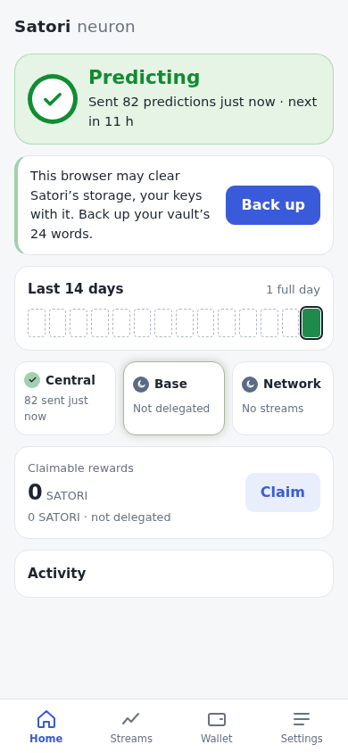

## Screenshots

What it is doing, and the three greens (`e2e/work.spec.js`, `SHOTS=1`): working
(Loading history), critical (Keep Satori open · Sending), at rest (sky),
light and dark:

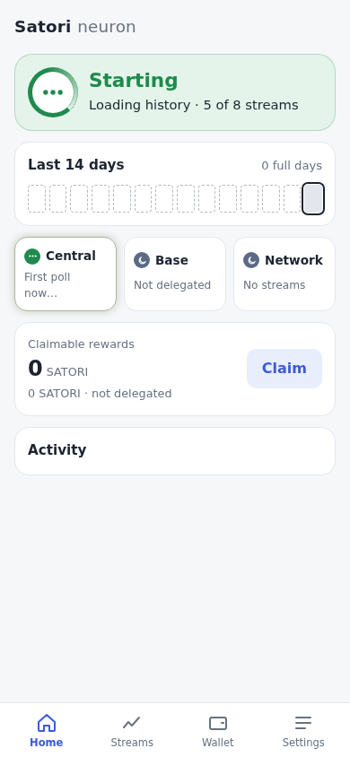 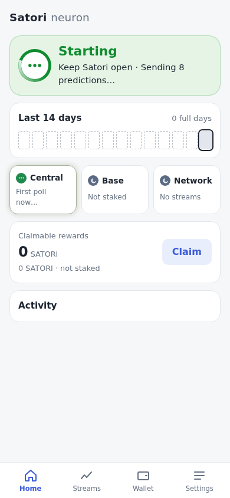 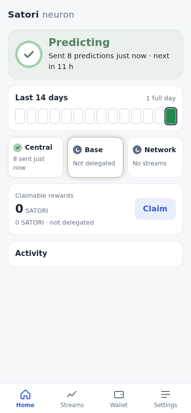

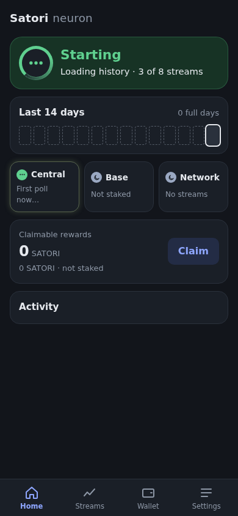 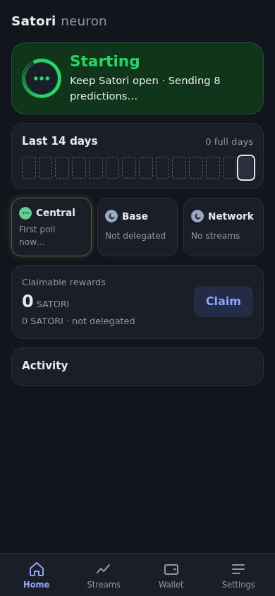 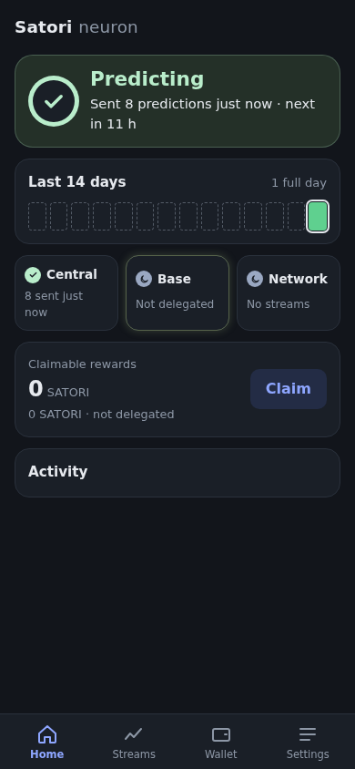

From `e2e/home.spec.js` (`SHOTS=1 npx playwright test e2e/home.spec.js`):
each state on a phone (390 × 844, the first screen) and a computer (1280
wide), light and dark, `docs/screenshots/home-<state>-<phone|desktop>-<light|dark>.png`
for `ok`, `idle`, `warn` and `bad`, and `new` (a new neuron's first day).

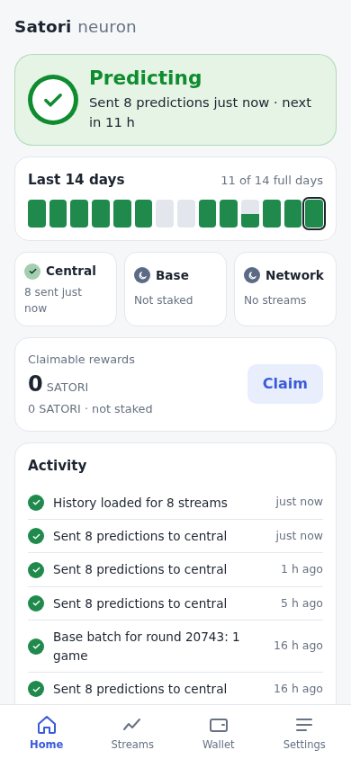 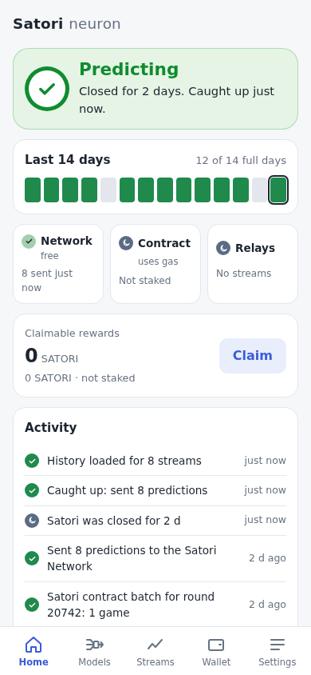 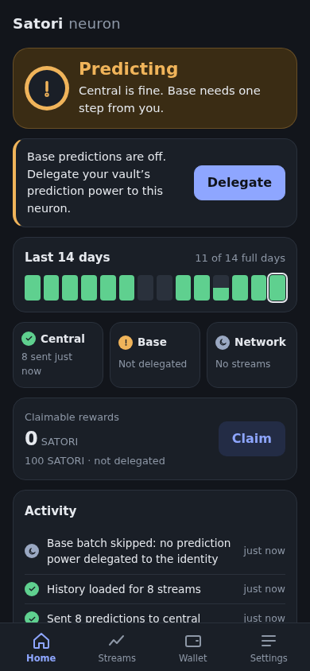 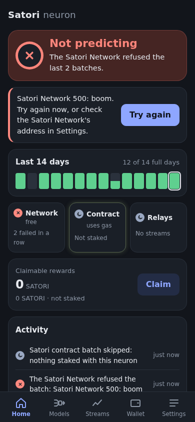

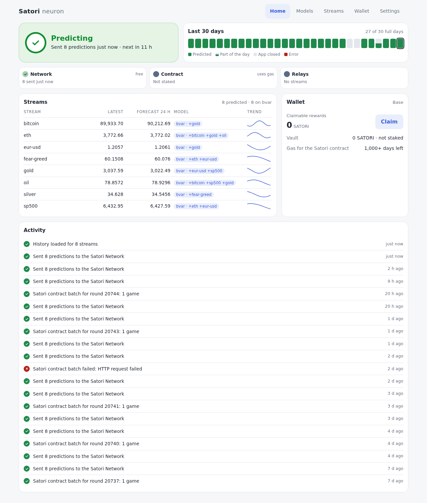

*Partly predicting* (the e2e's fake chain with its RPC aborted after
staking: the batch check failed twice while central is fine; it read a
red *Predicting*):

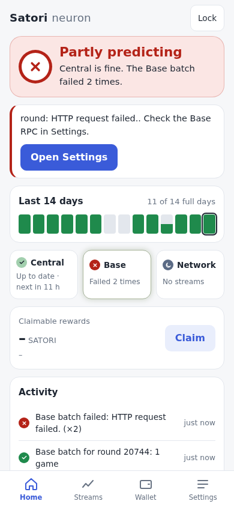 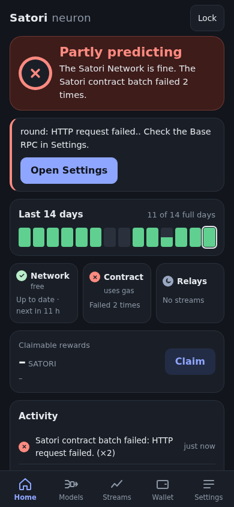

A new neuron after its first poll: the days before it are empty outlines,
not closed days.

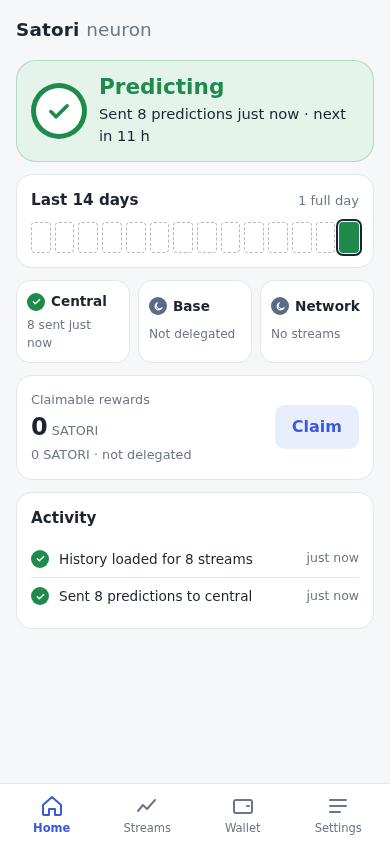 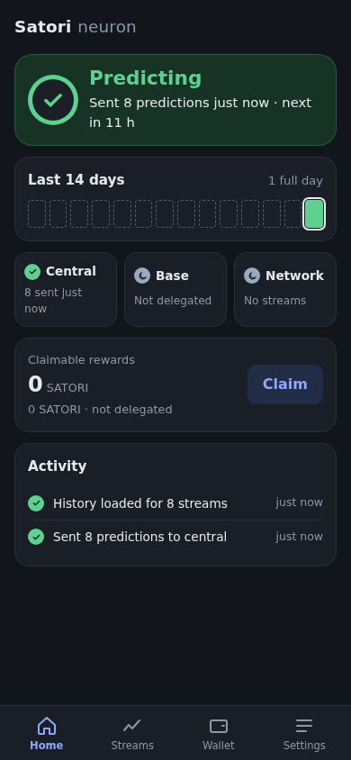
