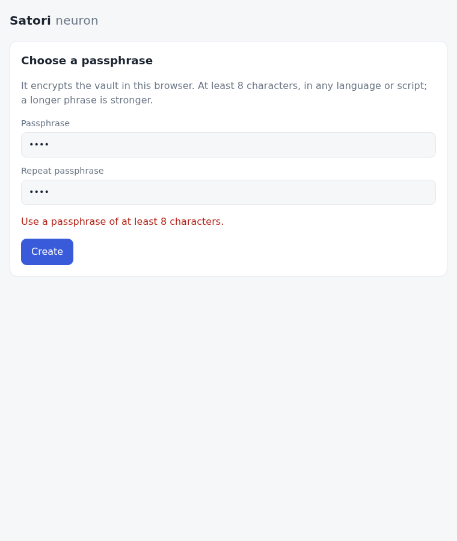
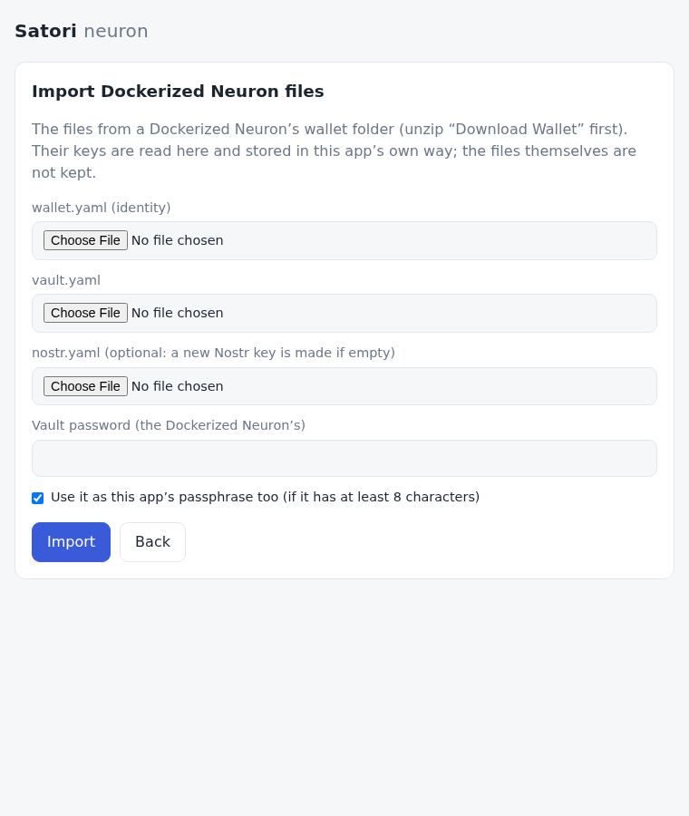
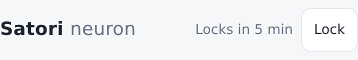
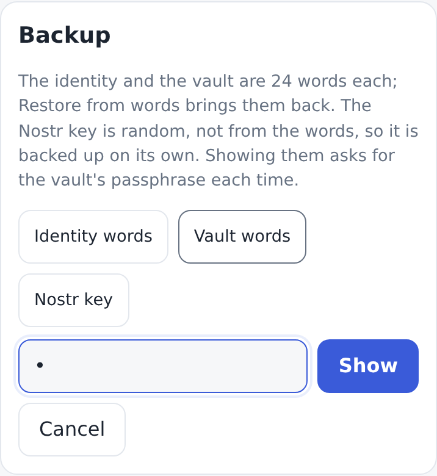

# Keys: alias and wallet

[← OVERVIEW](OVERVIEW.md)

The browser neuron holds Satori's two keys, made and used as the Docker
neuron (Satori Lite, `../neuron`) and satorilib (`../satorilib`) make and use
them, and a Nostr key. It stores them in a record of its own. The
owner's direction (2026-10-16), **migrate in, never back**: what a user
brings from the Dockerized Neuron is imported and translated into this app's
own way; nothing is kept in Docker's formats, limits or files only so it
could move back. This app is about Base: each key's address is its **Base
(0x) address**, the only kind it shows.

| Key | Stored as (meta `keys`) | Encrypted? | Used for |
|---|---|---|---|
| **alias** | its 32-byte secret, hex | no, on purpose | everything the neuron does on its own: central's register and login ([central.md](central.md)); its pubkey is the `alias_pubkey` of our Nostr announcements; the daily Base batch ([base.md](base.md)) |
| **wallet** | its secret sealed with the passphrase; its public key in clear | yes | holds the funds: stake, claims and sends on Base. Only while unlocked. |
| Nostr key | its secret, hex | no, on purpose | signs the neuron's Nostr events ([nostr.md](nostr.md)); not one of the two keys above; derived from a wallet in the app, random for a connected one ([wallets.md](wallets.md#derived-keys)) |

The alias and the Nostr key are unencrypted on purpose: the neuron must
run after a page load with nobody there to type a passphrase. The wallet holds
the funds, so it is opened only by **Unlock** (enter the passphrase) and
wiped from memory by **Lock**.

## What Satori Lite does (the pattern followed)

| Behaviour | Where in Docker |
|---|---|
| The alias is made at startup with no user input: `EvrmoreIdentity(wallet.yaml)` loads the file, or generates and saves it when missing. No password. | `neuron/neuron-lite/start.py:75`; `satorilib/src/satorilib/wallet/identity.py:611-615`; `neuron/neuron-lite/satorineuron/init/wallet.py:94-111` ("doesn't require a password") |
| The wallet is made only when a password is given (`wallet-setup`, at least 4 characters, typed twice). | `init/wallet.py:44-45,113-155`; `neuron/web/routes.py:570-619` (length rule at `:589`) |
| Login (unlock) decrypts the wallet with the password; a wrong password leaves it encrypted. Logout closes it (Lock). | `routes.py:462-568,625-634`; `init/wallet.py:219-245` |
| The wallet's public key is read from `vault.yaml` without decrypting it, so it shows and registers while locked. | `start.py:4637-4667` |
| The alias signs the daily Base batch with no wallet unlock (the wallet staked with it, Lite's "Enable staking"). | `start.py:1148-1165` |
| The wallet password is never saved by the web setup. | `routes.py:598` |
| Backup: the dashboard (behind login) reveals the wallet's and the alias's private key; "Download Wallet" zips `wallet.yaml` + `vault.yaml`; "Import Wallet" takes both files back. | `routes.py:1267-1291,3214-3254,2281-2420`; `web/templates/dashboard.html:2112-2160,3821-3850` |

## One key, one secret

Each key is one 32-byte secp256k1 secret, used directly as the private key
and as the BIP39 entropy of its 24 words: satorilib's scheme, kept so a
neuron's words give the same keys and the same Base addresses here as in
Docker. No HD path, no `mnemonicToSeed`, so the words do not open the same
account in a standard wallet; whether new neurons should use BIP32 paths is
an owner decision ([QUESTIONS](../inbox/QUESTIONS.md)). `src/keys/keys.js`:

| Output | Rule | Evidence |
|---|---|---|
| keygen | 32 random bytes, retried until 1 ≤ k < n | `wallet/identity.py:309-317` |
| words | `Mnemonic('english').to_mnemonic(entropy)` (24 words) | `wallet/identity.py:319-320` |
| public key | compressed, hex (66) | `evrmore/identity.py:46-50` |
| Base address | keccak256 of the uncompressed key, EIP-55 (`Account.from_key(entropy)`, satorilib's `ethAddress`) | `wallet/ethereum/wallet.py:114-121` |
| private key (backup) | `0x` and the secret in hex: what a Base wallet's "Import account" takes | |
| transaction signature | ECDSA over the tx hash, RFC 6979, low-S, as viem's `sign` | |
| central's login signature | EIP-191 (`personal_sign`) of the challenge by the alias: `0x` + r ‖ s ‖ v, RFC 6979, low-S, v 27/28 | [central.md](central.md#login-signature), `src/central/login.js`; satorilib's `ethSign` (`wallet/identity.py:706-715`) |

There is no Evrmore anywhere in the app: no Evrmore address, WIF, scripthash
or message signature is made, read or shown. The wallet signs its link to the
alias, sent with every register; central answers the wallet it pays
(`wallet_address`), which the app compares with the wallet's own Base address
([central.md](central.md#the-wallets-link)).

## The record

One `meta` row, `keys`, written in one commit (so a setup is all or
nothing):

```json
{
  "v": 1,
  "created": 1792195200,
  "alias": "<64 hex>",
  "nostr": "<64 hex>",
  "wallet": {
    "pubkey": "02…",
    "kdf": { "name": "PBKDF2", "hash": "SHA-256", "iterations": 600000, "salt": "<base64, 16 bytes>" },
    "cipher": { "name": "AES-GCM", "iv": "<base64, 12 bytes>" },
    "data": "<base64: the 32-byte secret encrypted, and GCM's 16-byte tag>"
  },
  "link": { "message": "Satori: link this alias to my wallet\nalias: 0x…\nwallet: 0x…\nissued: 1792195200", "signature": "0x…" }
}
```

- `v` is the record's version. A record from a newer app is refused, not
  guessed at; a later change adds a version and reads this one.
- `created` is when the record was made (unix seconds: Create, Restore or
  Import): Home's day strip starts there or at the first session in the
  activity log, whichever is earlier ([health.md](health.md#the-day-strip)).
  A record made before 2026-10-17 has none.
- The alias and the Nostr key are their secrets, in hex or sealed with this
  device's key ([at rest](#at-rest)); everything else about them (public
  keys, addresses) is worked out at load. `from` is where they came from
  (`wallet`, `random`: [wallets.md](wallets.md#derived-keys)).
- The wallet's public key is in clear: its Base address shows while locked.
  At Unlock the decrypted secret must give the same public key.
- A **connected** wallet (its wallet app holds it,
  [wallets.md](wallets.md#a-connected-wallet)) is stored as `"wallet": {
  "kind": "connected", "address": "0x…", "rdns": "io.metamask", "name":
  "MetaMask" }`: nothing secret, no passphrase.
- `link` is the wallet's EIP-191 signature of its link to the alias
  ([wallets.md](wallets.md#the-satori-network-register-login-and-the-link)):
  `{ message, signature }`, made at Create, Restore and Import, and at the
  next Unlock of a wallet stored without one.
- Each wallet carries its own KDF and cipher parameters, so a later iteration
  count still opens an older wallet.
- An earlier version's wallet, until its next Unlock: `"wallet": { "pubkey":
  "02…" | null, "yaml": "<that version's vault.yaml text>" }` ([migration](#migration)).

## At rest

(Owner, 2026-10-26.) The alias and the Nostr key are used with nobody
present, so they can't wait for the passphrase; they are sealed with a key
that never leaves this browser instead: an AES-GCM key made with WebCrypto
as non-extractable (no script can read its bytes, only use it), kept in
IndexedDB (database `satori`, store `app`, key `device-key`). The record
then holds `"sealed": { "iv", "data" }` (the alias's and the Nostr key's
secrets, 64 bytes) in place of `alias` and `nostr`.

- **Only where it works.** At load the app makes or reads the key and
  checks it: stored, read back as a CryptoKey that can't be exported, and a
  seal opened again. Any failure (a browser that can't keep a CryptoKey in
  IndexedDB, a private window) → plain hex, as before, and the next load
  checks again.
- **What it protects**: a copy of the database file or of a device backup
  without the browser's own storage. Not code running in the page.
- **The key is gone, the keys are gone**: storage cleared with IndexedDB but
  not OPFS can't happen (one site storage), but if the key is missing the
  alias and the Nostr key are derived again at the next Unlock (or
  re-signed, connected); random ones then can't be opened, and the app says
  so (their backup is in Settings › Backup).

## The wallet encryption

`src/keys/wallet.js`, all WebCrypto, no new dependency:

- **Passphrase → key:** PBKDF2-HMAC-SHA256, **600,000 iterations** (OWASP's
  Password Storage Cheat Sheet figure for PBKDF2-HMAC-SHA256, set in 2023 to
  match its bcrypt and scrypt costs on current GPUs), a random 16-byte salt
  per encryption (NIST SP 800-132 asks at least 128 bits), 32 bytes of key.
  The passphrase goes in as the **UTF-8 bytes of its NFC form**: any Unicode,
  and an `é` typed as one code point or as `e` + a combining accent (macOS,
  Windows and phone keyboards differ) is the same passphrase. NFC, as the
  PRECIS OpaqueString profile for passwords (RFC 8265); NFKC would also merge
  look-alikes (full-width letters, ligatures) that a user may mean as different.
- **Key → ciphertext:** AES-256-GCM over the 32-byte secret, a random 12-byte
  IV. A fresh salt means a fresh key each time, so an IV is never reused.
- **Wrong passphrase:** GCM's tag fails, so a wrong passphrase (or any changed
  byte) is `Wrong passphrase`, with nothing decrypted.
- **Cost:** measured in Chrome on this shared box (dev server, 2026-10-16):
  seal 0.29–0.30 s, open 0.26–0.30 s. One Unlock pays it once; an attacker
  pays it per guess. (An earlier version's wallet takes satorilib's
  PBKDF2-SHA1 × 1,000,000 per field once more, at its first Unlock: 0.7–1.5 s.)
- **Why not Argon2id or scrypt**, OWASP's first choices: WebCrypto has
  neither. `@noble/hashes` (already a dependency) has both in pure JS, several
  times slower than native, so at the same wait an attacker on native code or
  GPUs gets cheaper guesses than PBKDF2-SHA256 at 600,000 in WebCrypto gives
  them. Not clearly better here, so not used.

## Passphrases



**At least 8 characters, any Unicode, no other rule** (`MIN_PASSPHRASE`,
`checkNewPassphrase`). Counted in code points after NFC, as NIST SP 800-63B
counts them (each code point one character): 8 Chinese characters count 8,
4 emoji (8 UTF-16 units) count 4.

Why 8: it is NIST SP 800-63B's floor for a user-chosen secret (rev. 3
§5.1.1.1; rev. 4 keeps 8 where the password is not the only factor and asks
15 where it is, for logins). This passphrase is not a login: it guards a
wallet at rest against someone who already holds this browser's storage,
behind 600,000 rounds, and the 24 words are the backup. The setup text says
a longer phrase is stronger. The old minimum, 4, was Docker's
(`routes.py:589`).

The rule is for **new** passphrases (Create, Restore, a new one at Import).
A passphrase an earlier version accepted keeps working: the forward
migration re-encrypts the wallet with it as it is.

## In the browser

- **Setup → Create**: a new wallet (random), its alias and Nostr key derived
  from it ([wallets.md](wallets.md#derived-keys)), the wallet's 24 words
  shown and three of them checked (they bring back all three keys), one
  passphrase. One record is stored.
- **Setup → Import**: the wallet's 24 words or its private key (`0x` and 64
  hex, as a Base wallet exports it), then the passphrase; the alias and the
  Nostr key are derived from it.
- **Setup → Import Docker files**: [below](#import-translate).
- One setup runs at a time, from the UI or an agent; a second one is refused.
- **Settings › Keys** shows each key's Base address (the alias's, and the
  wallet's while locked) and the Nostr pubkey. The neuron runs from page load
  on the alias: it registers both public keys with central and signs
  central's login challenge. The wallet has **Unlock** there; while
  unlocked, **Lock** is in the header with "Locks in 4 min" beside it (and
  "Lock the wallet" there). An action that needs the wallet (Stake, Unstake,
  Claim) asks for the passphrase in place when it is locked: one inline
  prompt, then the action, then Lock ([health.md](health.md)).
- **The wallet locks on its own**: [below](#the-wallet-locks-on-its-own).
- **Backup and Send** ask for the passphrase each time, unlocked or not:
  [below](#backup), [base.md](base.md#send-the-passphrase-each-time).

## Import: translate



**Import Docker files** takes the wallet file (`wallet.yaml`, or `vault.yaml`
in an older install) and the Docker wallet password; the alias and the Nostr
key are derived from the wallet (2026-10-26: the install's own are not kept). `src/keys/docker.js`
reads them, read only, as satorilib wrote them; the keys are then sealed in
this app's record. The files themselves are not kept.

- **The files** (`wallet/identity.py:625-651,682-692`): both have `entropy`,
  `privateKey` (WIF), `words`, `publicKey`, `scripthash`, `evr.address`; the
  wallet encrypts the first three, each as `base64(salt16 ‖ iv16 ‖
  AES-256-CBC(PKCS7(utf8(value))))` with key PBKDF2-HMAC-SHA1(password, salt,
  1,000,000, 32) (`satorilib/src/satorilib/utils/secret.py:10-42`). The
  password goes in as **Latin-1** bytes, as pycryptodome takes a `str`
  (`Crypto/Util/py3compat.py`); a password outside Latin-1 makes satorilib
  save the wallet unencrypted (`identity.py:682-692`), which the import
  refuses.
- **Which file is which**: by the secret fields, with satorilib's length rules
  (a 44-char `entropy`, a 52-character `privateKey` and `words` with spaces
  are plain, `identity.py:131,152,595`). `wallet.yaml` must be plain and `vault.yaml`
  encrypted; files in each other's slots are named as swapped.
- **Reading** (`identity.py:115-177,662-680`): the key is the `entropy`,
  which every file satorilib writes has; a file without one is refused
  (watch-only; satorilib cannot load a WIF-only file either). An old wallet
  also encrypted its `publicKey` (decrypted by length). The public key and
  the words are derived from the secret and compared with the stored ones; a
  mismatch refuses the file. The Evrmore fields (`privateKey`'s WIF,
  `evr.address`, `scripthash`) are not read.
- **Wrong password**: AES-CBC's padding fails, or the text is not a 44-char
  entropy: `vault.yaml: Wrong passphrase`.
- **Not a wallet file** (2026-10-19, the security review): a file over 64 KB
  (`IMPORT_MAX`; satorilib's are under 2 KB) is refused before it is read,
  "wallet.yaml: over 64 KB, so not a Docker file." (a file of
  gigabytes froze the tab). A file that is not YAML says only where,
  "wallet.yaml: not valid YAML (line 5)": js-yaml's own message quotes the
  lines around the fault, which in a wallet are its words and keys, and Setup
  showed them.
- **This app's passphrase**: by default the Docker wallet password is reused
  ("Use it as this app's passphrase too", ticked) when it meets the
  [rule](#passphrases); otherwise, or unticked, the passphrase step asks for
  a new one ("The Docker install's wallet password is shorter than 8
  characters…").
- `nostr.yaml` (`start.py:120-149`): `secret_hex`, checked against
  `pubkey_hex`; none means a new Nostr key.

## Migration

Earlier versions stored Docker's texts: `meta.wallet_yaml`,
`meta.vault_yaml` and (from step 5) `meta.nostr_yaml`. Profiles like that
are live at neuron.satorinet.io and in the owner's browsers.
`test/fixtures/profiles.json` holds what each version really stored, made by
that version's own code (`scripts/profile_fixtures.mjs`).

- **At load** (migration 7, `src/db/schema.js`, one transaction): the
  alias and the Nostr key are plain text, so they are translated into the
  record at once (a profile from before step 5 gets its Nostr key now, as the
  load did before). The wallet needs the passphrase: the record keeps its
  `vault.yaml` text, and its public key when it was in clear. The three old
  rows go in the same commit. Rows it cannot read stop the open with nothing
  changed ("Satori could not start", nothing deleted).
- **At the next Unlock**: the old wallet is opened as its version did, sealed
  in this app's format with the same passphrase, opened again to check, and
  only then stored (`unlockWallet` returns the record, `main.js` stores it).
  Until then every load reads the old format. A wrong passphrase changes
  nothing.
- **Shapes** (each tested, in node on the migration itself and in Chrome on
  OPFS):

| Shape (versions) | At load | At the next Unlock |
|---|---|---|
| Steps 2–4 (2026-10-15 14:04 → 15:58): `wallet_yaml`, `vault_yaml`, Latin-1 passphrase bytes | alias translated, a new Nostr key | Latin-1, as satorilib |
| Step 5 on: and `nostr_yaml` | alias and Nostr key translated | the same |
| Step 2 (06:29 → 14:04): the passphrase as **UTF-8** bytes (`a5bd150`) | the same | Latin-1, then UTF-8. These wallets did not open at all before this version when the passphrase was outside ASCII |
| Docker import kept as given (satorilib's `vault.yaml`, or an old one re-written) | the same | Latin-1 |
| Docker import before 2935be0: a **plain-text** `vault.yaml` kept as given | the same | encrypted for the first time, with the passphrase typed then (it must meet the rule) |
| Docker import before ecf3ae0: a `vault.yaml` with **no plain `publicKey`** | the same; the wallet's address is unknown | the app opens on **Unlock to finish the update** (the neuron needs the wallet's public key), then starts |
| The step-1 prototype's sealed key, `meta.wallet` (7be47fc) | not touched (never read since step 2); Setup | — |
| A setup cut off after the wallet row (no `wallet_yaml`) | not touched; Setup | — |

In the running app (dev server, 2026-10-16): a browser profile set up by an
earlier version on central2 opened on Home after the update, its Base
addresses in the Keys card, registered again (`walletMismatch: false`: central
had the wallet whose public key the record kept), its
subscriptions and history intact; wrong passphrases left its wallet as it was.
Home: [../screenshots/home.png](../screenshots/home.png).

## The wallet locks on its own

An unlocked wallet on a phone or a laptop left open is funds anyone at the
screen can move (the security review, 2026-10-19). So, besides Lock
(`src/keys/autolock.js`, `src/keyring.js`, `src/main.js`):

- **After an action an inline Unlock was opened for.** Stake, Unstake or
  Claim asked for the passphrase in place because the wallet was locked: once
  that action ends (done or failed), the wallet is locked again. Unlock in
  Settings › Keys is a session: it stays unlocked until Lock or the idle
  rule.
- **After 5 minutes without interaction** (`IDLE_MS`) while it is
  unlocked, or while a backup is on screen. An interaction is a key, a
  tap or a click (`pointerdown`), the wheel, or a wallet action through the
  UI or `window.satori` (its end counts). A wallet action running at the
  deadline is never cut off: it locks once the action ends (checked every
  5 s). A device that slept past the deadline (browser timers don't count
  sleep) locks at the first heartbeat after it wakes (the catch-up pass,
  [../plans/runtime.md](../plans/runtime.md#catch-up-pass)).
- **Said by Lock**: "Locks in 4 min" next to the header's Lock (whole
  minutes, up; "Locks in under a minute"), so the countdown restarts as the
  person uses the page. `status().lockAt` is the deadline (ms) for agents.

  

Satori Lite's dashboard keeps its login session until logout; this is
stricter because a browser tab is easier to leave open than a server's
dashboard.

## Backup

The passphrase each time (2026-10-19): **Backup → Alias words, Wallet
words, Nostr key** asks for the wallet's passphrase in place, every time,
unlocked or not, and derives the wallet from it (`backupKeys`,
`withPassphrase`: PBKDF2 again, ~0.3 s), so a wallet left unlocked can't
show its words without it. A wrong passphrase shows nothing. A backup on
screen hides itself after 5 minutes without interaction, as the wallet
locks. Docker shows the keys behind login; here the passphrase is asked
per showing, the alias's and the Nostr key's too (they are stored
unencrypted, but they are private keys). It shows:

- **Alias words**, **Wallet words**: the 24 words (Import
  brings the key back, as does the private key) and the private key in `0x` hex, which imports into a
  Base wallet (the words don't, [above](#one-key-one-secret)).
- **Nostr key**: its `nsec` (NIP-19) and its hex secret. It is random, so the
  words don't bring it back; Import takes either form.
- **Earlier keys** (only when the record has some,
  [wallets.md](wallets.md#keys-are-never-lost)): each earlier alias's address
  and private key, and its Nostr key's npub and nsec.

No files are downloaded: Docker's formats are not written any more.
`window.satori.backup(undefined, passphrase)` gives all three,
`backup('alias' | 'wallet' | 'nostr', passphrase)` one; without the
passphrase it throws "The wallet's passphrase is needed: it is asked each
time." ([/llms.txt](../../public/llms.txt)).



### An encrypted backup

For agents (owner, 2026-10-25): a browser's storage can be wiped at any time
and the person can't be counted on to back up, so an agent backs up for them.
`exportBackup(passphrase)` (`sealBackup`, `src/keys/index.js`) seals the three
keys (the wallet's words, the alias's, the Nostr key's nsec) as one JSON text
with the passphrase, the way the wallet is stored here (PBKDF2-SHA-256 600 000,
AES-GCM): `{ kind: 'satori-backup', v: 1, address, at, sealed }`. A connected
wallet's own words stay in its wallet app (`wallet` null). `setup({ passphrase,
backup })` opens it (`openBackup`) and sets up from the three. public/llms.txt
tells agents to make it right after setup, keep it where the person keeps
secrets, and say where.

## Secrets in memory

JavaScript can't wipe a string, nor the curve library's numbers, so a
secret's traces after Lock are mostly beyond reach. What can be wiped is
(2026-10-19, the security review's cheap wins): the wallet's secret at Lock
(`signer.lock()`) and after a one-use wallet (`withPassphrase`); the
passphrase's UTF-8 bytes once WebCrypto has taken its copy (`wallet.js`, and
a Docker wallet password's in `docker.js`); the copy an Unlock opens again to
check its re-encryption (`index.js`); Setup's words at the passphrase step.
On screen, the 24 words are fixed slots (`wordList`, `src/ui/parts.js`), each
blanked in place when the backup hides or the wallet locks: ArrowJS kept a
list's unmounted `<li>`s, their words in them, to reuse.

## Code

`src/keys/`:

- `keys.js`: the secret's words, public key, Base address, private key and
  transaction signatures.
- `wallet.js`: the wallet encryption and the passphrase rule.
- `index.js`: the record. `newKeys({alias?, wallet, nostr?}, passphrase)`
  (create, restore, import), `readDockerFiles({walletText, walletText,
  password, nostrText?})` (import: the secrets), `recordFromRows({walletYaml,
  walletYaml, nostrYaml?})` (migration 7), `loadKeys(record)` (the alias's
  signer, the Nostr key, the wallet's public key and Base address),
  `unlockWallet(record, passphrase)` (→ the wallet's signer, and the record to
  store when it was upgraded), `withPassphrase(record, passphrase, fn)` (the
  wallet for one use, wiped after `fn`: Send), `backupKeys(record, which,
  passphrase)` (Backup). A signer: `pubkey`, `evmAddress`,
  `signDigest`, `backup()`, `lock()`; the alias's also
  `signCentralLogin(challenge)`.
- `docker.js`: Docker's files, read only: `readWallet`, `secrecy`,
  `walletPubkey`, `decryptField`, `readNostrYaml`. Used by the import and by
  the migration only.
- `autolock.js`: [the wallet locks on its own](#the-wallet-locks-on-its-own).

`src/central/login.js`: central's login signature (EIP-191).

## Tests

- `keys.test.js`: words, public key and Base address against satorilib's
  vectors (`test/fixtures/alias-parity.json`), viem for the address and
  the transaction signature.
- `wallet.test.js`: round trips; the record's parameters; another
  implementation (node:crypto) opening it; wrong passphrase and changed bytes;
  non-Latin and emoji passphrases; NFC; the passphrase rule.
- `twokeys.test.js` also: a file that is not YAML names only its line (no
  secret in the error), and one over 64 KB is refused.
- `docker.test.js`: every Docker fixture shape (current and old wallets, a
  Latin-1 password, a file with no entropy, a mismatched file, wrong fields
  that are not read (the WIF, the nested address, `scripthash`), swapped files, `nostr.yaml`), and the UTF-8-era
  wallets.
- `twokeys.test.js`: the record, Unlock and Lock, backup, the import's
  translation, and every earlier profile carried forward; `withPassphrase`
  and `backupKeys` refuse no passphrase and a wrong one, and wipe the wallet
  after its one use.
- `wipe.test.js`: the passphrase's bytes zeroed once derived; an earlier
  version's wallet re-encrypted at Unlock, its check's copy zeroed; the wallet's
  own secret zeroed at Lock. `app.spec.js`: the very `<li>`s that showed the
  words are blank after Hide.
- `autolock.test.js` (fake timers): 5 minutes with no interaction, each
  interaction restarting them, never in the middle of a wallet action, a
  wake past the deadline, Lock by hand.
- `src/db/db.test.js`: migration 7 on every profile, then the Unlock.
- `src/central/login.test.js`: central's EIP-191 vector, and a login checked
  by viem's `verifyMessage`.
- e2e: `app.spec.js` (Create with a non-Latin passphrase, reload, Unlock
  with "Locks in 5 min", Backup asking the passphrase each time, unlocked
  and locked, a wrong one refused, `backup()` without it refused, the stored
  record; Import, with a short Docker password); `home.spec.js` and
  `base.spec.js` (an inline Unlock for Stake or Claim locks again after it);
  `migrate.spec.js` (earlier profiles in Chrome: at load, at Unlock, the
  finish screen, the step-1 row).

## The compatibility audit (2026-10-16)

Every constraint that existed only so things could move back to the Docker
neuron, classified as a local format or limit (fixed per the direction) or a
network protocol (changed only where central's and Lite's parsers provably
accept it). The network rows' evidence is in
[central.md](central.md#the-protocol-audit) and [nostr.md](nostr.md#the-protocol-audit).

| Item | Kind | Verdict |
|---|---|---|
| Keys stored as Docker's `wallet.yaml` / `vault.yaml` / `nostr.yaml` texts | local | **Our record** ([above](#the-record)); migration 7 |
| The wallet sealed as satorilib does (PBKDF2-SHA1, AES-CBC per field) | local | **Our encryption** ([above](#the-wallet-encryption)); Docker's read only at import and migration |
| Passphrases Latin-1 only, at least 4 | local | **Any Unicode, at least 8** for new ones ([above](#passphrases)) |
| Backup downloads of the three files; `window.satori.file()` | local | **Gone**: words, `0x` private keys, `nsec` |
| The WIF in Backup | local | **`0x` hex**: Base's form |
| Evrmore addresses in the UI and the API (`status().alias`, register's addresses) | local | **Base addresses only** |
| Evrmore address, WIF and scripthash derivations | local | **Gone**; register's wallet check compares Base addresses (`wallet_address`, [central.md](central.md#the-wallets-link)) |
| Lite's relay model uuid as the relay streams' row id | local | Kept: never sent, as good an id as any ([nostr.md](nostr.md#the-protocol-audit)) |
| Prediction texts as Python's `str(float)` | network | **JS text**: central reads `float()` |
| Nostr content as Python's `json.dumps` | network | **Compact JSON**: satorilib reads `json.loads`, fields by name |
| Central's login: an Evrmore signed message | network | **EIP-191** (2026-10-16): central's format since base-upgrade f4d72f5, Lite's since satorilib 5028913 ([central.md](central.md#login-signature)) |
| The key scheme (secret = BIP39 entropy, no HD) | both | Kept: the words of every existing key must give the same keys; new neurons are an owner decision ([QUESTIONS](../inbox/QUESTIONS.md)) |

## Deviations from Docker, and why

| Deviation | Why |
|---|---|
| **Local format: our own.** One JSON record (`meta.keys`), not `wallet.yaml` / `vault.yaml` / `nostr.yaml`. | Migrate in, never back (owner, 2026-10-16). One commit for all three keys. |
| **Wallet encryption: our own.** PBKDF2-HMAC-SHA256 600,000 + AES-256-GCM over the secret, UTF-8 of NFC, not satorilib's PBKDF2-HMAC-SHA1 1,000,000 + AES-256-CBC per field with a Latin-1 password. | Current guidance; any passphrase; GCM's tag tells a wrong passphrase. Docker's scheme is read only at import. |
| **Passphrases: any Unicode, at least 8 characters** (Docker: 4, and Latin-1 only in practice). | [Passphrases](#passphrases). |
| **No export to Docker files.** Backup is the words, the private keys and the Nostr key. | Migrate in, never back. |
| **Base only.** No Evrmore address, WIF, scripthash or message signature is shown, stored, read or made. | This app is about Base (owner, 2026-10-16). Central's login is EIP-191; register's wallet check compares Base addresses. |
| **Words at setup.** Docker never shows words. | A browser's storage can be cleared by the browser itself, so the wallet's words are shown and checked at setup. |
| **Words import.** Docker has none. | It is the browser's other way back. |
| **Wrong password is an error**, not a silently encrypted wallet. | |
| **A wallet must be encrypted.** satorilib opens a plain-text `vault.yaml` with any password and saves one when the password is outside Latin-1. | The import refuses both: Unlock would protect nothing. |
| **Stored fields that don't match the key are refused**, where satorilib warns and goes on. | The wallet's address shown while locked comes from its public key. |
| **A file with no entropy is refused**, even with a WIF. | satorilib fails on a WIF-only file too, so no Dockerized Neuron runs on one; reading it would take Evrmore's base58check. |
| **The alias and the wallet must be different keys** (Docker never checks). | The same key twice would put the funds' key unencrypted on disk. |
| **Ticks run from page load with no login.** Docker's UI needs login. | Its neuron process also runs on `wallet.yaml` alone (`start.py:75`). |
| **The wallet locks on its own** (5 minutes without interaction; after an action an inline Unlock was for); Docker's login lasts until logout. | A browser tab is left open more easily than a server's dashboard (the security review, 2026-10-19). |
| **Backup and Send ask for the passphrase each time**, unlocked or not; Docker shows the keys and sends behind its login. | A wallet left unlocked can't show its words or move funds without the passphrase. |
| **Nostr key**: random as in Docker (`start.py:120-149`), plain text in the record, imported from `nostr.yaml`, backed up as `nsec`. | [nostr.md](nostr.md). |
| **Base**: each key's secret is also its EVM key, as satorilib's `ethAddress`. | [base.md](base.md#keys-on-base). |
