# Models: the engine, model by model

[← OVERVIEW](OVERVIEW.md) · intent: [../intent/ui.md](../intent/ui.md) (the
owner's direction, 2026-10-18) · the engine: [engine.md](engine.md)

The owner's ask: the neuron is an ETL process (streams come in, get
combined, a model is trained, it predicts, and the predictions are loaded
into central, Base and Nostr), and nothing showed that line. Not a canvas:
the simplest view. The **Models** tab (Home · Models · Streams · Wallet ·
Settings) shows:

- on top, **the engine's status**: is it working right now, are the models
  any good;
- **every model**, each named for the stream it predicts (one model per
  predicted stream today);
- **a model's drill-in** (`#models/<id>`), top to bottom as the pipeline:
  **In** (the streams it reads, ranked by how much each moves its forecast),
  the **Model**, **Out** (what it predicts, and where each forecast went).

The Streams tab stays as it is (it may later become "streams I publish").
Nothing new goes over the network: the tab reads what the neuron already
keeps, except a Base model's drill-in, which reads that stream's history
from the chain (one read, as the batch does).

Code: `src/neuron/models.js` (the data: pure but for the drill-in's reads),
`src/ui/drill.js` (what each part says: pure), `src/ui/models.js` (the
templates), the engine's `explainForecast`, `influence` and `explainModel`
([engine.md](engine.md#what-the-models-tab-reads)).

## The models

Every model the neuron runs, from what the app already holds:

| Source | Models | Kind | Output | Goes to |
|---|---|---|---|---|
| central | one per central stream with a forecast (`db.streams()`) | `bvar`, `bar1`, `bar1d`, `naive` (the latest prediction's) | the stream, 24 h ahead in two 12 h steps (t1, t2) | Network (the Satori Network, `network`) |
| Base | one per registry stream in the last batch, and each one left out after a forecast (`meta.base_last_batch`) | `bar1`, `bar1d`, `naive` | the stream at its horizon (max(24 h, cadence)) | Contract (the Satori contract, `contract`) |
| Nostr | one per subscription with a `_pred` (`nostr.status()`) | `bar1`, `bar1d`, `naive`, `echo` (a value that is not a number, echoed) | `<stream>_pred`, one cadence ahead | Relays (the Satori relays, `relays`) |

A model's id is `<source>:<key>`: `central:<stream uuid>`, `base:<stream
id>`, `nostr:<relay stream uuid>`.

**Outputs are a list.** Today each model predicts one stream, so it has one
output and is named for it. The engine may later make one model for several
streams (a single VAR, a network); such a model's `name` reads like "bvar ·
3 streams", its Out draws every output with its own chart and destinations,
In shows the inputs of the output chosen (each input's influence differs per
output), and its quality is the median of its outputs' ratios. Nothing in
the view assumes one output (a unit test draws a fabricated two-output
model).

```
{ id, source: 'central' | 'base' | 'nostr', name, kind, quality, trained,
  algorithms: [kind],          // a list: one today; a future ensemble lists several
  kindLabel,                   // its algorithm in plain words: "Bayesian VAR · reads 3 streams", "No change · not enough history yet"
  description,                 // how it works, one sentence: "Learns how this stream moves together with ltc and safetrade_eth, then predicts 24 h ahead."
  inputs: [{ stream, name }],
  outputs: [{ stream, name, as?,                       // as: the `_pred` stream a Nostr model publishes
      latest: { value, ts },
      forecast: { t1?, t2?, value, step, horizon, at }, // at: when it was made
      direction: 'up' | 'down' | 'flat' | null,
      influence: [{ stream, name, share }],             // largest first; sums to 1 (null shares: not kept yet)
      quality,
      destinations: [{ to: 'network' | 'contract' | 'relays', status, when, ref }] }],
  // central's, as models() gave them before: uuid, model, spec { companions: [{ uuid, name }], lambda1, lambda2 }, score, generation, accepted
}
quality = { mark: 'better' | 'tie' | 'worse' | null, ratio, error, noChange,
            text }   // the mark in words: "7% better", "Same as no change", "12% worse", "Not scored yet"
destinations: network  { status: 'accepted' | 'pending', ref: null }                        // the Satori Network (central)
              contract { status: 'sent' | 'left out', ref: { round, game, direction, tx, error? } } // the Satori contract (Base)
              relays   { status: 'published' | 'waiting', ref: { stream, seq, relays } }         // the Satori relays (Nostr)
// (until 2026-10-18 the destinations were 'central' | 'base' | 'network': renamed to the words people see)
```

## Quality: against no change

**Whose score is it?** The neuron's own. The quality figure is the
neuron's **backtest**: how its model would have done on past data against
"no change", worked out as part of training. It is **not** central's
scoring of the predictions the neuron submitted. The tab says so in one
plain line under the bar: "The neuron's own backtest, made as it trains:
how each model would have done on past data against no change. Not the
Satori Network's score of the predictions it sent." (`engine-note`).

*Later (a plan, not built):* also show the real-world score, central's
scoring of what was sent, next to the backtest, once central serves a
neuron's scores; the two answer different questions (would this model have
helped, did it).

The engine scores every model against **no change** (the last
value, "persistence") in its rolling backtest ([engine.md](engine.md#the-backtest-score-and-fade)):
at each of the last 28 origins, the model fit on the data up to the origin
forecasts the horizon (24 h for central), and both its error and no change's
are measured against what came. The tab uses exactly those numbers:

- `error` = the median of the model's errors (`score`), `noChange` = the
  median of no change's on the same origins, `ratio` = error / noChange.
- **better** below 0.95, **worse** above 1.05, **tie** between. The band is
  evolution's margin (`MARGIN`, 5 %): the change a neuron needs to see before
  it keeps a mutation. Inside it, the backtest can't tell the two apart.
- **naive** is no change itself: a tie by construction (`=`, ratio 1).
- **not scored yet** (`null`) below 5 origins (a young stream), or an
  echoed value. A model whose score is missing or stale is not left so: the
  [training pass](#the-training-pass) scores it at once, from the stored
  history.
- The forecast scored is the **unfaded** one. The fade weight is computed
  from these same medians (w = clamp(2 − ratio, 0, 1)), so scoring the faded
  forecast on the same origins would be circular; the Model says how far the
  fade pulled what was sent ("Fade: 40% of the way back to no change").
- **The median model**: the median ratio of the models with a backtest
  (naive left out: it says nothing about the models).

Where it comes from: scoring is part of training, so each model's backtest
is kept with it by whatever fit it: central's by the poll that ran the
model (`model_specs`: `score`, `persist`, `influence` and the `fit_key` of
the data they were computed on, migrations 11 and 12); Nostr's by the
intake with each `_pred` (`relay_streams.p_score`, `p_persist`, `p_tests`);
Base's on the batch's games. Whatever lacks a current one, the training
pass fills. The list computes nothing: it reads what is kept.

On the page each mark is **short words in its colour** (`quality.text`), a
tinted pill: "7% better" green, "Same as no change" grey-blue (on a phone
"Same"), "12% worse" amber, "Not scored yet" in a dashed outline. The list
row, the drill-in's header and the status bar's legend say the same. (It
was an icon in a circle beside a symbol, ✓ "−3%", = "+1%", "new": the
owner read neither.) The pill's ink is the colour mixed 65% toward the text,
so it reads on its tint in light and dark. The amber is the model's own mark
against no change, not the engine's status: the fade already pulls a weak
model toward no change, and nothing needs the person.

## The training pass

The owner, 2026-10-18 ([../intent/engine.md](../intent/engine.md)): "Why
aren't you doing anything? I can see that you have work to do." The tab
said *Resting* over "Beats no change on 0 of 83 · ties 2 · worse 0 · 81 not
scored yet": those 81 specs were stored before migration 11, and only a
poll scored a model, so they waited up to 11 h. The neuron never rests
while a model it runs lacks a current fit.

`src/neuron/train.js`. **What lacks a fit** is read from the data each time
(`lacking()`), never queued:

| Model | Current when | Else |
|---|---|---|
| central | its spec's `fit_key` is its data's now: `v1`, λ1, λ2, then the target's and each companion's row count and newest time (`fitKey`, from `db.streams()`'s `observations` and `obs_ts`) | null (stored before migration 12), or new history (a poll's row, a backfill), a new spec, a changed companion |
| Nostr | its latest `_pred` has its backtest (`p_tests` not null; the intake keeps it with each one) | a `_pred` kept before migration 12 |
| Base | its game has `score` or `tests` (the batch keeps them with each game) | a batch from before they were kept: scored from the chain's history (the registry, one read per game as the batch reads it), kept in memory for the session |

naive and echo have nothing to score (naive is no change itself).

**The pass** (`trainPass`) fits each one with stored history only:
central's with `fitter` ([engine.md](engine.md#what-the-models-tab-reads)),
the poll's own scoring with no repair and no proposal, so the spec, its
generation and its mutations never change and the numbers are the poll's on
the same data (tested); Nostr's and Base's with `explainForecast` at their
step and horizon. Central's histories are one read (`db.histories` of the
targets and their companions), then the fits are one write (`db.saveFits`,
only where the spec is still the one fit: a poll that evolved it meanwhile
wins). It **never predicts and never submits**: no prediction row, no
central call (tested with a spy, and in Chrome against the stub central:
no poll, no predictions batch).

**When it runs** (`createTrainer`, one pass at a time, one more after it
when asked during it):

- on load, once the screen shows the models;
- after a poll and after the load-time history, when central's work ends;
- whenever the list is read again (central's streams, the Nostr status, the
  Base status changed), if something lacks a fit.

It waits while central's work runs (a poll, its sign-in, the history) and
stops between models when a poll begins; what it fit is kept, and the
poll's end runs it again for the rest. A closed tab is the same: nothing is
queued, so the next open picks up exactly what still lacks a fit
(restart-safe by construction). A model it tried this session with the same
data is not tried again (a fit that cannot be kept never loops).

**What it shows**: the work task `train`, step `score`: Home's hero and the
Models status read "Scoring models · 12 of 81" in regular green (working,
never critical), then *Resting* once the list is read again with the
scores. A poll and the Base batch lead over it on the hero. It gives the
page a turn between models once 10 ms of work have passed
(`scheduler.yield`, else a task), so the page stays responsive.
`status().train` is the last pass: `{ central, nostr, base, stopped, ms }`.

**Measured, live** (2026-10-18 21:30, the dev server on :5180 restarted
with this code, central2, a fresh Chrome profile, no stubs; this shared box
at load 5–6): setup → the first poll (84 streams, 84 of 84 accepted) →
the app closed and every spec's `score`, `persist`, `influence` and
`fit_key` cleared (as a profile from before migration 11) → reopened on
Home. Twice:

| | run 1 | run 2 |
|---|---:|---:|
| The pass (`status().train.ms`): 84 models, one history read, the fits, one write | **1,529 ms** | **2,133 ms** |
| of which the history read (until "1 of 84") | ~0.5 s | ~0.9 s |
| the 84 fits ("1 of 84" to "84 of 84" on screen) | 0.66 s (~8 ms a model) | 0.81 s |
| Home shown → *Resting* with every score (the list read again, the step's end grace) | 3.5 s | 4.2 s |

The hero said "Scoring models · 0 of 84", "10 of 84", "28 of 84" … "84 of
84" in working green, then "Sent 84 predictions just now · next in 11 h";
the tab "Working · Scoring models · …", then *Resting · Trained just now*.
Every score came back equal to the poll's (84 of 84). After the reload the
app called central2 for register, `base/config`, `relay-config` and
`relays` only: **no observations batch and no predictions batch**; nothing
went to prod.

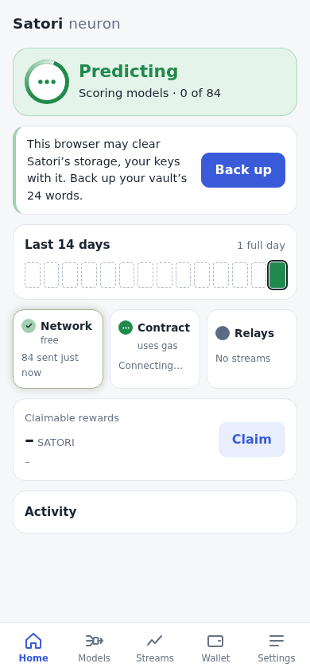 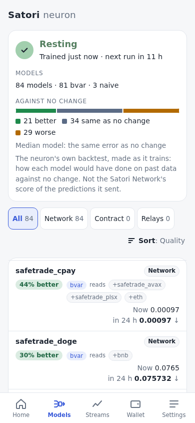

## Retrain

The owner, 2026-10-18 ([../intent/engine.md](../intent/engine.md)): "The
first thing I want to do as a user is tell the neuron to keep training on
the models that are worse than naive. A button in the model details screen,
near the top right, that tells it to **Retrain**, meaning it'll keep
training till it finds a better model, then stops."

What it is for, in the owner's terms: a person who sees a model losing to
no change can make the neuron work on that one model now, instead of
waiting for one mutation per poll, and it stops by itself once it has
something better, or says plainly that it could not.

`src/engine/retrain.js` (the search, pure), `src/neuron/retrain.js` (one at
a time, paced, persisted, paused for a poll), the drill-in's header.

### Where

A **Retrain** button in the drill-in's header, top right, under the
quality words (a word, no icon). It is the accent (primary) button when the
model is worse than no change or the same; a plain one when it is already
better (a retrain then looks for a model better than it).

- **Shown** on Satori Network (central) models, `bvar`, `bar1`, `bar1d` or
  `naive`, whose stream has the history to split: 14 older backtest origins
  besides the tab's 28, which takes 52 back-to-back 12 h buckets, about four
  weeks (central serves ~41 days of an hourly stream, so every hourly
  stream has it). A `naive` model with that history now (history that came
  after its forecast) has it too.
- **Not on Contract (Base) and Relays (Nostr) models**, for now: they read
  only their own stream (`bar1`, [engine.md](engine.md#scope)), so there is
  no spec to search and none is stored. Their drill-in says so in one muted
  line where the button would be: "Retrain is for Satori Network models for
  now: this one reads only its own stream."
- A Network model without that history has no button either, and one
  muted line: "Retrain needs about four weeks of this stream's history."
  (a daily stream never has it: it never has three buckets in a row).

### What it does

A focused search on this one target, from stored history only. Like the
training pass, it **never predicts and never submits**, and never calls
the Satori Network.

- **The space**: 1–3 companions from the target's aligned pool (the poll's
  pool, [engine.md](engine.md#the-spec)), λ1 and λ2 on their grids, and the
  algorithm: `bvar` with its companions, or the single-stream AR (`bar1`).
  A spec that chose `bar1` is `{ companions: [], algorithm: 'bar1' }` with
  its λ's kept: the poll's repair leaves it alone, and the poll's only
  proposal for it is to add a companion back.
- **The search**: a hill-climb. From the current champion it tries every
  spec one change away (swap a companion, add one, drop one, λ1 or λ2 one
  grid step, to or from `bar1`) in a seeded order, and moves to the first
  that scores better; at a local optimum (every neighbour tried) it
  restarts from a seeded random draw. Seeded by identity + target + the
  target's retrain counter, so a retrain is reproducible.
- **The goal**: better than no change, by the tab's rule (the median error
  over no change's, below 0.95).

**The held-out scheme.** The search scores candidates only on the older
backtest origins, and checks its best once, on the newest 28 (the last two
weeks, the ones the tab's quality is), which it never chose on; it keeps it
only if it has 20 % less error than no change there. On simulated random
walks that passes by luck 1.5 times in 100, where the tab's own rule (5 %)
on the same 28 would pass 19.

Why so: the tab's quality is itself noisy. On a pure random walk a spec
drawn with no search reads "better" on the 28 origins 11 % of the time,
and the search's best more often (its high-variance specs spread both
ways), so a split alone is not enough: the check must be one look, and its
bar must hold against that spread. Measured with `retrainer` on synthetic
12 h series of 83 buckets (central's ~41 days), the champion a drawn spec,
the pool 30 streams, one look (`node scripts/retrain-sim.mjs`: each run's
looked-at spec scored on the held-out origins, every rule applied to the
same numbers):

| Rule at the one look | Random walks accepted (400) | A strong leader confirmed (100) |
|---|---:|---:|
| the tab's rule, below 0.95 | 19.0 % | 86 |
| below 0.90 | 9.3 % | 78 |
| below 0.85 | 3.3 % | 74 |
| **below 0.80 (shipped)** | **1.5 %** | **63** |
| below 0.95 and each week below 1.0 | 8.0 % | 70 |
| each week below 0.95 | 3.8 % | 63 |
| each week below 0.90 | 1.0 % | 58 |

(The strong leader: the target's 12 h return is another stream's last one
plus a little noise, so the first 12 h step of its 24 h forecast is known
and the second is not: the true edge is about 30 %, and the search held the
leader at its look in 95 of 100. With a pool of 80, as on central, the
shipped rule accepted 3 of 100 random walks and confirmed 20 of 40 such
leaders, the search holding it in 31.) A week of 14 origins is too noisy
to ask each to agree: a truly 30 % better model lost to no change in one
of the two weeks often enough that the weekly rules cost power for the
same honesty. A weaker leader (worth ~12 %) is confirmed about a time in
ten: 28 origins can't tell it from luck. Earlier drafts, for the record:
three looks at the tab's rule accepted 4 random walks of 20; one look at
the tab's rule, 15–19 in 100.

- **The split**: the held-out origins are the tab's (the last 28 bucket
  positions); the search's are the older ones whose actual (24 h on) came
  before the first held-out origin, so no value it scored on is one it is
  checked on. The champion's own held-out ratio is the tab's number.
- **One look per observation**: a second retrain on the same data would
  look at the same 28 origins again (more looks, more luck), so once a
  retrain has looked, the next one waits for the stream's next observation:
  "Already retrained on this data. Try again after its next observation."

### When it stops

- **(a) Found**: the one look passes (at the first local optimum that is
  the best so far and beats no change on the search origins, or when the
  search ends). When the champion already beats no change, the best must
  also have 20 % less error than the champion there. The spec becomes the champion where evolution keeps it
  (`model_specs`: the spec; its score, no change's, influence and fit key
  as the poll scores them, so the tab shows the held-out number;
  generation + 1, accepted + 1). Written only where the stored spec is
  still the one it was compared with (a poll that evolved it meanwhile
  wins). "Found one: 14% better. Used from the next prediction."
- **(b) Search over**: the look failed, or **400 tries without a better
  search score** (more than every neighbour of a three-companion spec in an
  83-stream pool, 3 × 80 swaps + 2 drops + 4 λ steps + 1 = 247, so a
  stalled climb has tried them all), or 3,000 tries in all (about 10 s), or
  every spec tried (a small pool). The best is kept only if it has 20 %
  less error than the current champion on the held-out origins (the same
  test against it); else the
  champion is untouched: "Couldn't find a model that beats no change. Kept
  the current one." For a model worse than no change, one more line: "Its
  fade already pulls the forecast toward no change." (the weight from the
  same backtest, [engine.md](engine.md#the-backtest-score-and-fade)).
- **(c) Stop**: it ends at once and keeps the current one: "Stopped after
  40 tries. Kept the current one." It looks at nothing held out, so a
  retrain can follow at once.

A new champion is used **from the next prediction**, the next new
observation (Lite's rule: an observation is never predicted twice); until
then Out still shows what was sent. The result line stays until the model
next predicts. The spec keeps a small summary of the last retrain:
`{ n, at, outcome, kept, ratio, was, tried, ms }` (Details: "Last retrain").

### While it runs

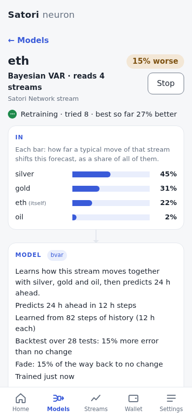 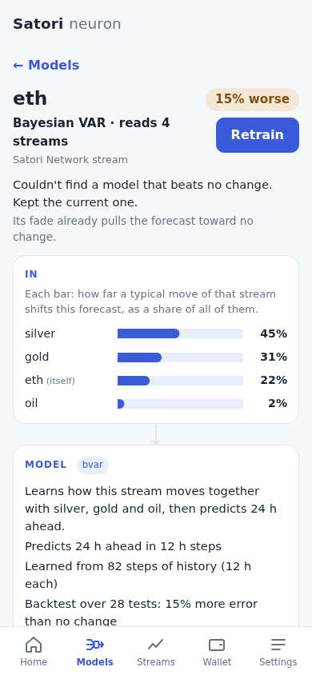 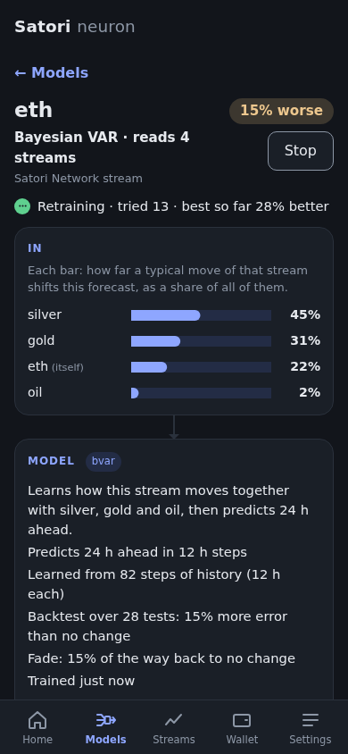 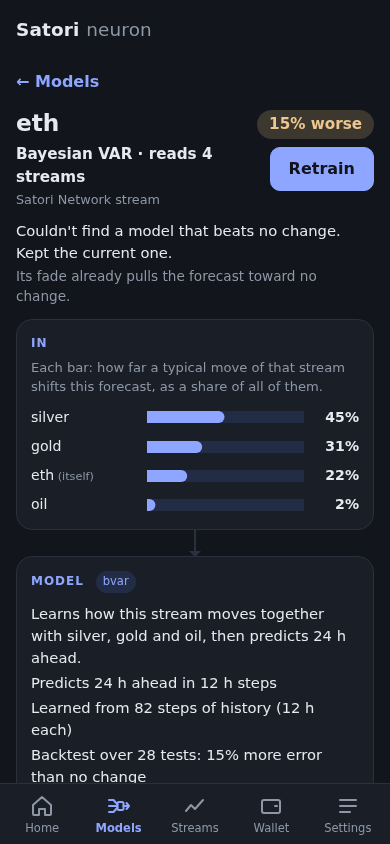

(From `e2e/retrain.spec.js`, `SHOTS=1`. The e2e's eth trails bitcoin by
12 h; the search found bitcoin, 28 % better than no change on the older
origins, but only 18 % on the last two weeks, under the bar: an honest
"Couldn't find".)

- The button reads **Stop**; a line under the header: "Retraining · tried
  40 · best so far 3% worse" (the best on the search origins: what the
  search sees; the result is the held-out number). Behind another:
  "Retraining · after eth". During a poll: "Retraining · waits for the
  poll · tried 40".
- The work task `retrain` (step `search`, its count, the model's name):
  Home's hero reads "Retraining eth…", then "Retraining eth · tried 40", in
  working green with its one moving indicator; the Models status the same.
- **Paced**: it gives the page a turn every 10 ms of work (`scheduler.yield`,
  as the training pass); the count shows at most every 250 ms.
- **Resumable**: the request is pending work. It is kept with the spec
  (`model_specs.retrain`, migration 13) when asked, with the search's state
  (the count, the climb's place, the best) every 2 s, so a closed app
  continues on open, where it was, until (a), (b) or (c) ("never rest with
  work pending"). Retrains run one at a time, in the order asked.
- **One writer**: it waits while central's work runs (a poll, its sign-in,
  the history), then continues on the new data, the champion read again.

### Live

2026-10-19 00:50, the dev server on :5180 restarted with this code,
against central2, a fresh Chrome profile, no stubs (prod blocked, none
asked): setup → the first poll (84 streams, 54,803 rows of central's
history, 84 of 84 accepted; 25 better, 32 the same, 27 worse) → the worst
model's drill-in, **safetrade_cfb, "885% worse"** (its forecast faded all
the way back to no change) → Retrain:

- the button became Stop; the line read "Retraining…", then "Retraining ·
  tried 380 · best so far 65% better"; Home's hero "Retraining
  safetrade_cfb · tried 380";
- **434 tries, 1.37 s of search, 2.2 s from the tap to the result: 317
  tries a second**. Its best was 65 % better than no change on the older
  origins, but not on the last two weeks: "Couldn't find a model that beats
  no change. Kept the current one." (and the fade line);
- no poll, no predictions batch, nothing to prod, no page error.

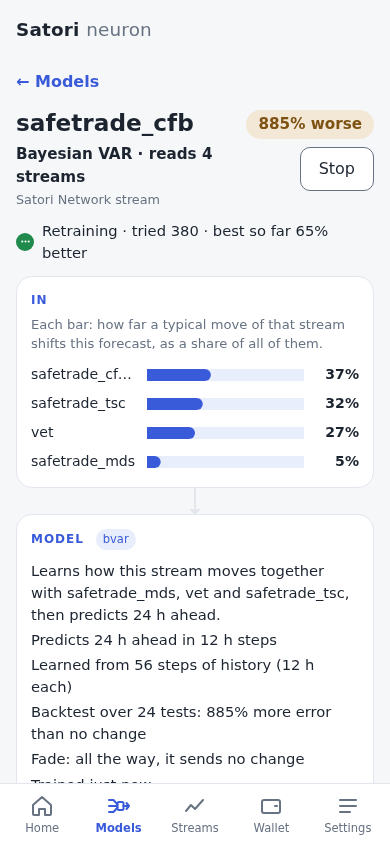 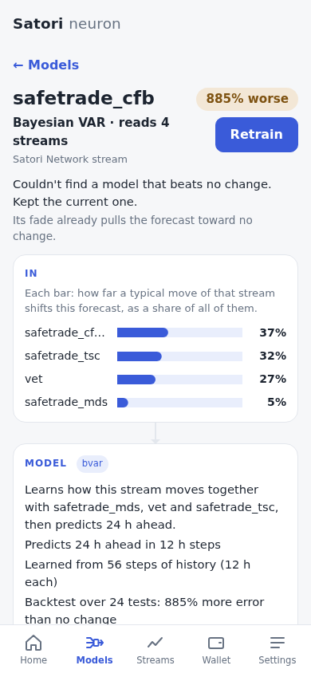 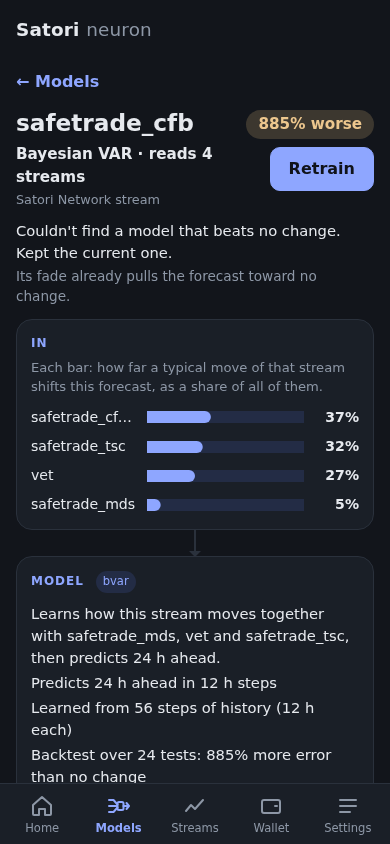

The same with another fresh profile (another identity, so other specs),
through `satori.retrain(id)` on its ten worst models: none beat no change
by 20 % on the last two weeks; four kept a closer one (safetrade_kcn from
41.6 times no change's error to 28.3, safetrade_btcz 3.79 to 2.50,
safetrade_cfb 2.17 to 1.00, safetrade_evr 1.86 to 1.39), five kept the
current one, and gold was refused (it lacks four weeks of back-to-back
history). Each took 1.6–6.3 s (261–937 tries); **431 tries a second** over
all. On the older origins their bests read 6–80 % better than no change:
the recent weeks of central2's thin safetrade streams did not bear them
out, which is the luck the look is there to catch. In the e2e, on this
box's busier moments, 105–210 tries a second.

## Influence: how much each input moves the forecast

For a `bvar` model (a Bayesian VAR(1) of the target and its 1–3 companions,
[engine.md](engine.md#the-model)), the target's forecast is Σₖ coef[0][k] ×
(input k's last step). An input's influence is its **standardized
coefficient** in that equation: |coef[0][k]| × σ(input k's step over the
rows the model learned from), how far a typical step of that input moves the
forecast. The tab shows them as shares that sum to 100%, the target's own
last step included ("eth (itself)"), largest first. The plain line on the
page: "Each bar: how far a typical move of that stream shifts this forecast,
as a share of all of them."

- `bar1`, `bar1d` and `naive` read the stream alone: itself, 100%.
- The shares say what the model leans on, not how far it moves the forecast
  at all: in a model shrunk toward the random walk the coefficients are tiny
  and still sum to 100%. The Backtest and Fade lines say how much it does.
- The sign is left out of the bars (a companion can push either way); the
  coefficients are under Details.
- With every coefficient 0, the forecast is the last value: itself, 100%.

Tested (`src/engine/bvar.test.js`): a fit of three series where one
companion drives the target ranks it first (above 60%) on three seeds, the
shares sum to 1, |coef| × σ by hand, the sign ignored. Live, a stream that
trails another by 12 hours was 98% that other stream (the e2e's eth and
bitcoin).

## The engine's status (top of the tab)

| Title | Tone | When | Line |
|---|---|---|---|
| Working | green (`working`), vivid while sending (`critical`) | the poll, the Base batch or the training pass runs | the step, in Home's hero's words at its pace: "Building models · 40 of 82", "Scoring models · 12 of 81" |
| Resting | sky (`idle`) | otherwise | "Trained 2 h ago · next run in 9 h" (the newest forecast; central's next poll) |
| No models yet | sky | before the first poll | "The first poll builds them · in 1 min" |
| Needs a look | amber (`warn`) | the engine itself failed: the last run's local error (the database or the engine) | "The last run failed: …" |

The tones are Home's ([health.md](health.md#the-tone-three-greens)); amber
only when something is wrong with the engine. Central's own failures (a
refused batch, a timeout) are Home's to say. **One moving indicator**: the
Models tab shows the step with the still "working" mark, never a second
turning ring (`e2e/models.spec.js` checks the tab has no running animation
while a poll is held). The step text comes from the same work state
(`src/neuron/work.js`) through its own pacer (`src/ui/hold.js`), keyed on the
step, so a count ticks at once.

Under it: "83 models · 81 bvar · 2 naive"; a bar of better / tie / worse /
not scored with its legend in the rows' words, a swatch of each colour:
"24 better · 40 same as no change · 19 worse" ("· 2 not scored yet" when
there are some); "Median model: 1% less error than no change"; the plain
line on whose score it is.

## The list

Each row, scannable: the mark in words; the name (a Nostr model also
"publishes `<stream>_pred`"); the kind as a chip; the inputs it reads besides the
stream, as chips by influence ("+eth +gold"; on a phone, with no column
header, "reads +eth +gold"); the values labelled, "Now
3,153.92 · in 24 h 3,141.01 ↓", the horizon the model's own (24 h, 1 h,
a day), the arrow after the forecast saying which way it goes from now (on
a phone, two short lines: "Now 3,153.92" and "in 24 h 3,141.01 ↓"); where
its predictions go, as tiny text tags in the chip style ("Network",
"Contract", "Relays": the pictograms they replaced were unreadable). Above it, on the left, the
filters **Network · Contract · Relays**, each with its count: three toggles,
all on at first (the owner, 2026-10-18: "remove the All filter button").
A tap turns one off or on again (`aria-pressed`, the selected style), and
the list shows the models whose predictions go to any one that is on; the
last one on stays on (a tap on it does nothing), so the filters never empty
the list. The choice is not kept: each visit to the tab (from another tab,
or a reload) starts with all three on; back from a drill-in keeps it. On the right a
borderless **Sort** with a sort icon (three stacked lines) that shows its
choice subtly ("Sort: Quality"). Tapping it opens a small menu, **Quality**
and **Name**, with a check on the current choice (quality: the lowest ratio
first, not scored last). It is WAI-ARIA's menu button: the current choice
is focused when it opens, the arrows (and Home, End) move, Enter or a tap
chooses, Escape closes back to the button, Tab or a tap elsewhere closes;
the button and each item are 44 px tall. The choice is kept on this device
(`localStorage` `satori-models-sort`, read and written in try/catch as the
theme is, `src/ui/prefs.js`). (It was two segmented buttons, Quality ·
Name, which the owner did not read as a sort.) A computer shows a dense
table; a phone shows each row as the name and where it goes, then the mark,
the kind, the inputs and the values, wrapping, never cut. A tap opens the drill-in; the back link
returns to the list where it was.

## The drill-in

`#models/<id>` (a link or a reload opens it; the back link is the browser's
back when the list came first). Under the model's name, always, **what it
is** in plain words (`kindLabel`): "Bayesian VAR · reads 3 streams",
"Single-stream AR (bar1)", "Single-stream AR on changes (bar1d)", "No
change · not enough history yet", "Echo · the value is not a number"; a
model of several algorithms (`algorithms` is a list) would read "Ensemble ·
3 algorithms". Beside the name, its mark in words, and under the mark the
**Retrain** button ([Retrain](#retrain)); under them all, Retrain's line
while it runs and its result after. Then the source ("Satori Network
stream"). Top to bottom, joined by short arrows:

- **In**: each input with its share as a bar, ranked; for a model of several
  outputs, a choice of whose inputs.
- **Model**: first how it works, in one sentence (`description`): "Learns
  how this stream moves together with ltc and safetrade_eth, then predicts
  24 h ahead."; bar1 "Learns how each 12 h move of this stream follows the
  one before, then predicts 24 h ahead."; naive, with the true rule (6 lag
  pairs need 8 back-to-back steps): "Repeats the latest value until it has 4
  days of back-to-back history." (8 h for an hourly stream). Then in plain
  lines: "Predicts 24 h ahead in 12 h steps", "Learned
  from 49 steps of history (12 h each)", "Backtest over 28 tests: 15% less
  error than no change", "Fade: none, its forecast is sent as is", "Trained
  2 h ago". **Details** (closed): λ1, λ2, mutations tried and kept, the
  coefficients (or φ), the fade weight, the median error and no change's,
  rows and backtests.
- **Out**: per output: the forecast (t1 and t2, or the one value), the
  latest value, a chart, and where it went: Network ("Accepted Oct 18,
  16:23", or "Pending since …"), Contract ("Round 20743 · UP · tx 0xab…cd",
  linked to the explorer; or "left out: …"), Relays ("`btc_pred` #12 · 2
  relays").

**Computed on demand** (`modelDetail`): the stored spec and the stored
history of the target and its companions (one read, `db.histories`), refit
as the poll fit it (`explainModel`; Nostr and Base: `explainForecast` at
their step and horizon). Until new history arrives it is the poll's model
exactly (the e2e compares the drill-in's influence with the one the poll
kept). In and the Model are that refit; Out is what was sent. When the
refit is another kind than the forecast sent (history came after the poll),
In and the Model fall back to what the list kept. An open drill-in follows
its model: after a poll, a `_pred` published or a Base batch it is
recomputed (the e2e publishes one more observation with a Nostr model open
and sees its `#17` in Out).

**The chart** (one series, so no legend; the title names it): the history
from 7 horizons before the forecast was made (at most 400 points) as a 2 px
line in the accent colour, broken where observations stop for over four of
their usual intervals; the forecast to scale in time and value, dashed from
the last point, t1 as a ring and the endpoint (the value sent) filled,
ringed in the surface colour and labelled with its value; each forecast
point labelled with how far ahead it is, "12 h" and "24 h" (one point:
"24 h", "1 h"), so the open and the filled circle mean something without a
legend (two points too close for both, as a week of history on a phone puts
them, are labelled a line apart); a hairline where the forecast was
made; the range's top and bottom as hairlines with their values outside the
plot; the first time and "+24 h" under it. Hover, or the arrow keys once
focused, moves a crosshair and the readout under the chart says that point
("Oct 17, 14:00 · 2,597.00"; at rest, the forecast's). Every value the
readout gives is also in the text above it or the table of history the agent
API returns. It is drawn px for px at the block's measured width
(`ResizeObserver`), so text and dots keep their size on a phone and a
computer, from the theme's tokens, light and dark. Two constraints shaped
it: the CSP allows no inline style (`style-src 'self'`), so geometry is SVG
attributes; and ArrowJS 1.0.6 builds an inserted chunk outside the SVG
namespace, so a chart's children are fixed and only their attributes move.
A third, found with Retrain (whose end always recomputes the open model):
the out blocks are rebuilt when the model is recomputed (their key holds
`modelRev`), so nothing inside one may follow `modelRev` too; the chart is
memoized on the detail object and the width instead. An expression that is
queued and released in the same flush throws inside ArrowJS's queue
("expressionPool[effect] is not a function"), and the rest of that flush's
expressions never update again: a poll that recomputed an open drill-in
threw three of these before the fix (`e2e/models.spec.js` now fails on any
page error). Retrain's status stays out of the reactive state for a like
reason (`box.retrains`, `state.retrainRev`): ArrowJS makes nested objects
reactive in place, and one shared by two parents broke its updates.

**Huge or tiny values** (a Base registry value is often a ratio × 10¹⁸) print
in four digits and a power of ten ("5.906e16", "1.234e−6"), never "0".

## Agents

- `await satori.models()` → every model, as above. It reads what the tab
  shows (refreshed after every poll, Nostr publish, Base check and training
  pass; `poll()` resolves after it), each with the backtest kept with it.
- `(await satori.status()).train` → the last training pass, `{ central,
  nostr, base, stopped, ms }`, or null (none this session); while one runs,
  `health().work` is `{ task: 'train', step: 'score', done, total }`.
- `await satori.model(id)` → the drill-in: the model's fields, `model: {
  kind, rows, tests, step, horizon, weight, phi, coef, lambda1, lambda2,
  generation, accepted, trained, quality }`, each output's `history` (the
  chart's points) and `influence` from the refit, `ms` and `readMs`. `id`:
  models()'s, or a central stream's uuid or name. null when there is none.
- `await satori.retrain(id)` → keeps training a Satori Network model until
  it beats no change ([Retrain](#retrain)), resolving when it ends with `{
  running, waiting, after, tried, best, result }`; `await
  satori.stopRetrain(id)` → the same, after it stopped. `model(id).retrain`
  → `{ available, why, running, waiting, after, tried, best, result }`;
  while one runs, `health().work` is `{ task: 'retrain', step: 'search',
  done, name }`.
- `satori.go('models')`, `satori.go('models/<id>')`; the URL's `#models`,
  `#models/<id>`.
- `data-test`: `models-tab`, `engine` (`data-tone`), `engine-title`,
  `engine-line`, `engine-kinds`, `engine-quality` (the bar's legend: its items `.qleg`, its `aria-label` the
  whole line), `engine-median`, `engine-note`,
  `models-filter-<network|contract|relays>` (toggles, `aria-pressed`), `models-sort` (the Sort button, `aria-expanded`),
  `models-sort-menu`, `models-sort-<quality|name>` (its items, `aria-checked`),
  `models`, `model-row` (`data-id`, `data-mark`) with `model-mark` (the words; `data-short`: the phone's),
  `model-name`, `model-kind`, `model-inputs`, `model-forecast`, `model-to`;
  `models-empty`; the drill-in `model-detail`, `model-back`, `model-title`,
  `model-in` with `model-input`, `model-model` with `model-line` and
  `model-details`, `model-out` with `model-output` (`data-stream`),
  `model-output-name`, `model-output-forecast`, `model-chart`,
  `model-endpoint`, `model-ahead` (the forecast points' "12 h", "24 h"), `model-readout`, `model-destination` (`data-to`),
  `model-kind-label`, `model-quality`, `model-retrain` (`data-action`
  `retrain` or `stop`), `model-retrain-line` (`data-r`), `model-retrain-note`;
  `model-loading`, `model-error`.

## Cost

Measured 2026-10-18 on this shared 8-core box, headless Chrome, each live
drill-in 3 times (the median), every one of the 83 models:

| What | Busy box (load 5–6) | Quieter |
|---|---|---|
| A drill-in, live on central2 (83 streams, ~54,760 rows of central's history) | **74 ms** median, max 101 ms; the history read 44 ms | **25 ms** median, max 80 ms; the read 21 ms |
| The same from an agent, `satori.model(id)`, timed in the page | 81–182 ms | |
| `satori.models()` (83 models), timed in the page | 2–12 ms | |
| A drill-in in the e2e (8 streams, 600 hourly rows each) | 22–112 ms, the read 19–75 ms | 15 ms, the read 13 ms |
| The poll's engine, for comparison (83 targets, a champion and a challenger each) | 924–1,111 ms | 503–565 ms (205 ms on a quiet box, [engine.md](engine.md#measured)) |

The refit itself is 4–30 ms; the rest is the one read of 2–4 streams'
history in DuckDB's worker.

Two changes made it cheap: the drill-in reads its 2–4 streams in one query
(one query per stream: ~100 ms of a ~110 ms drill-in in the e2e), and the
agent API reads the tab's state instead of every stream's row again
(`db.streams()`, ~0.6 s live: `models()` took 1.6 s, `model(id)` 0.7–0.9 s).

## Verify

- `npm test`: `src/neuron/models.test.js` (the quality classes and their
  edges, naive and not scored, a perfect no change, several outputs' median;
  the list from central rows, Nostr subscriptions and a Base batch with what
  was left out; the summary; sort and filter (any destination on; a tap
  toggles one, the last one on stays on); the status's four states;
  the drill-in recomputed for a bvar model, a Nostr model, a Base model with
  and without the chain; the Nostr scores cached per seq);
  `src/ui/drill.test.js` (a fabricated **two-output model**: Out draws both
  outputs, each with its forecast, chart and destinations, and In follows
  the chosen output; the Model's plain lines and Details; quality and
  destinations in words; the chart's scales, the endpoint, the step to
  scale, a gap; the row and the status); `src/engine/bvar.test.js`
  (influence), `engine.test.js` (`explainForecast`), `evolve.test.js` (what
  `runModels` keeps; `explainModel` gives the poll's numbers again);
  `src/db/db.test.js` (migrations 11 and 12, `histories`, `saveFits`,
  `setRelayFit`); `src/neuron/train.test.js` (the training pass: the fit
  key; exactly the models without a current fit, central, Nostr and Base;
  each scored as the poll would with the spec untouched; never a
  prediction; stopped between models and resumed by the next pass; a poll
  that evolved a spec meanwhile wins; it waits for central's work; the work
  state "Scoring models · k of n", refreshed before it ends);
  `neuron.test.js` (a poll's specs carry their fit key: nothing lacks a fit
  after it).
- `npm run e2e`: `e2e/models.spec.js`: a new neuron on the stub central with
  8 streams and 600 hours of history, staked on the fake chain (its batch:
  2 Base models) and subscribed to a stream on a test relay (16
  observations: a Network model). The status (Resting, Working with no
  animation on the tab while a poll is held, the counts by kind and mark),
  `models()`, the filters (three toggles, all on; one off and on again; the
  last one on stays on; a new visit starts with all on), sort by name and quality, a row's
  chips, a bvar drill-in (In ranked and summing to 100%, the Model, Details,
  Out with its chart and Central's acceptance) and `model(id)` against the
  list, back to the list where it was, a Base drill-in, a deep link over a
  reload, an unknown id; at 390 and 360 px nothing scrolls sideways and every
  tap target is 44 px; the Sort menu: the filters on the left and Sort on
  the right, open (the current choice checked and focused), the arrows,
  Enter, Escape back to the button, a tap outside, the choice kept over a
  reload, its items 44 px on the phone. `src/ui/prefs.test.js`: the kept
  choice (storage blocked: the default) and the menu's keys.
  `e2e/home.spec.js` checks the Models tab on the phone
  with the others. `e2e/train.spec.js`: a neuron whose stored specs lost
  their scores (cleared through the e2e store page, as a version before
  migration 11 left them) opens to "Scoring models · k of 8" on Home and
  the tab (working green, never *Resting* before it), then every score is
  back, equal to the poll's, and *Resting*; no poll, no predictions batch;
  a reload with nothing to do rests at once.
- Retrain: `src/engine/retrain.test.js` (the neighbours and the space; the
  split is the tab's 28 held out and older origins searched, the held-out
  ratio is the poll's score over no change's; a planted leader the champion
  lacks is found, checked once, has 20 % less error than no change on the
  held-out origins, and stops; its power on that leader, 8 of 12; 50
  random walks: 1 lucky acceptance, no lucky swap of the champion, 49 kept
  the current one; reproducible from
  the counter; resumes from a stored state to the same result; Stop keeps
  the champion and looks at nothing); `evolve.test.js` (a `bar1` spec:
  repair leaves it, the poll proposes only to add a companion back, kept
  unless that wins); `src/neuron/retrain.test.js` (found and stored as
  evolution stores a champion, its fit current, never a prediction; Stop;
  a reload: it continues from the kept place to the same result; it waits
  while a poll runs, before and mid-search, then compares with the champion
  the poll left; one look per observation; one at a time; refused without
  four weeks); `src/ui/drill.test.js` (the button, primary when worse or
  the same; the running lines; every result in words; the notes);
  `src/db/db.test.js` (migration 13, `setRetrain`, `saveRetrained`).
  `npm run e2e`: `e2e/retrain.spec.js` (a healthy neuron's worst model:
  Retrain, Stop and a counting line, Home's hero in working green, a reload
  mid-retrain continues from its kept place, a result line, the same data
  refused; no poll, no predictions batch, no page error).

## Live

2026-10-18 17:12, the dev server on :5180 restarted with the final code,
against central2, a fresh Chrome profile, no stubs (prod blocked, none
asked): setup → the first poll at once: 83 streams, central's history for
all 83 (54,761 rows), 83 of 83 accepted. The tab: *Resting*, "Trained just
now · next run in 11 h", "83 models · 81 bvar · 2 naive", "Beats no change
on 18 of 83 · ties 43 · worse 22", "Median model: the same error as no
change". Each fresh profile draws its own specs (the identity seeds them):
three others that day read 24 / 40 / 19, 17 / 49 / 17 and 19 / 32 / 32, the
median model between 1% less error and the same. Nothing scrolls sideways at
390 px.

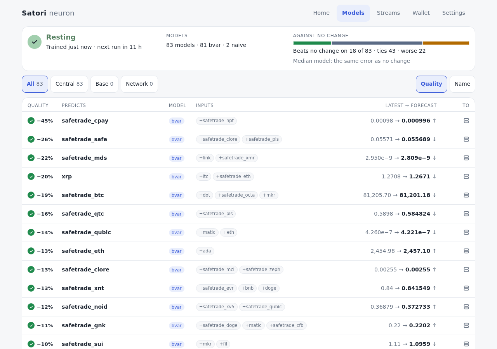

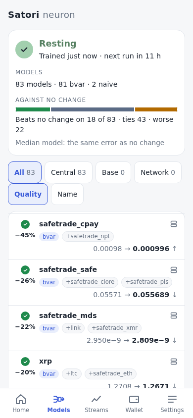 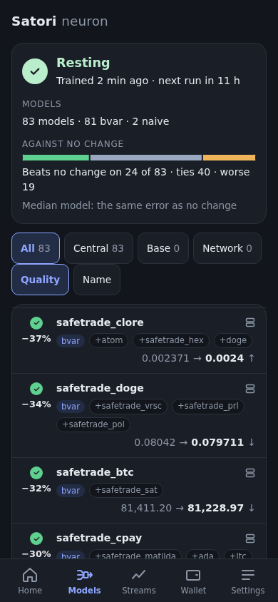

A drill-in live (xrp: 74% ltc, 15% safetrade_eth, 11% itself; 20% less
error than no change over 24 tests; the line breaks where central2's history
has gaps):

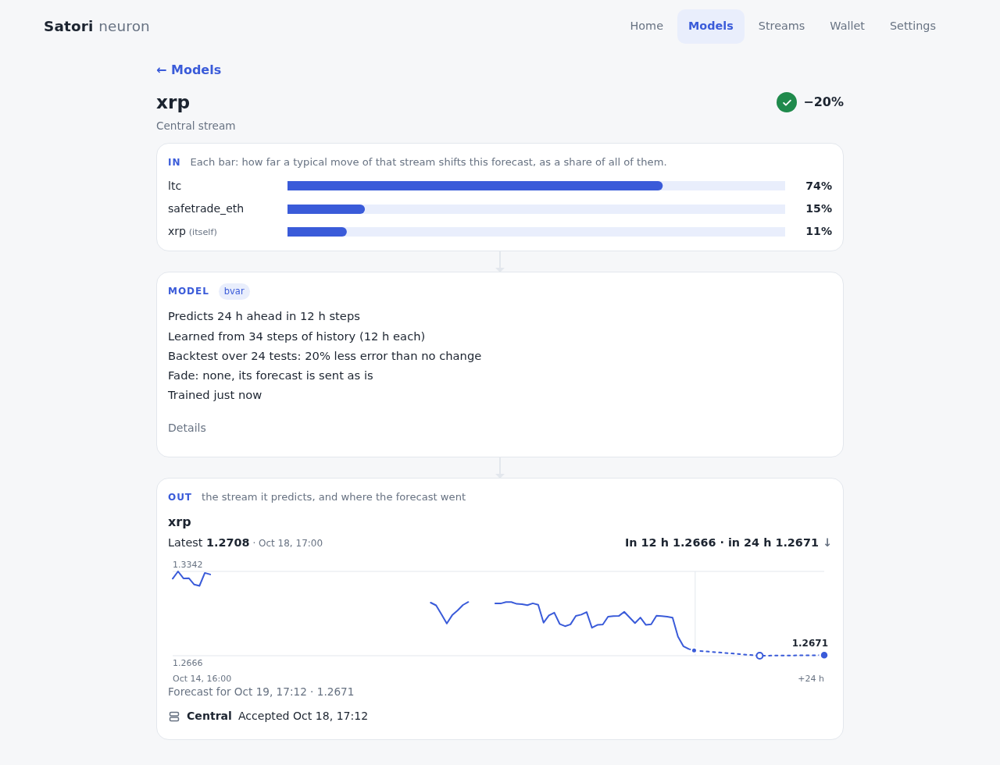

## Screenshots

From `e2e/models.spec.js` (`SHOTS=1`): the list and a bvar drill-in, on a
phone (390 px; the drill-in whole) and a computer (1280 px), light and dark:
`docs/screenshots/models-{list,drill}-{phone,desktop}-{light,dark}.png`, a
naive drill-in (the Base default stream) `models-drill-naive-*.png`;
the Sort menu open on a phone, `models-sort-phone-{light,dark}.png`.

The Sort menu open on a phone, light and dark:

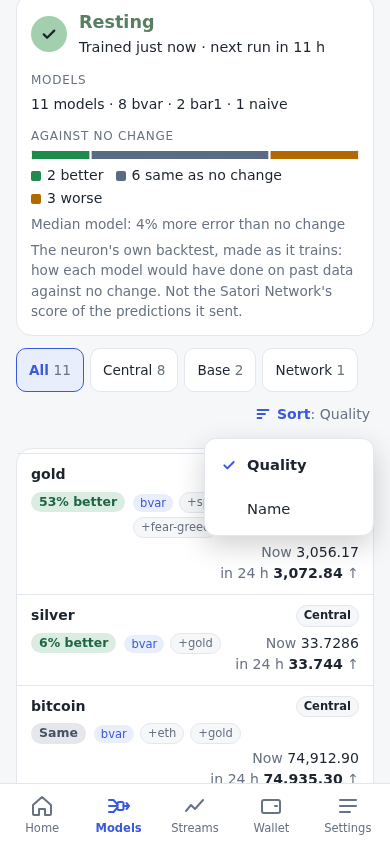 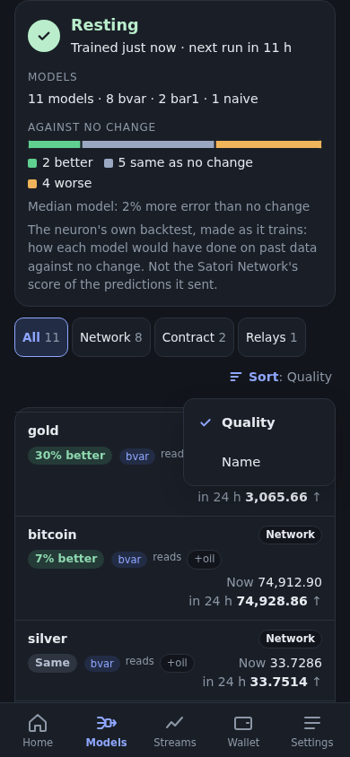

A naive model's drill-in on a phone: what it is, its rule, the chart's labels:

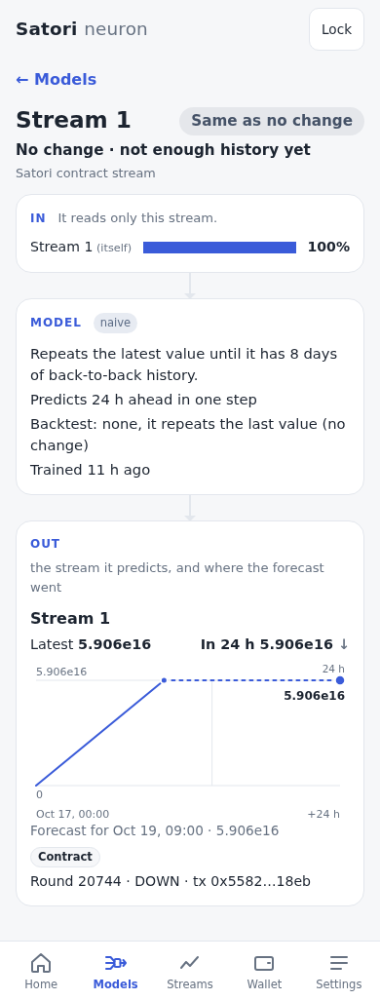 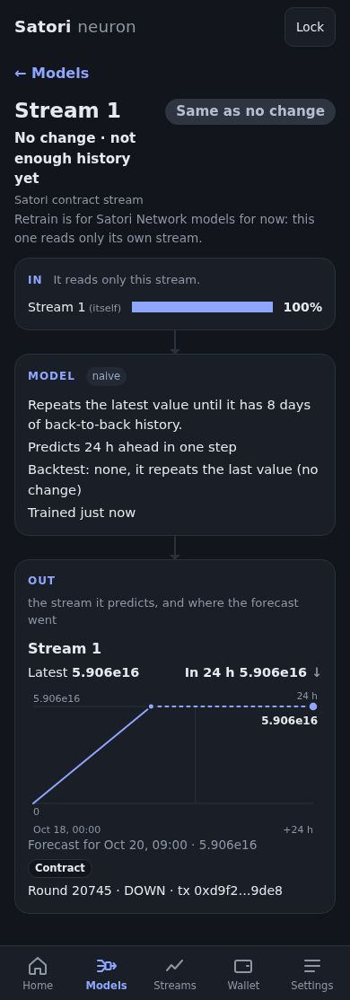

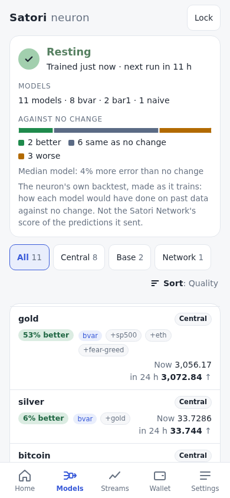 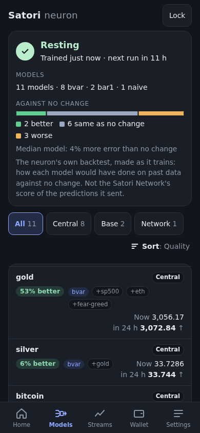 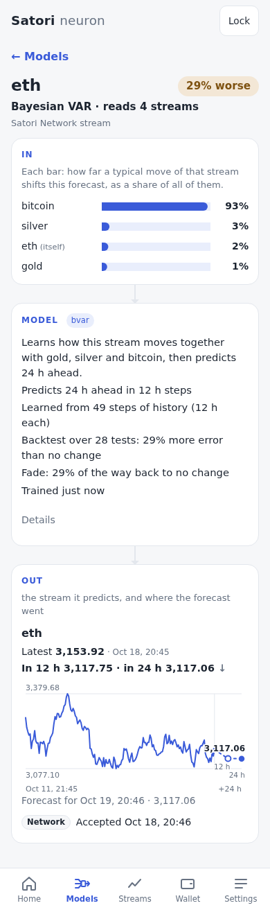 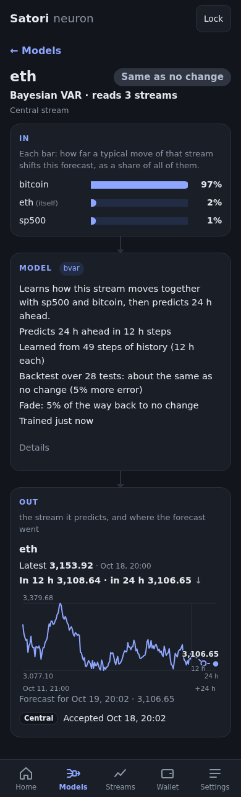

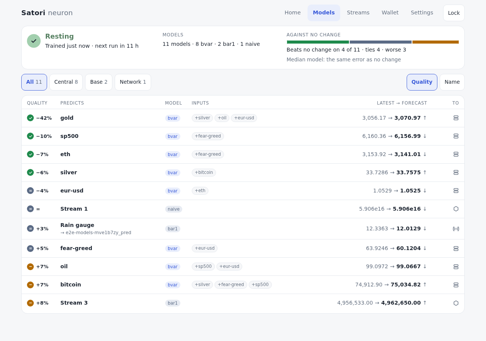

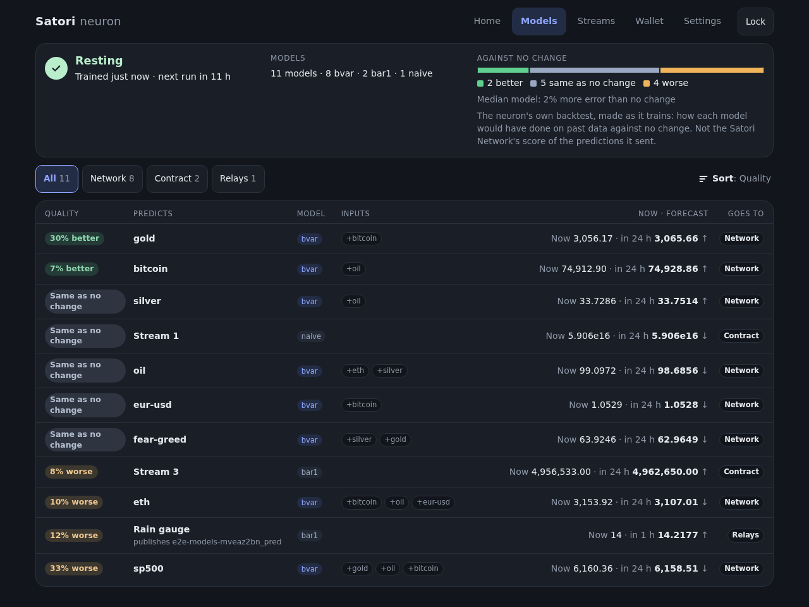

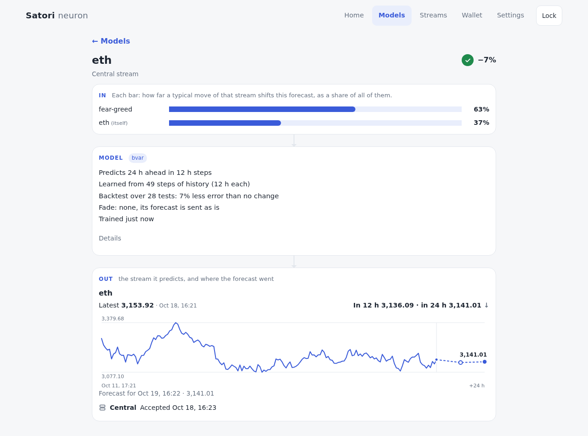

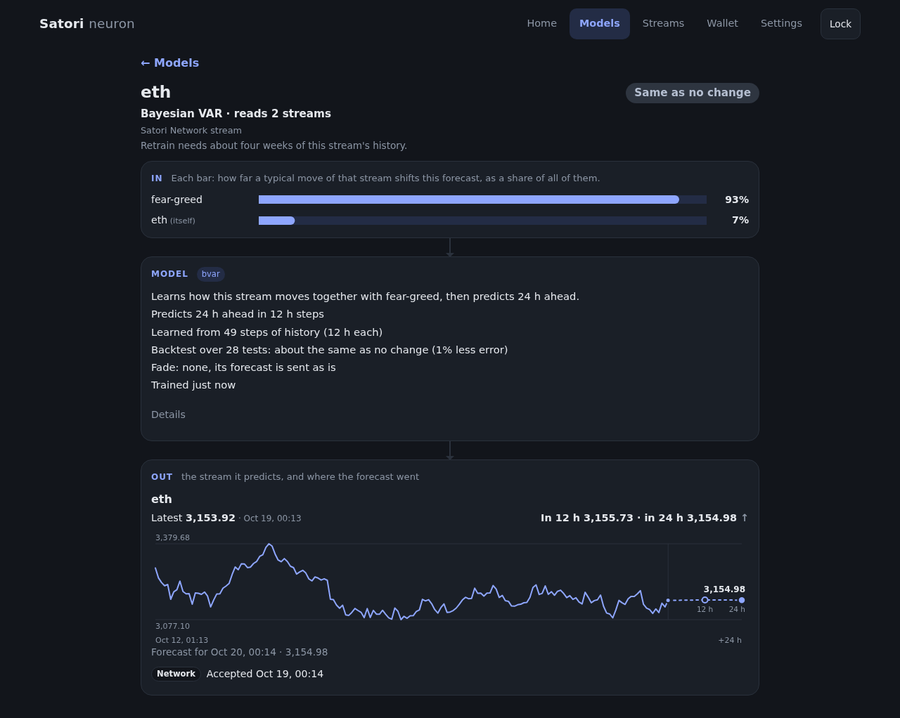
