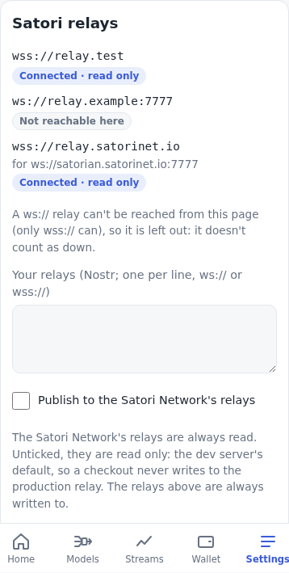

# Nostr: subscribe to streams, publish `_pred`

[← OVERVIEW](OVERVIEW.md)

The neuron follows free Satori streams on Nostr relays and publishes a
prediction stream, `<stream>_pred`, for each one, the way Satori Lite
(`../neuron`, the Docker neuron) does it. Relay streams are kept apart from
central's streams, as Lite keeps them (`sink='relay'` vs `'central'`): their
observations and predictions have their own tables, and relay predictions go
only to Nostr, never to central.

```
page load ─▶ Nostr key (the keys record; made once) ─▶ register with central (nostr-pubkey header)
         └─▶ relays = central's /peer/relays + Settings (+ ws://localhost:7778 on the dev server)
                      (a ws:// one this page can't open ─▶ its wss stand-in, as that relay)
connect each relay ─▶ REQ follow: per provider {kinds:[34601], authors:[p], #d:[streams]}
                   └─▶ announce each `<stream>_pred` (34600)
34601 in ─▶ subscribed? (stream_name, author) ─▶ verify ─▶ store once (event id; stream, provider, seq)
          ─▶ forecast (one cadence ahead) ─▶ publish `<stream>_pred` 34601 (seq + 1) to every relay we write to
         └▶ watched? (a prediction stream or its source) ─▶ verify ─▶ watch_observations (track-record.md)
hourly: refetch the relay list, reconnect, re-announce; daily: NIP-65 (10002); at most every 6 h: scan for prediction streams
```

Short names: `START` = `neuron/neuron-lite/start.py`; `ROUTES` =
`neuron/web/routes.py`; `NDB` = `neuron/neuron-lite/satorineuron/network_db.py`;
`CLIENT` = satorilib's `satori_nostr/client.py` and `MODELS` = its
`models.py`, both at `origin/base-upgrade` (dec62db, the client Lite runs;
`git -C ../satorilib show origin/base-upgrade:src/satorilib/satori_nostr/client.py`);
`PEER` = `central/src/api/v1/endpoints/peer.py`.

## What Satori Lite does, and what the browser does

| Step | Satori Lite | Browser (`src/nostr/`, `src/neuron/nostr.js`) |
|---|---|---|
| Key | `_initNostrKeys` (START:120-149): `nostr.yaml` `{pubkey_hex, secret_hex}`, a **random** key (nostr-sdk `Keys.generate()`), not derived from the alias or the wallet; plaintext, so the neuron runs on its own. | A random key the same way, kept in plain text in the keys record (`meta.keys.nostr`, local format: our own, [keys.md](keys.md#the-record)) beside the alias. Made at setup; an install from before step 5 got one at its update (migration 7). Imported from a Dockerized Neuron's `nostr.yaml` (translated); backed up under Backup as `nsec` and hex. |
| Register | `checkin` sends the pubkey as the `nostr-pubkey` header of `POST /peer/register` (satorilib `server.py:384-402`). | Same header (64 lowercase hex). |
| Events | nostr-sdk 0.45 builds and signs (BIP-340 Schnorr); `CLIENT:203-219`. | Hand-rolled NIP-01 (`src/nostr/event.js`): id = sha256 of `[0,pubkey,created_at,kind,tags,content]`, signed with `@noble/curves` schnorr. Checked against events made by satorilib's own client (fixture below). |
| Relays | Reconcile fetches `GET /peer/relays` (PEER:123-163) every pass and falls back to the relays of known subscriptions (START:4464-4476); user-added relays are used for publishing (START:304-337). | Central's list (fetched at start and hourly; the last one is kept in `meta.nostr_central_relays` and used while central is down) plus the user's relays (Settings). On the dev server the user list defaults to the test relay `ws://localhost:7778`. A `ws://` relay the page can't open is reached through its wss stand-in when it has one ([below](#relays-and-the-read-only-flag)). |
| Stream cap | `max_streams` from `GET /peer/relay-config` (PEER:166-173, `{max_streams: 60}`), fetched once per start (START:236-246); fallback 100 (NDB:14-36). Active subscriptions + own non-`_pred` publications must stay under it (ROUTES:2611-2622). | The same fetch and fallback; the browser has no publications of its own, so active subscriptions < cap. |
| Discover | `discover_datastreams` (CLIENT:809-882): `{kinds:[34600], limit:500}`, paged back with `until` (strfry returns at most 500 per filter); newest first, first per (author, d) wins; tombstones (`status=deleted`) dropped. | The same paging on every connected relay; each event's id and signature checked (a forged one is dropped, so it can't hide the real one), then merged by (author, d), newest wins. `_pred` streams are marked and hidden from the UI's list. |
| Subscribe | The UI stores the subscription (ROUTES:2592-2667, NDB:451-494); a separate action starts predicting (adds the `<stream>_pred` publication, ROUTES:2690-2711). Reconcile then finds the stream on a relay and publishes the 34602 (`subscribe_datastream`, CLIENT:1102-1154, called at START:4526). | One action: subscribe = predict. The announcement taken is the newest one signed by that provider with that name (anything else a relay sends is ignored). The 34602 and the `_pred` 34600 are published at once. Paid, encrypted and approval-gated streams and `_pred` streams are refused (later scope), and so is a second provider's stream with a name already predicted: there is one `<name>_pred` per name, as Lite's publications are unique by `stream_name` (NDB:751-789). |
| Follow | `set_followed_authors` (CLIENT:1687-1714): `{kinds:[34601,34604], authors:[…]}`, id `satori-follow`, 200 authors per filter; reconcile fetches each stream's latest by `{authors:[a], #d:[names]}` (CLIENT:944-983). | One REQ `satori-follow` of per-author filters `{kinds:[34601], authors:[p], #d:[streams]}` (≤ 200 per REQ): the latest stored event of each subscribed **or watched** stream ([track-record.md](track-record.md#following)), then live ones, and nothing of the author's other streams. Sent again only when the set changes. |
| Intake | `_networkListen` drops streams not subscribed by (stream_name, author) (START:1112-1137); empty content is a heartbeat (CLIENT:1818-1820); content is `DatastreamObservation` JSON (MODELS:105-140). `save_observation` dedupes by round, event id, then (stream, provider, seq) (NDB:597-636); only a new row runs the engine (START:621-667). | Same order: empty → skip; JSON with `stream_name, timestamp, value, seq_num`; subscribed or watched by (stream_name, author); id and signature verified once; a timestamp more than max(cadence, 300 s) ahead of its arrival: dropped ([data growth](#data-growth)); a subscription's: insert or ignore on event id and (stream, provider, seq), and only a new row is forecast; a watched stream's (a prediction stream or its source): kept in `watch_observations` with when it arrived, never forecast or published; both: both ([track-record.md](track-record.md#following)). |
| Value | `_numericObservationValue` (START:1365-1410): a scalar → `float()`; a dict → `value`, else `raw` unless `unit == 'tick'`; anything else none (the prediction echoes). Timestamps outside 2000–2100 give no forecast (`_safeEpoch`, START:1413-1424). | `numericValue` (`src/nostr/satori.js`), with Python's `float()` rules for strings; checked against Lite's own function on 17 values (fixture). |
| Model id | `uuid5(DNS, "satori-relay:<lowercase pubkey>:<stream>:")` (`satorineuron/relay_ids.py`), pinned in `neuron/tests/test_relay_ids.py:23-28`. | Same uuid keys the relay tables; the vector is Lite's pinned one. |
| Forecast | `predictForRelay` → `str(firstPredictionOf(_runForecast(…)))` (`engine-lite/engine.py:714-739`); `_runForecast` returns the second, autoregressed forecast (the first with its value appended), falling back to the first (`:1153-1186`): t2. With little data the StarterAdapter forecasts the last value, as a float (`"82234.0"`). No model, a bad timestamp or a non-numeric value echoes the value (`json.dumps` unless a string) (START:1276-1310, 1413-1424). | `forecast(history, { step: cadence, horizon: cadence })`; value = `String(value)` (JS's text; readers take `float()` of it, [the protocol audit](#the-protocol-audit)), **one cadence ahead** (the owner's rule; Lite sends t2, two steps ahead); `naive` gives the last value; echo as Lite when there is no number (`JSON.stringify` unless a string). |
| Publish `_pred` | `_networkPublishObservation` (START:3549-3617): seq = `last_seq_num + 1` (NDB:835-848), content `{stream_name, timestamp: int(now), value, seq_num}` (MODELS:105-140, Python `json.dumps`), tags `[d, stream, seq, satori=observation]` (CLIENT:579-596), to every connected relay; seq advances even with none. | The same fields and values, as compact JSON (`JSON.stringify`; satorilib reads it with `json.loads`, [the protocol audit](#the-protocol-audit)), to every connected relay we write to. The observation, the seq and the prediction are checkpointed first (Lite commits `mark_published` before sending); then the event is sent beside the intake queue, and the count that answered OK is stored when they answer. |
| Announce `_pred` | `_networkAnnouncePublications` (START:3442-3482) on each new connection (START:326-328, 4539): `DatastreamMetadata` (MODELS:14-40) with `name "Predictions for <name>"`, `description ""`, `tags []`, the source's cadence, `created_at` = when the publication was added, `metadata {source_stream_name, source_provider_pubkey, alias_pubkey}` (the alias's compressed pubkey); tags `[d, satori=datastream, stream=satori:stream:<name>, source_stream, source_pubkey]` (CLIENT:294-356). | The same, on every connect and reconnect, on subscribe, and hourly; plus `a` = `34600:<source provider>:<source stream>` (2026-10-28, not Lite's): NIP-01's address of the stream it predicts, a single-letter tag relays index, so `{"#a": [...]}` finds a stream's predictions without the whole catalog. |
| Unsubscribe | Soft delete (NDB:496-503), 34602 with `action=unsubscribe`, `satori=unsubscription` (CLIENT:1600-1644), and a tombstone 34600 for `_pred` (`[d, satori=datastream, status=deleted]`, content = empty metadata with `created_at 0`; START:3683-3720). | The same three steps. The row stays (inactive), so a later subscribe keeps counting `_pred` seq from where it was. The two events wait in an outbox (`meta.nostr_outbox`, kept over a reload) for every relay we write to that is not open or does not answer, and go when it opens. |
| Cadence | Hourly reconcile loop (START:200-292); NIP-65 10002 of the connected relays daily (START:288-291, 370-389, CLIENT:405-428). | Hourly reconcile; NIP-65 of the relays open at the time, when the last one is a day old (`meta.nostr_relay_list_at`), checked hourly and whenever any relay opens, sent only when a relay we write to is open. |

## Follow and predict

Following a stream is not predicting it (owner, 2026-10-25). Subscribe
follows: the 34602 is sent, the stream followed, its observations kept
(Streams, the engine's inputs, the track record), nothing announced or
published. **Predict** (the Streams tab's button per subscription,
`setPredict`, or `subscribe(…, { predict: true })`) announces its
`<stream>_pred`, predicts its latest observation at once, and forecasts and
publishes each new one; stopping tombstones the `_pred` (as Unsubscribe
does) and keeps following. `relay_streams.predict` (migration 18); the
subscriptions made before were all predicted, so they stay so. One
`<name>_pred` per name holds among the predicted ones only.

## Our other streams

Every stream this app produces goes to the relays unless it is private
(owner, 2026-10-25), not only the `_pred` of the relay streams it predicts:

- **The Satori Service's predictions**: after each poll that predicted,
  each stream's forecast (24 h ahead, as sent to the Satori Service) as
  `<stream>_pred`, tagged `satori-network`, its source `<stream>`.
- **The Satori contract's calls**: each game's call when the batch is sent,
  or the game played by hand sends, as `satori-contract-<stream id>_pred`
  (1 up, -1 down; a day's cadence), tagged `satori-contract`.

`publishOwn` announces (34600) and observes (34601, each stream its own seq,
kept in `meta.nostr_own_seq`) where we write. A relay stream we predict
keeps its `<name>_pred`: ours of the same name is skipped. Announced with
each publication, not in the hourly pass (83 streams: the volume stays
low). Not built: re-announcing them hourly; private streams (none yet).
Relays that only take a stranger's `_pred` whose source they hold (Lite's
write policy) may refuse these.

## Event shapes (verified)

`test/fixtures/nostr-parity.json` is made by `scripts/nostr_vectors.py`:
satorilib's own `SatoriNostr` methods (origin/base-upgrade) build the events and
nostr-sdk 0.45 signs them, with the metadata built as START builds it and the
clock pinned. The unit tests rebuild every event and compare the kind, the
tags (in order), the time and the content's fields and values (the same keys,
no more or fewer), check our content is compact JSON, and verify the
signatures nostr-sdk made and ours.

| Kind | Tags (in order) | Content (JSON; satorilib's fields) |
|---|---|---|
| 34601 `_pred` | `d`, `stream`, `seq` (string), `satori=observation` | `{"stream_name": …, "timestamp": int, "value": "<str>", "seq_num": int}` |
| 34600 announce | `d`, `satori=datastream`, a `t` per tag, `stream=satori:stream:<name>`, `source_stream`, `source_pubkey`, and on a `_pred` `a` = `34600:<source_pubkey>:<source_stream>` | `stream_name, nostr_pubkey, name, description, encrypted, price_per_obs, created_at, cadence_seconds, tags, approval_required, metadata` |
| 34600 tombstone | `d`, `satori=datastream`, `status=deleted` | the same keys, empty, `created_at 0`, `cadence_seconds null`, `metadata null` |
| 34602 subscribe | `d=S`, `p=P`, `stream=S`, `satori=subscription` | `{"subscriber_pubkey", "stream_name", "nostr_pubkey": P, "timestamp", "payment_channel": null}` |
| 34602 unsubscribe | `d=S`, `p=P`, `stream=S`, `action=unsubscribe`, `satori=unsubscription` | same |
| 10002 | `["r", url]…` | `""` |

Our content is compact JSON, so our events' ids differ from Lite's for the
same fields (satorilib's `json.dumps` puts a space after `,` and `:`): the
brief's ids (345fa77e…, 484c59ab…) are the compact ones, Lite's 3e82a076…
and 13dc7e51…. An id is the hash of the content as sent, so both are valid.
The 10002 id (6077ae96…) is the same in both.

## The protocol audit

The owner's direction of 2026-10-16 ("migrate in, never back"): copy what
readers depend on, not Lite's bytes. Checked against satorilib
(`origin/base-upgrade`), Lite and central's relay watcher:

| Item | Kind | Verdict | Evidence |
|---|---|---|---|
| Content as Python's `json.dumps` (`", "`, `": "`, `ensure_ascii`; `pyJson`) | network | **Compact JSON** (`JSON.stringify`); `src/py.js` is gone | satorilib parses every content with `json.loads` (`satori_nostr/client.py:825,873,1460,1665,1771`) and takes fields by name: observations `from_dict` reads `stream_name, timestamp, value, seq_num` (`models.py:128-144`); announcements and subscriptions are `cls(**data)` (`models.py:36-47,164-176`), so the **key set** must be exact (it is: tested). Nothing re-serializes or hashes received content (`models.py` imports `hashlib` but never uses it); dedupe is by event id (`client.py:1615`). Lite stores its own `to_json()` re-serialization (`start.py:627`). |
| `_pred` values as Python's `str(float)` (`"82234.0"`) | network | **JS text** (`"82234"`), still a JSON string | Lite turns values into numbers with `float()` (`_numericObservationValue`, `start.py:1365-1410`, the `float` at 1408; `scoring/mae.py:29,56`; `web/routes.py:2168-2233`); nothing compares the text. Central's relay watcher only counts events from registered neurons (`relay_watcher/watcher.py:183-188`). |
| Event ids and signatures (NIP-01, BIP-340) | network | Kept | The standard. |
| Kinds, tags (`d`, `stream`, `seq`, `satori`, …) | network | Kept | Lite's relay policy reads the `d` tag (`relay_manager.py:694`); satorilib's filters read the tags. |
| Provider pubkeys lowercase hex | network | Kept | `client.py:1774` compares strings exactly. |
| Lite's relay model uuid (`uuid5(DNS, 'satori-relay:…')`) | local | Kept as our row id | Never sent anywhere (`relay_ids.py:28,48-67`; central gets no relay-model predictions, `start.py:4707`); a deterministic id is as good as any, and changing it would need a migration for nothing. |
| `nostr.yaml` for the key | local | **Our record** | [keys.md](keys.md#the-record). |

## Relays and the read-only flag

- **ws vs wss.** A build's CSP allows `connect-src 'self' https: wss:`, with
  no `ws:` (2026-10-19: it only added `ws://localhost` services); the dev
  server's adds `ws:`, for its test relay. So in a build a `ws://` relay
  can't open, nor from an https page, where the browser refuses it as mixed
  content before the CSP is asked (`ws://localhost` and `127.0.0.1` aside).
  Such a relay goes to its **wss stand-in** when it has one (below);
  otherwise it shows as **blocked** and is not tried ("ws:// relays are not
  allowed in a build: use wss://", "ws:// cannot be opened from an https
  page"). A blocked relay is neither down nor counted on Home, and Settings
  says why once, under the relays
  ([health.md](health.md#relays-blocked-and-reconnecting)). The dev server is
  plain `http://localhost:5180`, which can open any `ws://`: there nothing
  is blocked and no stand-in is used.
- **A relay's wss stand-in** (2026-10-20). Central lists one relay,
  `ws://satorian.satorinet.io:7777`, the one every Satori Lite neuron uses
  (~350 live streams, Lite's `_pred` among them), and a deployed (https)
  app could not reach it ([issue](../issues/relays-not-wss.md)).
  `wss://relay.satorinet.io` is a TLS front for it (nginx on central's
  nginx-proxy, proxying to port 7777): the same relay, the same events. The
  app keeps an explicit map from a `ws://` relay to the `wss://` address
  that serves the same relay (`src/config.js`, the build variable
  `VITE_NOSTR_WSS`, [deploy.md](deploy.md#build-variables); not a user
  setting). Its default, on the dev server and in a build alike, is the one
  pair satorian → `wss://relay.satorinet.io` (the dev server never needs it,
  but one default is simpler). Where the neuron would block a `ws://` relay
  and the map has a stand-in for it, it connects to the stand-in instead, as
  that same relay:
  - it keeps the original's roles: central's relay stays central's (read
    only unless "Publish to central's relays", below), a user relay stays the
    user's; if the stand-in is also in the user's list, the one entry has
    both roles and one connection;
  - the entry says which address it stands in for (`for`, on each relay in
    `nostr()`), and Settings shows it under the address in small words: "for
    ws://satorian.satorinet.io:7777";
  - everything else keys on the address actually connected: the follow REQ,
    the announcements, the outbox, NIP-65's list (the relays we are on);
  - `meta.nostr_central_relays` keeps central's list as central sent it
    (the `ws://` address), so a central that later lists a `wss://` address
    itself just works, with no stand-in.

  Without a stand-in a blocked relay is blocked as before. The proper fix is
  central listing a `wss://` address itself, which waits on the relay
  redesign ([issue](../issues/relays-not-wss.md)). The deployment's build
  also sets `VITE_NOSTR_RELAYS=wss://nostr.satorinet.io`, Satori's public
  relay over TLS, as the user's relay by default
  ([deploy.md](deploy.md#build-variables)).

  
- **Publish to central's relays** (Settings, `meta.nostr_central_write`).
  Off by default on the dev server, on in a build (a build's default is
  `VITE_NOSTR_CENTRAL_WRITE` when set). When off, central's relays
  are read only: the app subscribes (REQ) to them but sends them nothing, so a
  dev checkout never writes to satorian (production), the same rule as the dev
  central. User relays are always written to; on the dev server the default
  user relay is the test relay `ws://localhost:7778`, in a build none, or the
  build's `VITE_NOSTR_RELAYS`.
- **Relay client** (`src/nostr/relay.js`): one WebSocket per relay; `REQ`/
  `EOSE`/`CLOSE`; `fetch` (one REQ until EOSE, 10 s timeout as satorilib's
  `fetch_events`); `publish` resolves on the relay's `OK` (10 s timeout); kept
  subscriptions are re-sent after a reconnect. Reconnect backoff: 1 s, doubling
  to 5 min, ±20 % jitter, reset only once a connection has worked (its first
  EOSE, or 30 s open), so a relay that accepts and drops connections is not
  hammered. `retryAt` is the pending reconnect's time (ms); `downSince`
  (ms) is since when it has not been open, from its first try or its last
  drop, kept through its reconnects: Home counts it down only after 10 min.
- **After the device sleeps** (timers fire late): the
  [catch-up pass](../plans/runtime.md#catch-up-pass) calls `nostr.catchUp()`,
  which connects each closed relay whose `retryAt` has passed (the backoff
  is kept: a relay not yet due waits) and runs the hourly pass once an hour
  has gone by since the last one (the hourly timer skips a pass the catch-up
  ran within the hour).

## Sending

Intake (store → forecast → keep the `_pred`) runs one event at a time.
Everything that waits for a relay's OK (the `_pred`, announcements, the 34602,
NIP-65, the outbox) runs beside it, each relay at once, so a slow relay, or
one that never answers (10 s timeout), delays nothing else.

## Storage (migration 4)

- The key in the keys record (`meta.keys.nostr`, [keys.md](keys.md#the-record)), `meta.nostr_relays` (the user's relays),
  `meta.nostr_central_write`, `meta.nostr_relay_list_at`.
- `relay_streams` (uuid, stream_name, provider_pubkey, name, cadence_seconds,
  meta = the 34600 content, active, subscribed_at, unsubscribed_at,
  pred_created_at, pred_seq): NDB's `subscriptions` and `publications` in one
  row, since every subscription has exactly one `_pred`.
- `relay_observations` (stream_uuid, seq, ts, value, raw, event_id,
  received_at), primary key (stream_uuid, seq), event_id unique: NDB's
  `observations`. `value` is the unwrapped number (null when there is none),
  `raw` the value as JSON.
- `relay_predictions` (stream_uuid, seq, value, model, obs_seq, made_at,
  event_id, relays): NDB's `predictions`, plus how many relays took it.
- Migration 14: `watch_streams` and `watch_observations`, the watched
  prediction streams and their sources, apart from the subscriptions
  ([track-record.md](track-record.md#storage-migration-14-additive)).
- Migration 5: each `relay_streams` row also keeps its latest observation
  (`obs_*`, the highest seq), our latest `_pred` (`p_*`) and its observation
  count, set at insert time, so the status read on every change is one row
  per stream (a scan of every observation took 0.6 s at 86k rows and 5 s at
  1.3M).

## Data growth

The reliability review (2026-10-19) measured a 1-minute relay stream: every
observation read the stream's whole history and forecast on all of it, and
nothing was ever deleted, so a year in, each observation cost seconds and the
file grew without end. Now (`RELAY_WINDOW`, `src/neuron/nostr.js`):

- **The engine's window**: 400 of the stream's cadences back from its newest
  observation (a daily stream ~400 days, the default; a 1-minute one ~7 h).
  The intake, the training pass and the Models tab read only that
  (`db.relayHistory(uuid, seconds)`): the engine needs 6 lag pairs and 28
  backtest origins, and 400 buckets is about what central's history gives a
  12 h model. An observation older than the window (a relay replaying an old
  event) is neither kept nor forecast.
- **The future-timestamp guard** (2026-10-20): an observation stamped more
  than max(its stream's cadence, 300 s) (`AHEAD_S`, `src/db/index.js`)
  ahead of its arrival is neither kept nor forecast, for the subscriptions
  and the watched streams ([track-record.md](track-record.md#storage-migration-14-additive))
  alike. One observation stamped 2096 would otherwise be the stream's
  newest: the engine's window and the prune would count back from it, past
  the whole history.
- **The prune**: in the hourly pass, at most daily (the first at start),
  each stream's observations older than its window, counted back from its
  newest timestamp **not in the future**, are deleted, and any row more
  than max(cadence, 300 s) ahead of now (stored before the guard), the
  watched streams' too (`db.pruneWatch`)
  (`db.pruneRelay`; a row with no time of its own by its arrival), 10,000 to
  a statement, each its own call in the database's queue so a poll's writes go
  between them. The stream's count (`observations`) stays what was received.

**Measured** (2026-10-19, Chrome on OPFS through the app's own opener and
schema, this shared box at load ~7.5: one 1-minute stream seeded for a year
and two, then `db.relayHistory` and `forecast` timed, best of 3, before and
after this change on the same file):

| | before: read + forecast per observation | after: the window (401 rows) | after the prune |
|---|---|---|---|
| 1 year (525,600 rows, 32 MB) | 2.18 s + 2.98 s = **5.2 s** | 114 ms + 5 ms = **0.12 s** | 24 ms + 5 ms; 10.5 MB |
| 2 years (1,051,200 rows, 61 MB) | 3.23 s + 9.99 s = **13.2 s** | 144 ms + 5 ms = **0.15 s** | 20 ms + 6 ms; 36.5 MB |

The first prune of such a backlog is slow: 51 s for a year's 525,199 rows,
101 s for two (about 1 s per 10,000-row batch; the indexes' deletes dominate:
one DELETE took 42 s, a copy-truncate-reinsert 39 s). It runs once, in the
background, and a poll waits at most one batch; afterwards a day of a
1-minute stream is 1,440 rows.

## The engine's step

`forecast(points, { step, horizon })` buckets history by `step` instead of
12 h; the first-lag spacing is `step / 2` (6 h at 12 h) and the rest (6 lag
pairs before `bar1`, so at least one observation every step; 28 backtest
origins; the clamp) is counted in buckets, so nothing else changes. A relay
stream uses its `cadence_seconds` (a day when it has none, the owner's
default cadence) as both the step and
the horizon: `_pred` is the forecast **one cadence ahead**
([engine.md](engine.md#the-step-and-the-horizon)).

The owner's rule (2026-10-15, [../intent/engine.md](../intent/engine.md)): a
forecast predicts a stream one cadence ahead. Lite publishes t2, two cadences
ahead (`engine-lite/engine.py:733-735, 1176-1186`), while its bounty code
scores a prediction against seq + 1, the next observation
(`neuron-lite/scoring/mae.py`; START:1344-1358 submits it for `seq_num +
horizon` with horizon 1). One cadence ahead is what that scorer expects, so
the browser follows the rule, not Lite's t2 (a deviation, below).

## Deviations from Satori Lite, and why

| Deviation | Why |
|---|---|
| `_pred` is the forecast one cadence ahead; Lite's is t2, two cadences ahead. | The owner's rule: a forecast is one cadence ahead ([../intent/engine.md](../intent/engine.md)); it is also what Lite's bounty scorer scores (seq + 1). |
| Subscribing also predicts; Lite has subscribe and predict as two actions (ROUTES:2592, 2690). | The neuron's job is the prediction; one action keeps the flow and the UI small. |
| The follow REQ is per-provider `#d` filters only, not `{authors:[…]}` plus a separate latest-per-stream fetch. | One filter set gives both the catch-up and the live events of exactly the subscribed streams. An authors-only filter would pull every stream of a big provider (e5e6… has ~400) and still hit strfry's 500-per-filter cap. |
| Every listed relay is kept connected; Lite hunts relay by relay for inactive subscriptions, marks them stale for 24 h and drops relays carrying nothing it needs (START:4407-4547). | Central lists one relay today; with a handful, staying on all of them is the same result without the stale bookkeeping. |
| The 34602 is published when the user subscribes; Lite publishes it when reconcile finds the stream active on a relay (on every start, and after a stale period). | The browser has no hunt step. The 34602 is informational for free streams (providers use it for paid ones, later). |
| `_pred` is re-announced hourly, not only on a new connection. | Also restores the announcement on a relay that lost it (a restarted in-memory relay). It is a replaceable event: one per stream per relay. |
| No round dedupe (bridge streams) and no paid, encrypted or approval-gated streams. | Base bridge streams are step 6; payments are later. Such streams show in the catalog but can't be subscribed. |
| Every catalog event's id and signature are checked before `discover()` returns it (2026-10-19), as are the announcement subscribed from and every stored observation; satorilib's `discover_datastreams` takes what the relay sends. | A relay can forge any provider's name, description and tags, and agents read them (the security review). A schnorr verify costs ~4–5 ms in JS, so ~1,000 events are checked in slices of 20 with a yield between them (the tab stays responsive; "Checking the announcements' signatures · 400 of 1,061"), each signature once per page load. |
| The relay connection, NIP-65 and the `_pred` announcement go to relays we write to; with "Publish to central's relays" off, central's relays are read only. | A dev checkout must not write to production (satorian). |
| Content is compact JSON, and numbers are JS's text (`82234`, not `82234.0`). | Readers parse JSON and take `float()` of values ([the protocol audit](#the-protocol-audit)); Lite's byte layout is not something any reader depends on. |
| The key is stored in this app's keys record, not as `nostr.yaml`; Backup shows it as `nsec` and hex, with no file. | Local format: our own ("migrate in, never back"); a Dockerized Neuron's `nostr.yaml` is still imported (translated). |
| A `ws://` relay the page can't open (a build, an https page) is reached through its wss stand-in, `wss://relay.satorinet.io` for satorian ([above](#relays-and-the-read-only-flag)); Lite connects to `ws://` directly. | A browser on an https page can't open `ws://`. The stand-in is the same relay behind TLS, so the network sees the same relay and events; the map is explicit (a build variable), never guessed from the address. |
| Built without nostr-tools. | Signing and verifying are ~30 lines over `@noble/curves` (already a dependency), and the relay client is specific (Satori's filters, OK counts); nostr-tools would add its own `@noble`/`@scure` versions and a general pool we don't need. |

## Test relay and demo provider (dev)

- `node scripts/test-relay.mjs [port…]` (default 7778, on 127.0.0.1; `HOST=0.0.0.0`
  opens it to the network): an in-memory NIP-01
  relay (`ws`, a dev dependency): EVENT (id and signature checked, `OK`),
  REQ/EOSE/CLOSE with `ids, authors, kinds, #x, since, until, limit` (500 at
  most per filter, as strfry), replaceable kinds by (pubkey, kind) for 0, 3 and
  10000–19999, and by (pubkey, kind, d) for 30000–39999. A filter of the wrong
  shape is answered with CLOSED; no message takes it down.
- `node scripts/provider.mjs [relay] [stream] [seconds] [--pred]`: a throwaway provider
  (it refuses any `satorinet.io` relay: satorian, `wss://relay.satorinet.io`,
  `wss://nostr.satorinet.io`) that announces a stream (34600) and publishes a random walk (34601) on it;
  with `--pred`, a second throwaway key also announces `<stream>_pred` (as
  Lite names it, the source in its tags and metadata) and publishes a
  forecast a moment after each value, most of the way to the next one: a
  prediction stream to watch ([track-record.md](track-record.md)).
- The e2e runs two of these relays (7781 as the user's, 7782 as central's) and
  checks that nothing of the app's reaches central's while it is read only.
  Its https page routes satorian's stand-in, `wss://relay.satorinet.io`, to
  7782, and every other e2e routes it to nothing: no test reaches the real
  one.

## Inherent, as in Lite

- Two `_pred` events of one stream in the same second: the relay keeps one
  (NIP-01's tie rule for replaceable events with equal `created_at`), and the
  other's OK is false, so that publish counts 0 relays. Lite stamps
  `created_at` the same way; with cadences of a minute or more it needs two
  observations of one stream within a second (the stored one and a live one).
- History is what the neuron received while the tab was open, within the
  engine's window ([above](#data-growth)): a reopened tab gets each stream's
  latest observation, not the ones it missed. For the same
  reason the first observation after subscribing is the relays' stored latest
  one (34601 is replaceable: one per stream), however old.

## Measured

- Satorian's catalog, 2026-10-15: 1,061 announcements, 924 live (111 of them
  `_pred`) from 43 providers; one provider (e5e6…) announces ~400 streams.
  The whole catalog pages back in one Discover.

## UI and agents

- **Settings › Keys**: the Nostr pubkey (npub on hover). On **Streams**, the **Nostr** card:
  each relay with its state (Connected, Connecting, Disconnected and
  retrying, Blocked) and "read only", and each subscribed stream with its
  latest observation (formatted as our `_pred` is; what the provider sent on
  hover), when it was observed, our latest `_pred` value, its seq and how
  many relays took it, and Unsubscribe.
- **Prediction streams**: every prediction stream on the relays, watched
  on its own, with its verified track record against no change
  ([track-record.md](track-record.md#ui-streams)).
- **Network streams**: Discover (on opening), a search over name, stream,
  description and tags, the first 50 matches; prediction streams are hidden
  and counted; paid or gated streams show but can't be subscribed.
- **Settings**: each relay with its state, a stand-in with "for ws://…"
  under its address in small words; the user's relays (one per line) and
  "Publish to central's relays". **Backup** (after the passphrase): **Nostr key** shows its `nsec` and hex
  (it is random, so the 24 words don't bring it back). **Import Dockerized
  Neuron files**: an optional `nostr.yaml`, translated.
- Agents: `window.satori`'s Nostr methods and their shapes are in
  [/llms.txt](../../public/llms.txt), the one reference.

## Later

Paid streams (NIP-04 per subscriber, payment channels), bounties, access
requests, own data sources and publications ([../plans/transport.md](../plans/transport.md)).
Base's bridge streams are not needed: step 6 reads the registry on the chain
([base.md](base.md#the-daily-batch-the-alias-on-its-own)).
