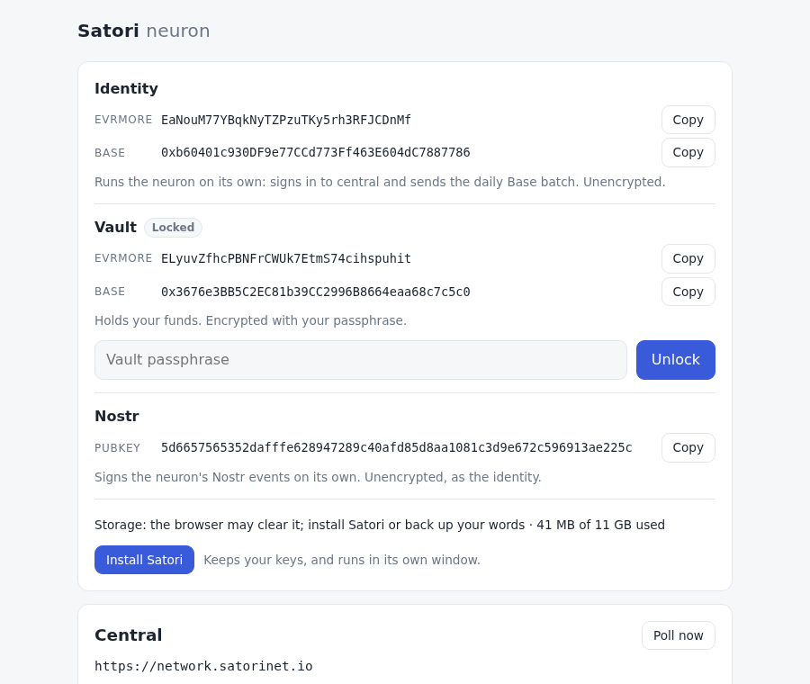

# The installed app (PWA)

[← OVERVIEW](OVERVIEW.md)

The neuron can be installed as an app: a web app manifest, a service worker
in a build, persistent storage, an Install button and an Update button. It is
the browser's own kind of app (a PWA); Satori Lite, a Docker process, has
nothing like it, so there is no Lite pattern to follow here.

## Why, in the owner's order

1. **Keep the keys.** The identity, the vault and the Nostr key live only in
   the OPFS DuckDB database, with the data. Safari deletes a site's
   script-writable storage (OPFS included) "after seven days of Safari use
   without user interaction on the site"; web apps added to the Home Screen
   (or the Dock) "are not part of Safari and thus have their own counter of
   days of use", and WebKit does "not expect" their data to be deleted
   (webkit.org/blog/10218). Chrome keeps
   storage through storage pressure only when it is **persistent**
   (`navigator.storage.persist()`), which it grants on its own to installed
   apps, among others. Before this step the app never asked.
2. **Stay open.** An installed app has its own window, which is less likely
   to be closed than one tab among many. The neuron runs only while it is open.
3. **A fast start that works offline.** The page, the app's code and DuckDB's
   worker and 34 MB wasm come from the cache, so the neuron opens with its
   stored data without the network; central, the relays and Base say they
   cannot be reached and retry as they always do.

## What it does not do

- **It does not run the neuron while closed.** The service worker caches
  files and nothing else: it holds no keys, opens no database and never
  polls. A browser kills an idle service worker, and one cannot start
  DuckDB's worker.
- **Periodic Background Sync** is not used: Chromium only, installed apps only,
  the browser picks the times, and the service worker could not run DuckDB
  anyway ([runtime plan](../plans/runtime.md#periodic-background-sync)).
- It caches no data from central, the relays or the chain, and never touches
  their requests.
- It does not move a neuron between Safari and a Safari web app: they have
  separate storage (below).

## Files

| File | What |
|---|---|
| `public/manifest.webmanifest` | `id` and `start_url` and `scope` `/`, name "Satori neuron", short name "Satori", `standalone`, theme and background `#f6f7f9` (the page's light background, `src/style.css`), icons 192, 512 and a maskable 512. |
| `public/icon-192.png`, `icon-512.png`, `icon-maskable-512.png`, `apple-touch-icon.png` | The Satori mark, copied unchanged from the dapp's own PWA icons (`../contract/satori-ui/public`: `logo192.png`, `logo512.png`, `logo-maskable-512.png`, `apple-touch-icon.png`); already the right sizes. |
| `index.html` | Links the manifest, the icon and the apple-touch-icon; `theme-color` `#f6f7f9` in light mode and `#12151b` in dark (the manifest takes one colour; Chrome uses the page's for the app window's title bar). |
| `src/pwa/sw.js` | The service worker: `route()` (tested, `sw.test.js`) and `start()`. |
| `vite.config.js` (`service-worker` plugin) | In a build only: writes `dist/sw.js` from `src/pwa/sw.js` (a classic script, `export` dropped) and the list of files to precache. |
| `src/pwa/index.js` | The page's side: registers the worker in a build, the Update button, Install, persistent storage. |

No dependency was added. Workbox was not needed: the worker is about 25
lines of code.

## Caching

`route(request, origin)` decides, and only for this origin's GETs:

| Request | Rule |
|---|---|
| `/assets/*`: the build's hashed files (the app's JS and CSS, DuckDB's wasm and worker) | **Cache first.** A hashed name never changes content, so a cached copy is always right. A miss goes to the network (not stored). |
| A navigation to `/` or `/index.html` | **Network first**, so a new version shows on the next load; offline, the cached page. |
| Everything else: other origins (central, the RPCs, the relays, Coinbase), `/rpc`, `/llms.txt`, the manifest, the icons, `/sw.js`, any POST | **Not touched**: the browser fetches it as if there were no worker. `/llms.txt` is always fresh, and offline a navigation to it fails rather than turning into the app. |

- **Precache.** The build's file list, put into `dist/sw.js` by the plugin:
  `/` and every file under `assets/` except DuckDB's mvp bundle (39 MB, only
  for browsers without wasm exceptions, which every browser with OPFS has;
  fetched from the network if ever picked). About 36 MB, almost
  all of it DuckDB's eh wasm. Every file is fetched with `cache: 'no-cache'`
  (revalidated, so a host's cached `index.html` is never precached stale).
- **One cache per version**, named `satori-` + a hash of the file list and
  the page. On install a hashed file that an older cache already holds is
  copied rather than downloaded again: a new version with the same DuckDB
  does not fetch its 34 MB wasm twice.
- **On activate** every other cache is deleted.
- Cached files are matched with `ignoreVary`: a module script is sent with an
  `Origin` header, so a host's `Vary: Origin` (`vite preview` sends one)
  would otherwise miss and fail offline.
- On a first visit the page and the worker's precache both fetch the wasm; a
  host that sends hashed files as cacheable lets the second come from the
  HTTP cache. The first visit is not controlled by the worker (no
  `clients.claim()`); the next load is.

## Updates

A new build changes `dist/sw.js` (its file list or its cache name), so the
browser installs the new worker next to the running one, where it **waits**.
The page then shows a quiet **Update ready, reload** in the header
(`status().app.update`). Clicking it (or `satori.update()`) tells the waiting
worker to take over and reloads the page once it has. Nothing reloads on its
own: a Base batch or a central submission may be in flight, and the old
version keeps its files until then. Without a click the new version takes
over when every Satori window and tab is closed. The page asks the browser to
look for a new version every hour, so a window left open for days still
finds one; the network-first page means a plain reload also loads the new
code.

## Persistent storage

`keepStorage()` runs when the neuron starts: right after setup, and on each
load. It asks `navigator.storage.persist()` unless `persisted()` already says
yes, then reads `estimate()`. Home shows it under the keys:

- **Storage: kept** (persistent), or
- **Storage: the browser may clear it; install Satori or back up your words**,

each with what is used of the quota (`41 MB of 11 GB used`; the precache
counts). `status().storage` is `{ persisted, usage, quota }` (bytes). After
`appinstalled` it asks again, since an installed app's request is granted.

## Install

- **Chromium** (Chrome, Edge, Android): the page keeps `beforeinstallprompt`
  and shows **Install Satori** with "Keeps your keys, and runs in its own
  window." on Setup and on Home (under the storage line). It calls the
  browser's prompt, which needs a user gesture (a click; Playwright's
  `page.evaluate` counts: the prompt opens).
  The browser's own install menu works as well.
- **Safari** has no prompt, so Setup and Home show how: File › Add to Dock
  (macOS) or Share › Add to Home Screen (iOS, iPadOS), and that the added app
  starts empty.
- **Firefox** offers neither, and nothing is shown; the storage line still
  says to back up the words.
- **Installed** is `display-mode: standalone` (or iOS's `navigator.standalone`),
  or the `appinstalled` event in this page; then the Install box is hidden.
  A tab of an installed app cannot tell, so it shows Install only if the
  browser offers it (Chromium does not once installed).
- `status().app` is `{ installed, canInstall, update }`; `satori.install()`
  → `'accepted' | 'dismissed' | 'unavailable'`.

## One neuron

The app window and a tab are one origin in one browser profile, so they share
the `satori-neuron` Web Lock: the second one to open says "Satori is open in
another tab". The e2e opens an app window (`chrome --app`, the kind of window
an installed app opens in: `display-mode: standalone`) and a tab: one runs the
neuron, the tab waits, and runs it once the window is closed and it is
reloaded. Safari's web apps cannot meet a Safari tab at all: their storage,
and so their database, is their own.

## The dev server

The dev server never registers the worker: it would serve old code to the
owner, who reviews on it. In dev the page unregisters any registration it
finds on its origin (one left by a build served on that port). Even such a
leftover cannot hold dev back: the page comes from the network first, and the
only paths it caches (`/assets/`) are not ones the dev server uses. The dev
e2e checks that no worker is registered and that a left one is removed.

## CSP and hosting

The CSP (`csp.js`) is a response header; the dev and preview servers send it
on every response, `/sw.js` and the manifest included (checked in the e2e).
`worker-src 'self'` allows the worker (and DuckDB's), and `default-src 'self'`
the manifest; the icons are `img-src 'self'`. A host must:

- serve over https (localhost is exempt);
- send the CSP header on every response, the worker script included;
- serve `.wasm` as `application/wasm` (DuckDB streams it) and the manifest as
  `application/manifest+json`;
- not cache `/sw.js` or `/index.html` for long; the hashed `/assets/` can be
  cached forever.

## Platforms (2026-10)

| Platform | Install | Storage |
|---|---|---|
| **Chrome** desktop (Windows, macOS, Linux, ChromeOS) | **Install Satori**, or the install icon in the address bar. The app shares the profile's storage with its tabs: a neuron set up in a tab is the same neuron in the app. | Best effort until persistent; Chrome grants `persist()` without asking to installed apps, bookmarked or much-used sites. Up to 60 % of the disk per origin. |
| **Edge** | As Chrome (Chromium); the address bar shows "App available". | As Chrome. |
| **Firefox** desktop | No prompt. On Windows, Firefox 143+ can pin a site to the taskbar as a web app ("taskbar tabs"); not on macOS or Linux. | `persist()` shows a permission prompt; until it is allowed the line says the browser may clear it. |
| **Safari** macOS 14+ | File › Add to Dock (the hint). The web app's storage is **separate**: only cookies are copied when it is made, so set the neuron up in the app, or move it there with Backup's files (Import Docker files). | In Safari, deleted after 7 days of use without a visit; a Dock app keeps its own count. `persist()` (Safari 17+) is granted by heuristics such as being opened as a web app. |
| **Safari** iOS and iPadOS | Share › Add to Home Screen (the hint; other iOS browsers' share menus offer it too). Separate storage, as on macOS. | As on macOS. iOS suspends a web app's JavaScript seconds after it leaves the screen: the neuron runs only while it is on screen. |
| **Android** | Chrome and other Chromium browsers: Install Satori where the browser offers the prompt, or the menu's install entry (an app in the launcher, with the maskable icon). Firefox: the menu's Add to Home screen, no prompt. | As the browser's; the app shares the browser's storage. Android may stop a backgrounded app at any time. |

The splash screen on Android uses the manifest's light background, in dark
mode too (one colour per manifest).

## Verify

- `npm test`: `route()` for each kind of request (`src/pwa/sw.test.js`), the
  storage line (`src/ui/format.test.js`), the CSP's `worker-src`.
- `npm run e2e` (the dev server): no worker; a worker left on the origin is
  removed; `status().storage` and `status().app`.
- `npm run e2e:pwa` (a build on `vite preview` :5181, `e2e/pwa.spec.js`; each
  test in its own Chrome profile, every host but localhost unresolvable, a
  build's central routed to the stub): the manifest valid and installable
  (Chrome's own checks over CDP); `/sw.js` served with the CSP; the page and
  DuckDB's eh files precached, the mvp not; Install on Setup and Home;
  `persist()` asked after setup and again on a reload while not kept; a
  reload served by the worker; **offline** (the worker's own network gone
  too) the page, DuckDB and the stored keys and streams load, while central
  says "unreachable", Base "did not answer" and `/llms.txt` fails; a new
  `sw.js` waits for **Update ready, reload** with no reload on its own, then
  takes over on the click; an app window and a tab run one neuron.
