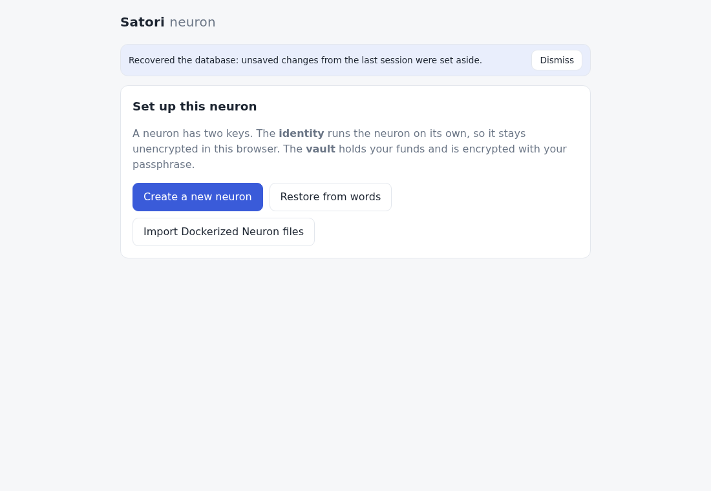

# Storage: DuckDB-WASM on OPFS

[← OVERVIEW](OVERVIEW.md)

One database per browser profile and origin: `opfs://satori-mvp.duckdb`
(`src/db/opfs.js`), DuckDB-WASM 1.32.0, which is DuckDB 1.4.3. Newer builds
are dev builds only (`1.33.1-devNN`; npm's `latest` is dev57, `next` dev65,
which is DuckDB 1.5.6). They create OPFS files but never write them, and the
WAL bug below is still in DuckDB 1.5.6. The name stays: renaming it would orphan stored keys and
data, and `satori.duckdb` on this origin holds an earlier draft's other schema.
Only the tab that holds the `satori-neuron` Web Lock opens it. The API is
`src/db/index.js`: every call runs one at a time, in call order (`serial()`,
`src/util.js`). No DuckDB extension is loaded (`autoload_known_extensions =
false`): JSON is kept as text and parsed in JS. Times are unix seconds.

## The checkpoint rule

OPFS keeps what DuckDB has **checkpointed** in the database file. A tab may
close at any moment, and nothing runs on close. DuckDB-WASM 1.32.0's WAL on
OPFS can't be relied on. Measured in Chrome (`e2e/wal.spec.js`, and probes
on raw connections):

- **After a checkpoint, nothing new reaches the WAL file.** Its old bytes stay
  (DuckDB's truncate never takes effect on OPFS). A later write that isn't
  checkpointed is gone after a reload: CREATE, CHECKPOINT, INSERT, reload
  gives 0 rows. That's why every write that must survive was followed by
  `CHECKPOINT`.
- **A WAL written before the first checkpoint replays, unless it holds
  migration 3.** That migration is an `ALTER TABLE … ADD COLUMN` on
  `predictions`, whose `id` defaults to `nextval(…)`. DuckDB 1.4.3 can't
  replay that, so the open fails: "Failure while replaying WAL file …
  Calling DatabaseManager::GetDefaultDatabase with no default database set"
  ([duckdb#18259](https://github.com/duckdb/duckdb/issues/18259); also
  [#19712](https://github.com/duckdb/duckdb/issues/19712) and
  [#20543](https://github.com/duckdb/duckdb/issues/20543)). This was the
  owner's "Satori could not start" on the live site. A first load runs all
  the migrations, and before setup nothing checkpointed, so a reload on
  Setup replayed them. The e2e only ever reloaded after setup, which
  checkpoints. Bisected on raw connections: the meta table plus migrations
  1–2 replay; adding migration 3 fails.
- **A WAL the database has moved past can be replayed again.** The stale
  bytes carry the checkpoint they belong to. Checkpoints that never touch
  the WAL file (DuckDB's own, below) move the database file on, so the next
  open may replay those bytes once more. In a profile set up with the
  version before this fix and never reloaded since, that WAL holds
  migration 3, so the open fails.

So **DuckDB checkpoints every commit itself**. `openDb` runs
`SET checkpoint_threshold = '0b'` (`wal_autocheckpoint` is the same setting)
before the migrations, then a `CHECKPOINT` after them. A commit's changes go
straight to the database file and the WAL stays at 0 bytes. The e2e checks
this after the first load, after setup, and after writes with no explicit
`CHECKPOINT`. No write path can forget, now or later, including the ones
that never checkpointed (central's relay list, a `_pred`'s relay count, a
failed poll's `central_last_poll`). The explicit `CHECKPOINT`s from before
stay where they are: setup (the keys), each central cycle (after its submission), each new poll time,
a Settings save, a new relay list from central, NIP-65's time, each outbox
edit, each history run from central, a relay observation and its `_pred`
(before the `_pred` is sent, as Lite commits first), a subscribe and an
unsubscribe, the Base batch's hash as soon as it is sent and the batch after
its receipt. Each one now finds nothing to do (about 2 ms).

**The keys** are one `meta` row, `keys` ([keys.md](keys.md#the-record)),
one commit, checkpointed before setup returns. The e2e copies the database
file alone, without any WAL, right after `satori.setup()` and finds it in
it. A reload right after setup keeps it, and so does Chrome killed
(`SIGKILL`, every process of the profile) right after setup.

**The cost**, measured in Chrome on OPFS on this shared 8-core box (load
about 3). The database held 83 streams × 1,001 rows (13 MB). Each figure is
two runs, under DuckDB's default and with every commit checkpointed:

| Write pattern | Before (16 MB, explicit CHECKPOINTs) | Every commit checkpointed |
|---|---|---|
| A poll: 83 new rows (one transaction), the specs, 83 predictions, the last poll, sent, the submission, a CHECKPOINT | 2.8–2.9 s (one commit per prediction) | 4.9–5.1 s with one commit per prediction; **2.4–2.5 s** with the poll's predictions in one transaction (`addPredictions`, now) |
| History: 83 streams × 1,000 rows, one commit each (as `history.js` did, once per stream) | 3.5–4.2 s | 8.1–8.7 s |
| One statement of 10,000 rows (an `INSERT … string_split`) | 79–87 ms | 153–160 ms |
| A `meta` write (a Setting) | 9–12 ms, plus its CHECKPOINT | 27–31 ms |
| A relay observation, its seq and its `_pred`, a CHECKPOINT | 117–121 ms | 152–170 ms |
| `CHECKPOINT` with nothing to do | 1–2 ms | 1–2 ms |
| The database file afterwards | 12.9 MB | 12.6 MB |

The history run is the only real cost, about +55 ms per stream, so about
+5 s for 83 streams. It runs once per stream, in the background, and its
fetches overlap the writes. One
statement of 83,000 rows (83 k comma-joined values) stops
the wasm with "memory access out of bounds" under either setting. The
history never sends one: it is at most 1,000 rows per stream, one stream per
statement.

**Fewer statements.** Each statement is a round trip to DuckDB's worker
(with parameters: prepare, run, close), about 4–12 ms in Chrome on this box.
So a poll's writes are a few set statements, not one per row: a column of
many rows goes as one parameter, comma-joined (numbers as their exact text,
text as base64 so any character survives; `decode(from_base64(…))` in SQL)
and `unnest(string_split(…))` splits it back. Measured on central2's 82
streams (2026-10-17, a fresh profile on OPFS):

| Write | One statement per row | Set statements |
|---|---|---|
| The poll's batch (`addObservations`: 82 streams upserted, 82 rows) | 1.9–2.1 s | 0.11 s |
| The specs and the predictions (`saveSpecs`, `addPredictions`: 82 each, the streams' `predicted_ts`) | 1.8–2.3 s | 0.11 s |

## Recovery

A WAL that isn't empty comes from an older version, because every commit is
checkpointed now. Before the database opens, `src/db/recover.js` moves it
out of DuckDB's way. It is renamed in OPFS, never deleted
(`FileSystemFileHandle.move`: Chrome 102, Firefox 111, Safari 15.2, the same
releases that have the sync access handles DuckDB needs):

1. DuckDB opens the database once on that WAL and runs `CHECKPOINT`. It
   either replays the WAL or skips it as already checkpointed, so whatever
   the WAL held is now in the database file. Then the worker is ended, which
   lets go of the files. The move is retried every 100 ms for up to 5 s
   while the ended worker still holds them. The WAL is renamed
   `satori-mvp.duckdb.wal.checkpointed-<time>` with no notice. This happens
   once to every profile set up before this version.
2. If DuckDB fails to replay it ("Failure while replaying WAL"), it is
   renamed `satori-mvp.duckdb.wal.unreplayed-<time>`. That is the owner's
   profile, and any profile reloaded before its first checkpoint under an
   older version.

Then the database opens on no WAL, as of its last checkpoint, and the app
goes on as usual. In case 2 a small notice shows above the screen: "Recovered
the database: unsaved changes from the last session were set aside."
Dismiss hides it. For agents, `satori.status().recovered` holds the file's
new name for that page load (null otherwise). `<time>` is the ISO time with
`:` and `.` as `-`.

**What can be lost** is only what the set-aside WAL held: writes that were
never checkpointed. Under older versions those were the first load's
migrations, which run again at once. On a set-up neuron, they could only be
writes the old version already lost on a reload (the first point above).
**Never the keys**: setup checkpointed them in every version, and now each
row is checkpointed as it is written. The set-aside files stay in this
site's storage (a few kB each).

Any other failure to open, the database file itself included, is not
touched. The WAL stays where it is, and the "Satori could not start" screen
shows the error with a way forward. It says nothing was deleted, offers
Reload, links to the issue tracker, and points to the backup (the 24 words,
or the Dockerized Neuron files) for another browser. Nothing is ever deleted
on its own.

## Migrations

`src/db/schema.js` holds an ordered list; `meta.schema_version` says how many
have run, each in its own transaction. An entry is SQL, or a function given
the `meta` rows (`get`, `set`, `remove`) for what SQL can't do. A shipped
entry is never edited: a change is a new entry. A database from a newer app
(a higher version) is refused, not migrated.

1. **Step 1**: URL-fetched streams, their observations and signed predictions
   (times in ms). Replaced by 2.
2. **Step 3**: central's data, as Lite's StreamStore. `streams (uuid, name,
   meta)`; `observations (stream_uuid, ts, value)`, one row per (stream, whole
   second), insert or ignore; `predictions (id, stream_uuid, made_at, model,
   t1, t2, observed_at, hash, status 'pending' | 'sent', sent_at)`. Step 1's
   tables are dropped; `meta` (the keys) stays.
3. **Step 4**: `predictions.phi` and `weight`, the engine's AR coefficient and
   fade weight (null for `naive` and for older rows).
4. **Step 5**: relay (Nostr) streams, apart from central's, as Lite's
   `network.db`: `relay_streams` (a subscription and its `_pred` publication:
   `uuid` = Lite's relay model uuid, `stream_name`, `provider_pubkey`, `name`,
   `cadence_seconds`, `active`, `subscribed_at`, `pred_created_at`,
   `pred_seq`), `relay_observations (stream_uuid, seq, ts, value, raw,
   event_id, received_at)` deduped on the event id and on (stream, seq), and
   `relay_predictions (stream_uuid, seq, value, model, obs_seq, made_at,
   event_id, relays)`.
5. **Step 5 review**: each relay stream keeps its latest observation
   (`obs_*`), its latest `_pred` (`p_*`) and its observation count on its own
   row, set at insert time, so the status (read on every change) reads one
   row per stream. Filled from the existing rows when it runs.
6. **bvar** ([engine.md](engine.md#bvar-a-model-per-central-stream-unique-to-each-neuron)):
   `model_specs (target_uuid, spec, score, generation, accepted,
   updated_at)`, each central target's champion spec as JSON
   (`{companions: [uuid, …], lambda1, lambda2}`), its backtest score (null
   below 5 origins), the mutations proposed and the ones kept; and
   `streams.history_at`, when central's history was fetched for the stream
   (null: not yet, so every stream is fetched once after the update;
   [central.md](central.md#history-an-addition-beyond-lite)).
7. **Own key format** (2026-10-16, a function): `meta.wallet_yaml`,
   `vault_yaml` and `nostr_yaml` (Docker's texts) become one record,
   `meta.keys`. The identity and the Nostr key are translated at once (a new
   Nostr key if there was none); the vault keeps its yaml in the record until
   its next Unlock re-encrypts it; the three rows go in the same commit.
   Without both `wallet_yaml` and `vault_yaml` (never set up, or a setup cut
   off) nothing is written, and the rows are left; the step-1 prototype's
   `meta.vault` is never touched. Rows it cannot read stop the open, with
   nothing changed. Every earlier profile shape is tested
   ([keys.md](keys.md#migration)).
8. **The activity log** (2026-10-16, [health.md](health.md#the-activity-log)):
   `activity (id, ts, last_ts, kind, level, data, count, mkey)`: what the
   neuron did (sessions, central cycles, Base checks, Nostr publishes,
   history runs, wallet actions, errors), for Home's health. `ts` and
   `last_ts` are the API's `at` and `until` (both are DuckDB keywords).
   Kept 90 days: pruned at start and once a day. Another central keeps it.
9. **Predicted through** (2026-10-17): `streams.predicted_ts`, the
   observation (its `ts`) the stream's latest prediction was made from, set
   in the same transaction as the prediction. A poll forecasts each stream
   whose latest observation is newer (or that has none), so a poll cut off
   between storing and forecasting is made up by the next one
   ([central.md](central.md#deviations-from-satori-lite-and-why)). Which
   observation an earlier prediction came from is not recorded: a stream
   predicted before counts as predicted through its latest observation (an
   observation is never predicted twice), one never predicted is due.

Columns kept but no longer written: `relay_streams.meta` (the announcement
at subscribe time) and `unsubscribed_at`; nothing read them. Kept and written,
though only the latest is read (from `obs_*`): `relay_observations.raw` and
`received_at`, the only record of what each provider sent and when.

## meta keys

Each value is JSON text.

| Key | Holds | Written by |
|---|---|---|
| `schema_version` | how many migrations have run | the migrations |
| `keys` | the keys record, local format our own ([keys.md](keys.md#the-record)): `{ v: 1, identity, nostr, vault: { pubkey, kdf, cipher, data } }`; an earlier version's vault keeps `{ pubkey, yaml }` until its next Unlock | setup; migration 7; an Unlock that re-encrypts an earlier version's vault |
| `wallet_yaml`, `vault_yaml`, `nostr_yaml` | gone: earlier versions' Docker texts, moved into `keys` by migration 7 (left only where a setup was cut off) | earlier versions |
| `vault` | the step-1 prototype's sealed key; never read, never deleted | the step-1 prototype |
| `central_url` | the Settings URL; `''` = the default | Settings, `setCentral` |
| `next_poll_at` | when the next poll is due, so a reload keeps the 11 h cadence ([central.md](central.md)) | each poll's schedule |
| `central_last_poll` | the last poll: `{ at, streams, new, predicted }` or `{ at, error }` (`local: true`: the database or the engine failed, not central) | each cycle; dropped with another central |
| `central_last_submit` | the last predictions batch: `{ at, total_submitted, successful, failed, errors }` or `{ at, error, total_submitted }` (`login: true`: central refused the login) | each cycle with something pending; dropped with another central |
| `backup_at` | when the vault's backup was confirmed (its words confirmed at Create, given at Restore, or shown under Backup; a Dockerized Neuron's files): Home stops asking for a backup while storage is not kept ([health.md](health.md)) | setup; Backup |
| `central_history` | the last history run: `{ at, url, streams, rows, left, error, retryAt }`; `retryAt` (a 404: no history route) holds off this central for a day | each history run; dropped with another central |
| `nostr_relays` | the user's relays (Settings) | `setRelays` |
| `nostr_central_write` | whether central's relays are written to | `setRelays` |
| `nostr_central_relays` | central's last relay list, used while central is down | the hourly reconcile |
| `nostr_relay_list_at` | when the NIP-65 relay list (10002) was last published (daily) | the relay-list publish |
| `nostr_outbox` | unsubscribes and tombstones waiting for a relay that was not open: `[{ url, event }]`, at most 100 | unsubscribe; each flush |
| `base_rpc_url` | the Base RPC setting; `''` = the default ([base.md](base.md)) | Settings, `setBaseRpc` |
| `base_max_fee_gwei` | the batch's max-fee ceiling; null = 2 gwei | Settings, `setBaseMaxFee` |
| `base_pending_batch` | a batch sent and not yet mined: `{ round, hash, games, dropped }`, so a check never sends twice | the batch, at send; cleared after |
| `base_last_batch` | the last mined batch: `{ round, at, hash, games, dropped }` | the batch, after its receipt |

Another central (Settings) has other stream uuids, so changing it deletes the
pending predictions, the `streams` rows, the `model_specs` and
`central_last_poll` / `central_last_submit` / `central_history`;
observations and sent predictions stay.

## Doubles

DuckDB-WASM sends a prepared statement's parameters as JSON, and its parser
read about 1 number in 12 one ulp off (measured: 158 of 2,000 observations,
34 of 300 predictions). A stored t2 could then print other digits than the
ones hashed when the prediction was made. Every DOUBLE is therefore bound as
text, `CAST(? AS DOUBLE)` with the number's shortest JS text, which DuckDB
parses back exactly (tested bit for bit). A stream's history (up to 1,000
rows) goes in one statement: its times and values as two comma-joined text
parameters, split and cast in SQL (~20 ms a stream; 200 ms as one row per
parameter triple).
