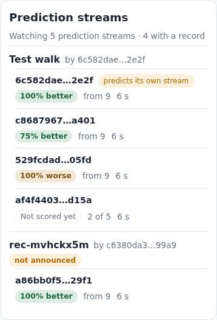
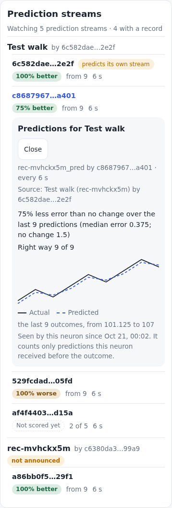

# Track record: how a buyer knows who's good

[← OVERVIEW](OVERVIEW.md) · the plan: [../plans/market.md](../plans/market.md)
(step 1, and "Track record: how a buyer knows who's good") · intent:
[../intent/network.md](../intent/network.md)

A market only works if a buyer can tell good sellers from bad (owner,
2026-10-20). So every prediction stream on the Satori relays gets a
**verified track record**: how its predictions did against no change,
worked out by this neuron from what it saw arrive, live. It runs on its own,
set and forget, the way the neuron predicts everything it sees. There are no
controls. Watching only reads: it publishes nothing, not even a 34602.

```
relays open ─▶ scan the catalog (as discover(): pages, signatures in slices)   again hourly, at most every 6 h
            ─▶ every `<name>_pred` that names its source (≤ 200) + each source ─▶ watch_streams
follow REQ = the subscriptions' #d filters ∪ the watched streams' (one filter per author)
34601 in ─▶ verify ─▶ subscribed? the existing path (store, forecast, publish `_pred`)
                    └▶ watched?    watch_observations (value, its timestamp, when it arrived)      (both: both)
records() ─▶ each outcome (the source's next observation) scored once: the earliest prediction that arrived here
             before it did, within half an interval of its baseline's arrival
          ─▶ the last 28: median error vs no change's ─▶ "12% better" (the Models tab's words)
```

The code: the selection, the follow list, the scoring and the records in
`src/neuron/records.js` (pure, plus `createWatch`, the stateful part);
the relays, the scan and the intake routing in `src/neuron/nostr.js`; the
tables in `src/db/` (migration 14); the mark's rule, shared with the Models
tab, in `src/neuron/quality.js`; the card's views in `src/ui/record.js`,
placed by `src/ui/streams.js`.

## What is watched

- **Every prediction stream in the relays' catalog**: the same verified
  catalog `discover()` builds (each relay's 34600s paged back, every
  signature checked in slices of 20 with a yield between them, newest per
  (author, `d`), tombstones dropped), taking each entry whose `d` ends in
  `_pred` and that names its source. The source is the `source_stream` and
  `source_pubkey` tags, as Lite writes them, else the announcement's
  `metadata.source_stream_name` and `source_provider_pubkey`; the pubkey
  must be 64 hex characters.
- **Each one's source stream**, followed with it, announced or not (54 of
  satorian's 112 sources have no announcement there, but their 34601s are
  on the relay). A source is **named by its own announcement**, else by its
  stream id as it is, never by the prediction stream's words: a predictor
  could call a stream it controls under another key "BTC". Each record says
  the source's author (`source.pubkey`), whether the source is announced
  (`source.announced`), and whether the predictor's key is the source's
  author (`sameAuthor`: "predicts its own stream").

**Inherent: a source the predictor controls.** A predictor can "predict" a
second stream it publishes itself under another key, and score perfectly:
it knows what it will publish next. Nothing in the data can tell that key
apart from an honest provider's. So a record against a source the predictor
controls means little, and the card shows each source's author and whether
it is announced, grouped by source, so a buyer picks the source first (the
real BTC, by its known provider) and judges a record against an unknown,
unannounced one for what it is.
- **Our own `_pred` streams** are among them, marked `mine`: our own events
  come back to us through the follow REQ like anyone's.
- **The cap: 200 prediction streams.** Past it, ours first, then the most
  recently announced (a live Lite neuron announces again on every
  connection, so recent means active). Satorian has 112 today
  (2026-10-20), from 24 authors; `nostr().watching.left` says how many a
  bigger catalog left out.
- **When.** The scan runs once relays are open: the first relay to open
  after the page loads starts it, and it waits up to 10 s for the others
  still connecting, as `discover()` does. Then again in the hourly pass,
  at most every 6 h after the last one that worked. A scan that fails (no
  relay open) is tried again at the next relay open or hourly pass. The
  person's Discover and this scan share one run when they overlap, and a
  Discover also refreshes the watched set from its catalog.
- **Dropped after 7 days.** A watched stream that no scan has selected for
  7 days (its announcement gone, tombstoned, or pushed past the cap) is
  dropped with its observations; a source goes when no selected prediction
  names it. Only a scan that worked drops anything: relays that are down
  say nothing about the catalog.
- **Never silent.** The scan is the `watch` task in the work list:
  "Finding prediction streams · asking the relays 1 of 2", then
  "Finding prediction streams · checking signatures 400 of 1,061". The
  Streams tab's card shows it, and the Relays chip on Home is green
  working while it runs ([health.md](health.md)).
- The cadence: the prediction stream's announced one, else its source's,
  else a day (`DEFAULT_CADENCE_S`, the owner's default). A source not
  announced takes its prediction stream's.

## Following

The follow REQ (`filters()` in `src/neuron/nostr.js`) was one `#d` filter
per subscribed provider. It is now one filter per author over the union of
the subscriptions and the watched streams, each `#d` list sorted, chunked at
most 200 filters per REQ as before (`followFilters` in
`src/neuron/records.js`). It is sent again only when the set changes, so a
scan that finds the same streams costs no re-REQ.

The intake verifies each 34601 once, then routes it by (author, stream):

| The event's stream is | Then |
|---|---|
| a subscription | the existing path: stored once, forecast, our `_pred` published |
| watched (a prediction stream or a source) | stored in `watch_observations`, nothing else: never a forecast, never a publish |
| both (a source we also subscribe to) | both |
| neither | dropped, as before |

## Storage (migration 14, additive)

Two new tables, nothing else touched (in `ADDITIVE`: an older build can
open the database and never reads them). Every commit is checkpointed
already ([storage.md](storage.md#the-checkpoint-rule)); the watched set and
the prune also call `db.checkpoint()` after their writes, as the other
writers do.

- `watch_streams`: `uuid` (the primary key, `relayUuid(pubkey,
  stream_name)`, as relay streams), `pubkey`, `stream_name`, `kind`
  (`pred` or `source`; a stream that is both is a `pred`), `source_uuid`
  (a `pred`'s source), `name` (a `pred`'s announced name; a source's own
  announced name, else its stream name), `cadence_seconds`, `meta` (JSON: a
  `pred`'s `announced_at`; a source's `announced`), `seen_at` (the last scan
  that selected it, or a prediction stream naming it), `added_at`.
- `watch_observations`: `stream_uuid`, `seq`, `ts` (the content's
  timestamp, null outside 2000–2100), `value` (`numericValue`, null when
  there is no number), `received_at` (this device's clock, whole seconds,
  rounded **up**, so a row never claims to have arrived earlier than it
  did), `event_id` (unique). `received_at` is taken when the relay
  delivered the event, before the intake's queue: a queue held up by a
  poll's writes is this neuron's own delay, not the event's. Primary key
  (`stream_uuid`, `seq`), insert or ignore: the first copy wins, from
  whichever relay sent it first, and so does its `received_at`.
- **The prune**: with the relay streams' (in the hourly pass, at most
  daily), each watched stream's observations older than `RELAY_WINDOW` (400)
  of its cadences back from its newest go (`db.pruneWatch`, in batches).

## Scoring: the verified-order rule

A relay keeps only the latest 34601 of each stream, and an author can set
any `created_at` and any timestamp in the content. So the only predictions
that count are the ones this neuron itself held before the outcome.

For a prediction p (its value v, its content timestamp t_p, when it arrived
r_p), over the source's observations this neuron stored:

1. **Its baseline** b (no change) is the latest source observation with
   ts ≤ t_p. None: p is not scored.
2. **Its outcome** o is the first source observation with ts > t_p, and it
   must be the source's **next** observation after b (seq = b's seq + 1).
   That is one cadence ahead, the owner's rule
   ([../intent/engine.md](../intent/engine.md)), and the next observation
   is what Lite's bounty scorer takes (`neuron-lite/scoring/mae.py`,
   seq + 1). Without the seq check, a pair with observations missed in
   between (the tab was closed overnight) would be judged hours ahead: one
   such pair per stream per visit, a third of an hourly stream's record.
3. **It counts only if it arrived here first**, by when each arrived here
   (`received_at`, this device's clock): r_p < o.ts (this neuron held p
   before the outcome happened) **and** r_p < r_o (before the outcome
   itself arrived here). The second compares two arrivals on one clock, so a
   source that stamps its outcomes ahead of our clock (or our clock behind)
   credits no copy of an outcome. A backdated prediction received after its
   outcome is not scored.
4. **It must lead**: it arrived within the first half of the interval after
   its baseline arrived here, r_p − r_b ≤ (o.ts − b.ts) / 2. A "prediction"
   made seconds before the outcome, from the source's own upstream (a
   nowcast), is not a forecast and is not scored. A Lite neuron forecasts
   seconds after the observation it follows, well inside the half (the
   e2e's predictors publish 0.3 s after it at a 4 s cadence). A stored
   prediction the relay hands over late (a page opened mid-interval) arrives
   with its stored baseline, so it leads and is scored against the outcome
   still to come.
5. v, b and o must be numbers, and |v − o| and |b − o| finite numbers (a
   value near the largest double would make Infinity or NaN): a prediction
   without a number (an echo) is skipped.
6. **One prediction per outcome**: the earliest received that qualifies. A
   predictor that publishes five times before one outcome has one scored,
   so "from N" counts outcomes.

Then, over the **last 28** scored outcomes (the Models tab's backtest
uses 28 origins):

- `error` = median |v − o|; `noChange` = median |b − o| (the two middles
  halved before adding, so they never overflow); `ratio` = error /
  noChange.
- **The mark** by the Models tab's rule and words:
  `qualityOf({ kind: 'record', score: error, persist: noChange })`
  (`src/neuron/models.js`): better below 0.95, worse above 1.05, else a
  tie; "12% better", "Same as no change", "8% worse"; no change perfect
  (0) and any error: "Worse"; both 0: the same. Fewer than 5 scored: "Not
  scored yet", and no numbers.
- `direction`: `{ right, total }` over the same set: right when v and o
  are on the same side of b; a tie (either equal to b) is left out of
  `total`.
- `since`: the first scored outcome's time still in the window.

It is the Models tab's comparison made live: the backtest asks how a model
would have done on past data; this asks how the stream's predictions did on
data that came after this neuron received them.

**A known deviation, not special-cased.** Lite publishes its `_pred` two
cadences ahead (t2, `engine-lite/engine.py:733-735, 1176-1186`); this
scores every prediction one cadence ahead, so Lite's streams are judged on
the next observation while aiming at the one after. The browser neuron
publishes one cadence ahead ([nostr.md](nostr.md#the-engines-step)).

**Inherent, as designed:**
- It counts only what this neuron saw while its tab was open. Two neurons
  can show different records for the same stream; each is honest about
  what it saw.
- The source is the ground truth: if its author backdates, every prediction
  of it is judged on that.

**No longer inherent: a clock behind the source's.** The first build
compared only `received_at` (this clock) with the outcome's timestamp (the
source's clock), so a source stamping ahead of us credited a copy of the
outcome that arrived just after it. Now a prediction must also arrive before
the outcome **arrived here**, two times on one clock, and lead by half an
interval after its baseline arrived; a clock behind can only leave out a
prediction that arrived just before an outcome, never credit one after it.

## API (window.satori, [/llms.txt](../../public/llms.txt))

- `await satori.records()` → the watched prediction streams, best first (a
  record before "not scored yet", by ratio; then by how many are scored),
  each `{ pubkey, stream, name, mine, sameAuthor, source: { pubkey, stream,
  name, announced }, cadence_seconds, received, scored, error, noChange,
  ratio, mark ('better' | 'tie' | 'worse' | null), markText, direction: {
  right, total }, since, last: { value, received_at } | null }`.
  `source.pubkey`: the source's author; `source.name`: its own
  announcement's name, else its stream id; `source.announced`: whether it
  has an announcement of its own; `sameAuthor`: the predictor's key is the
  source's author. `received`: the predictions held (in the window);
  `scored`: how many outcomes the record is from (at most 28).
- `await satori.record(pubkey, stream)` → the same, plus `pairs`: the last
  28 scored `{ ts, predicted, actual, baseline }` (ts: the outcome's), or
  null when that stream is not watched.
- `nostr().watching`: `{ streams, sources, found, left, at, error }` (the
  watched prediction streams and sources, how many the last scan found and
  left out past the cap, when it worked, its last failure).
- `health().work` may be `{ task: 'watch', step: 'ask' | 'verify' }`.

Records are computed when asked and kept until a new observation of the
stream or its source arrives (one read for every stream that changed).

## UI (Streams)

A **Prediction streams** card, after the Satori relays card:

- the status line: "Watching 112 prediction streams · 23 with a record"
  ("· none with a record yet"; past the cap, "(14 more on the relays not
  watched)"); the count is the records list's once it is read, so the
  status, the rows and "Show all N" say the same; while a scan runs, its
  step instead, beside the small turning ring Settings uses ("Finding
  prediction streams · checking signatures 400 of 1,061", at Home's reading
  pace: `src/ui/hold.js`); before the first scan, "Finding prediction
  streams…", or "Not watching yet: No relay is connected…" when it could
  not run; none found, "No prediction streams on the relays yet."
- **grouped by source** (`recordGroups` in `src/ui/record.js`): a buyer
  picks the source first. Each group's header is the source's name (its own
  announcement's, else its stream id), "by" its author's short key, and a
  "not announced" pill (amber) when it has no announcement of its own.
  Announced sources first, then by each one's best record, then by name: a
  perfect record against a source nobody announced comes after the
  announced ones, its author in view.
- under it, a row per prediction stream, best first: the predictor as a
  short key or "you" (with a "predicts its own stream" pill when its key is
  the source's author), the record pill (the Models tab's `q` pill: its
  colours and words; "Same" on a phone), "from 21" outcomes scored (not
  scored yet: "3 of 5", or nothing), the cadence; its tooltip in words
  ("12% less error than no change, over the last 21 predictions this
  neuron received before the outcome"), the row's "Predictions for Bitcoin
  by e5e6ce94…503d". A phone: the predictor, then the pill, from N and the
  cadence on one line; a computer: columns under a header. The first 25
  rows across the groups (a group cut where the limit falls), then "Show
  all 112".
- a tap opens the stream's detail in place, under its row: who and how
  often ("btc_pred by 1fc7ebf5…bfdd · every 15 min"), its source ("Source:
  Bitcoin (btc) by e5e6ce94…503d", ", not announced", or ": it predicts its
  own stream"), the record in words ("12% less error than no change over
  the last 21 predictions (median error 0.88; no change 1)"), the direction
  ("Right way 15 of 20"), the pairs as a chart (the outcomes as a line, the
  predictions dashed, on one scale, `sparkPath` with a shared range;
  "Actual" and "Predicted" beside their lines; "the last 21 outcomes, from
  98.2 to 104"), and in plain words: "Seen by this neuron since Oct 20,
  14:05. It counts only predictions this neuron received before the
  outcome."
- records are read again while Streams shows, when a watched stream gets
  an observation or the watched set changes, at most about once a second.

The words people see: the Satori relays, never central or server.

 

**Measured live** (2026-10-20, the dev server: satorian read only and the
dev relay): 120 prediction streams and 77 sources watched 2 s after a
reload; each holds the relays' stored latest at first, and a 60 s demo
stream on the dev relay had 8 scored within 9 minutes.

## Home

Watching is use of the relays. The Relays chip
([health.md](health.md#the-channels-chips)), which said "No streams" (grey,
off) without subscriptions, now says **"Watching 112"** (sky green) when
nothing is subscribed but prediction streams are watched; with
subscriptions it says what it said. Watching alone never colours the hero:
with every relay down for 10 min the chip says "Relays down" in amber, and
Home's answer (is it predicting?) is unchanged. The scan is relay work: the
chip is green working while it runs.

## Step 3 (paid streams), later

A seller will publish, with each paid (encrypted) prediction, a public
commitment hash(stream, seq, value, salt), and reveal value and salt after
the outcome. The scoring already takes plain `{ value, ts, received_at }`
predictions, so a revealed value scored with its **commitment's** arrival
time fits as it is; the watch tables keep each stream's observations
whatever their kind. Nothing of it is built now.

## Cost

- The scan is `discover()`'s: about 1,060 announcements paged and their
  signatures checked once per page load (~5 s of slices, the page
  responsive), at start and at most every 6 h.
- Following ~200 more streams: the REQ's catch-up is one stored event per
  stream (a few seconds of intake at start, in the intake's queue); then a
  few events a minute at satorian's cadences (15 min to a day).
- Storage: 400 cadences per stream, so ~160,000 small rows at 200
  prediction streams and their sources of 15 min.

## Verify

`npm test`: `src/neuron/records.test.js` (the selection: the cap, ours
first, tombstones, a source needed, tags or metadata; the follow filters
merged and chunked; the rule: a backdated prediction received after the
outcome not scored, one received before scored, the baseline, a missed
observation, the window of 28, medians, the ratio and marks with no change
0, fewer than 5, direction, non-numeric skipped; the records' order),
`src/neuron/nostr.test.js` (the scan at the first open and its 6 h, the
follow REQ with watched streams, intake routing: watched, subscribed, both,
never a forecast or a publish for a watched one; drop after 7 days; the
prune), `src/db/db.test.js` (migration 14, additive; the tables' insert or
ignore, the prune, the drop), `src/neuron/health.test.js` (the chip),
`src/neuron/work.test.js` (the words), `src/ui/record.test.js` (the status
line, the rows, the detail and its chart). `e2e/records.spec.js`: a
provider's stream on a test relay at a 4 s cadence and three predictors'
`_pred` streams (one most of the way to the next value, one the wrong way,
one only twice); a fresh neuron finds them on its own, follows them,
scores them ("75% better", "100% worse", "Not scored yet" 2 of 5), leaves
out a backdated prediction received after its outcome, publishes nothing
for watching, and shows them on Streams (`SHOTS=1` writes
`docs/screenshots/streams-records-phone-light.png` and
`streams-record-detail-phone-light.png`). `node scripts/provider.mjs
ws://localhost:7778 demo-walk 60 --pred` gives the dev app a predictor to
watch.
